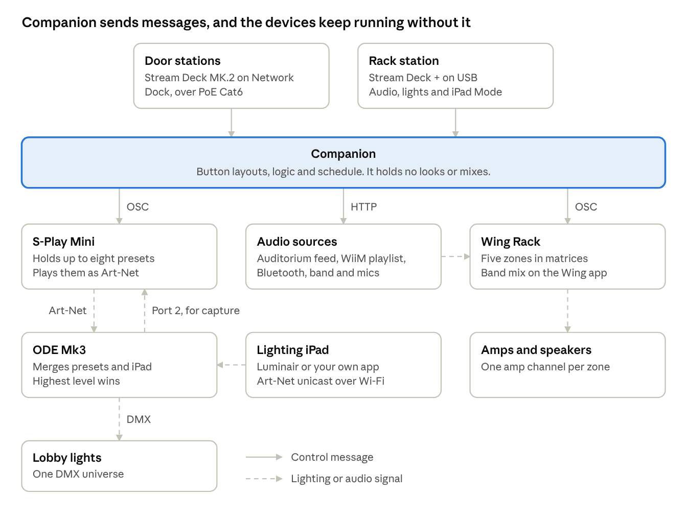

# System design

Every button talks to Companion, and Companion sends simple messages to devices that run on their own. If Companion stops, the door buttons stop working, but the lights and audio stay as they are.

The S-Play Mini holds the looks, the Wing Rack holds the zones, and the iPad takes over lighting through the ODE Mk3.

## Design rules

- **Buttons set a fixed state.** Whole-room buttons set every zone, and never toggle. That makes reset reliable after someone uses the Wing app.
- **Content stays out of the core.** Looks live in the S-Play and playlists live in Spotify, so lay people never open Companion.
- **Each job has one home.** Companion never stores a look, and the S-Play never decides what a button means.

## What happens when a part fails

| Part that fails | What people notice | How to carry on |
| --- | --- | --- |
| Companion host | Buttons stop responding | S-Play web page for lights, Wing app for audio |
| One door station | That door stops responding | Use another door |
| S-Play Mini | Presets can't change | iPad through the ODE, after setting iPad Mode |
| ODE Mk3 | Lighting control is lost | Spare node, or move the DMX line to the S-Play's DMX port |
| Wing Rack | All lobby audio stops | No fallback, so it must stay powered |
| WiiM | Playlist stops | Use Bluetooth or the auditorium feed |
| Network switch | All stations stop responding | Replace it, and keep it on the UPS |

## Why not Springtree

A [Springtree SMD-8](https://www.springtree.net/?p=21197) master with two satellites costs about $760 and needs no network. Its master even has a [built-in console switch](https://www.springtree.net/?p=21197). It remains the fallback if the bench tests fail.

The matching parts here cost about $1,080, including the S-Play Mini. That extra $320 or so buys changeable labels, live status at every door, a schedule, and active looks. It also keeps a single system when the audio already needs Stream Decks.
