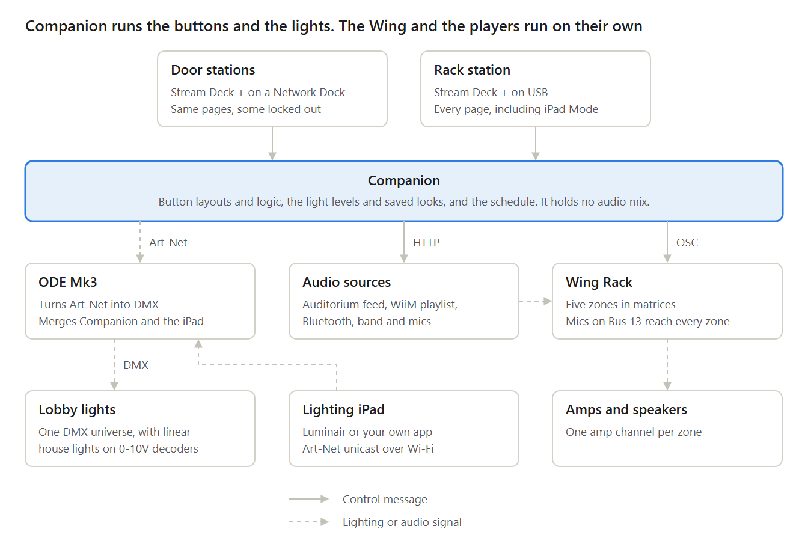

# System design

Every button talks to Companion. Companion sends the lights itself as Art-Net, and sends simple messages to the audio devices, which run on their own. If Companion stops, the buttons stop and the audio stays as it is. The lights depend on how the ODE handles a lost source, which bench test 4 settles.

Companion holds the looks, the Wing Rack holds the zones, and the iPad takes over lighting through the ODE Mk3. The diagram's source is [system-design.svg](images/system-design.svg).

## Design rules

- **Buttons set a known state.** Whole-room buttons set every zone, which makes reset reliable after someone uses the Wing app. Auditorium, Music, Bluetooth and Lobby Stage also toggle, so pressing a lit one turns its source off. The audio power key turns the whole system off and back on, and is green while it's on and red while it's off.
- **Lay people never open Companion.** They save a light look by holding its key, and change playlists outside Companion.
- **Each job has one home.** A look lives in two Companion variables, the patch lives in one block, and each room scene lives in one block. Every key points at those blocks.

## What happens when a part fails

| Part that fails | What people notice | How to carry on |
| --- | --- | --- |
| Companion host | Buttons stop responding. Lights hold or go dark, depending on bench test 4 | Lighting iPad straight to the ODE, Wing app for audio |
| One door station | That door stops responding | Use another door |
| ODE Mk3 | Lighting control is lost | Spare node |
| Wing Rack | All lobby audio stops | No fallback, so it must stay powered |
| WiiM | Playlist stops | Use Bluetooth or the auditorium feed |
| Network switch | All stations stop responding, and the lights follow the ODE's lost-source behavior | Replace it, and keep it on the UPS |
| Power relay | The audio power key and the source keys can't turn the amplifiers on or off | Turn the Furman's key to ON, or to OFF at night |

The Companion host and the switch now carry the lights, so both stay on the UPS. The startup trigger brings the last look back 5 seconds after Companion starts.

Only the amplifiers are ever switched off. A Furman sequencer powers them, and Companion switches it through a network relay on its remote terminals. The Wing Rack, the WiiM and the Bluetooth receiver stay on, so the controls never lose them and a source plays as soon as the amplifiers are up.

## Why not Springtree

A [Springtree SMD-8](https://www.springtree.net/?p=21197) master with two satellites costs about $760 and needs no network. Its master even has a [built-in console switch](https://www.springtree.net/?p=21197). It remains the fallback if the bench tests fail.

The matching parts here cost about $1,110 for three doors: the Stream Deck + decks, the docks, and the ODE that turns Companion's Art-Net into DMX. That extra $350 or so buys changeable labels, live levels and dials at every door, audio at the doors, saved looks, and a schedule. It also keeps a single system when the audio already needs Stream Decks.

## Why Companion runs the lights

The rack's light dials need live dimming. The S-Play Mini, the first plan, can only start and stop stored looks, so it couldn't drive them. Three other routes were considered on 2026-11-15:

| Option | Why not, for now |
| --- | --- |
| [DMX Core 100](https://dmxcore.com/dmx-core-100) | A good fit with its own Companion module, at $599 or more. Companion alone does the job for less |
| Lumen, your own app | Its head is close, but it doesn't take commands from Companion yet, and it would put code you maintain in the daily lights |
| Pharos or QLC+ | Pharos is integrator-level and quote-only. QLC+ is free but technical to edit |

Any of these can replace Companion's lighting later by changing only the lighting blocks on page 22.
