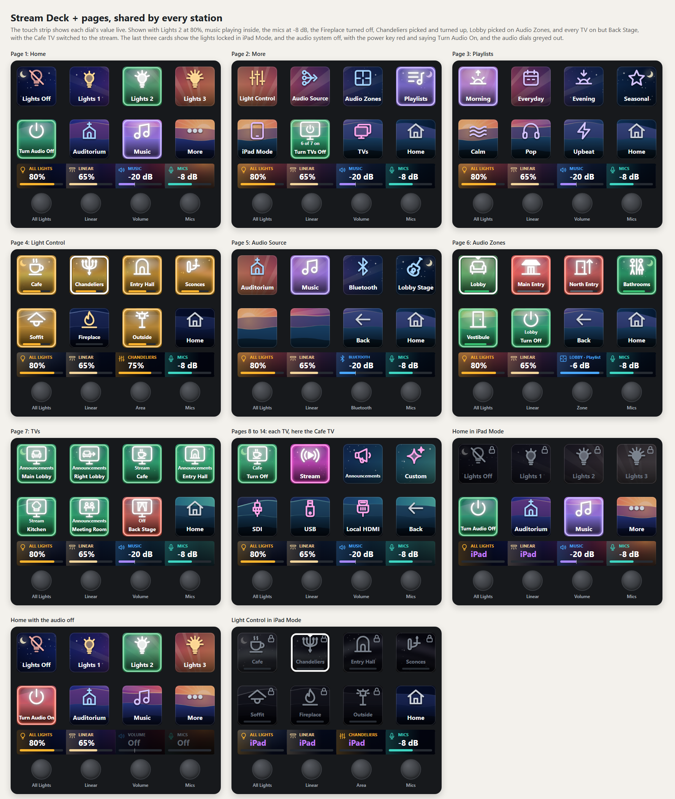

# Stream Deck pages

This is every Stream Deck page, key by key, with what runs behind each one. It is generated from [build.py](../config/stream-deck/build.py), together with the importable file and the artwork, so all of them match.

Import [lobby.companionconfig](../config/stream-deck/lobby.companionconfig) into Companion instead of building these by hand. [Companion setup](07-companion-setup.md) has the steps.

**Status:** The file has 404 buttons and has not yet been imported into a real Companion. Its format, every action and every button element were checked against the Companion 5.1.3 and module source, every expression in it was parsed and run, and its logic passed 228 simulated checks. [Bench test 13](09-testing.md) is the real proof.

## How a press reaches the hardware

Real keys don't talk to hardware directly. Each one runs a block on a Library page, so a change happens in one place.

| Target | Connection | Message | Example |
| --- | --- | --- | --- |
| Wing Rack | `wing`, 192.168.0.30 | Wing OSC through the Behringer module | `/bus/14/send/MX1/on` = 1 |
| ODE Mk3 | `dmx`, 192.168.50.31, Art-Net universe 0 | Channel values through the Art-Net module | `1-8,166;9-12,166;13-16,166;` and so on |
| WiiM | `wiim`, https://192.168.50.40/ | HTTPS GET to `httpapi.asp?command=` | `MCUKeyShortClick:1` |
| Rack power | `power`, 192.168.50.45, UDP 30333 | Console commands to a Juice Goose iP-1520 through the generic TCP/UDP module, each ended with a carriage return | `DEACTIVATE`, then `SEQUP1` |
| Powered speakers | `speaker1`, 192.168.50.46, `speaker2`, 192.168.50.47 | On and off through the TP-Link Kasa Smart Plug module, one connection a plug | Power On |
| TVs | `tv1` to `tv7`, 192.168.50.81 to .87, TCP 20060 | Sony's Simple IP control through the generic TCP/UDP module: 24-byte messages, each ended with a line feed | `*SCPOWR0000000000000001`, then `*SCINPT0000000100000001` for HDMI 1 |
| ATEM | `atem`, 192.168.10.240 (a placeholder, the factory address), 4 M/E Constellation HD | An output's source through the Blackmagic ATEM module | Output 18 takes `$(custom:atem_stream)` |

Key addresses read page/row/column from 0, the same form Companion uses. Rows and columns start at the top left.

On the Stream Deck +, rows 0 and 1 are the keys, row 2 is the touch strip, and row 3 is the dials.

## How it looks

Amber is lighting, warm white is the linear lights, blue is audio, violet is music, teal is the mics, purple is the iPad, green is on and red is off. A lit key glows in its color with a bright ring and a white icon: it is the active choice. On Home, the Lights key playing is green and Lights Off is red while the lights are off, so with the audio power key below, a glance shows whether the lights and the audio are on. A white ring marks the key a dial is pointed at, on Light Control and Audio Zones, and those keys show their level along the bottom. In iPad Mode, lighting keys go grey and show a lock. A green key with a check mark has just saved a look. While the audio system is off, the audio power key is red and says Turn Audio On, and the audio panels on the touch strip go grey. While it is on, that key is green and says Turn Audio Off. On Audio Zones, each zone key is green while it plays and red while it's off, and the switch works like the power key for the picked zone. The TV keys work the same way: green while a TV is on and red while it's off, with magenta marking what a TV shows.

Each page shows one picture across its eight keys, cut into a piece per key, and its touch strip is a lake reflecting the sky. Home is dawn, the sun cresting a ridge: over the lights row the sky brightens from Lights Off, under the moon, to Lights 3, nearest the sun. More, Playlists, Audio Source and Audio Zones are dusk, with the sun setting on the other side, Light Control is night under the northern lights, and the TV pages are the blue hour, a teal glow left on the horizon, so each part of the deck is easy to tell apart. Blank keys still show their piece. The picture allows for the bezel between keys (48 pixels, against a 144-pixel key), so it lines up across them. If it looks off on a real deck, measure a key and the gap between two keys and set `KEY_GAP` in build.py to 144 times the gap divided by the key.

The touch strip shows a live panel above each dial: what the dial does, its value, and a level bar that moves as you turn it.

Labels are live text, so you can rename a key in Companion without touching its artwork. The artwork is in [config/stream-deck/icons](../config/stream-deck/icons): 144-pixel keys, drawn larger than the Stream Deck +'s 120-pixel keys so they stay sharp, and 200 by 100 touch strip panels, the size of each strip segment.

Inside Companion the same 173 images live in the image library, stored once, and keys refer to them by name, such as `$(image:dawn_r0c2_level2_active)`. Replacing an image there changes every key that uses it.

## Pages

Every station is a Stream Deck + with 8 keys, a touch strip and 4 dials, and they all share these pages. The rack and each door have their own surface group, which sets the pages that station may use. Every group starts on Home with every page, so to lock a door out of something, untick its page in that door's group.

The first two dials and the last one do the same thing on every page, so hands learn them. The third dial follows the page: Volume on Home, More, Playlists and the TV pages, the picked area on Light Control, Bluetooth on Audio Source, and the picked zone on Audio Zones.



### Page 1: Home

| Key | Shows | Does | What runs behind it |
| --- | --- | --- | --- |
| `1/0/0` | Lights Off | Fades the lights out. Turning All Lights brings them back | Run `22/0/3` Lights Off |
| `1/0/1` | Lights 1 | Tap for Lights 1. Green while it plays. Hold 3 seconds to save the lights as they are now into it | Tap:<br>&nbsp;&nbsp;Run `22/0/0` Look 1<br>Hold 3 s:<br>&nbsp;&nbsp;Run `22/0/5` Save 1 |
| `1/0/2` | Lights 2 | Tap for Lights 2. Green while it plays. Hold 3 seconds to save the lights as they are now into it | Tap:<br>&nbsp;&nbsp;Run `22/0/1` Look 2<br>Hold 3 s:<br>&nbsp;&nbsp;Run `22/0/6` Save 2 |
| `1/0/3` | Lights 3 | Tap for Lights 3. Green while it plays. Hold 3 seconds to save the lights as they are now into it | Tap:<br>&nbsp;&nbsp;Run `22/0/2` Look 3<br>Hold 3 s:<br>&nbsp;&nbsp;Run `22/0/7` Save 3 |
| `1/1/0` | Turn Audio Off | Green while the audio is on, saying Turn Audio Off: press to turn every zone off, then the amplifiers. Red while it's off, saying Turn Audio On: press to turn the system on with nothing playing. Auditorium and Music also turn it on | If the audio system is on:<br>&nbsp;&nbsp;Run `21/3/1` Power Off<br>Otherwise:<br>&nbsp;&nbsp;Run `21/3/0` Power On |
| `1/1/1` | Auditorium | Lit while the auditorium feed plays. Press to play Auditorium, turning the audio system on if it is off and replacing anything else playing. Press again to turn the auditorium feed off | If any zone is on Auditorium:<br>&nbsp;&nbsp;Run `21/3/2` Stop Auditorium<br>Otherwise:<br>&nbsp;&nbsp;Run `21/2/0` Room Auditorium |
| `1/1/2` | Music | Lit while music plays. Press to play Music Inside, turning the audio system on if it is off and replacing anything else playing. Press again to turn music off | If any zone is on Playlist:<br>&nbsp;&nbsp;Run `21/3/3` Stop Playlist<br>Otherwise:<br>&nbsp;&nbsp;Run `21/2/1` Room Music Inside |
| `1/1/3` | More | Opens More | This surface goes to page 2 |
| `1/2/0` | ALL LIGHTS (live) | Touch strip: the All Lights level, Off, or iPad | Nothing |
| `1/2/1` | LINEAR (live) | Touch strip: the linear lights level | Nothing |
| `1/2/2` | What is playing and its volume from normal (live) | Touch strip: what is playing, and its volume from normal, or Off | Nothing |
| `1/2/3` | MICS (live) | Touch strip: the mic level, Muted, or Off while the audio is off | Nothing |
| `1/3/0` | Dial: All Lights | Turn to dim or brighten every light, 5% a click, more when turned quickly. Push to turn the lights off or back on | Push:<br>&nbsp;&nbsp;Run `22/0/4` Lights On/Off<br>Turn left:<br>&nbsp;&nbsp;Set `turn_n` from how fast the dial turned (see Dial speed)<br>&nbsp;&nbsp;Set `turn_ms` to `unixNow()`<br>&nbsp;&nbsp;Set `turn_key` to `all-`<br>&nbsp;&nbsp;Run `22/1/5` All Down<br>Turn right:<br>&nbsp;&nbsp;Set `turn_n` from how fast the dial turned (see Dial speed)<br>&nbsp;&nbsp;Set `turn_ms` to `unixNow()`<br>&nbsp;&nbsp;Set `turn_key` to `all+`<br>&nbsp;&nbsp;Run `22/1/4` All Up |
| `1/3/1` | Dial: Linear | Turn to set just the linear lights, 5% a click, more when turned quickly. Push to put them back to the look | Push:<br>&nbsp;&nbsp;Run `22/2/0` Linear Reset<br>Turn left:<br>&nbsp;&nbsp;Set `turn_n` from how fast the dial turned (see Dial speed)<br>&nbsp;&nbsp;Set `turn_ms` to `unixNow()`<br>&nbsp;&nbsp;Set `turn_key` to `lin-`<br>&nbsp;&nbsp;Run `22/1/7` Linear Down<br>Turn right:<br>&nbsp;&nbsp;Set `turn_n` from how fast the dial turned (see Dial speed)<br>&nbsp;&nbsp;Set `turn_ms` to `unixNow()`<br>&nbsp;&nbsp;Set `turn_key` to `lin+`<br>&nbsp;&nbsp;Run `22/1/6` Linear Up |
| `1/3/2` | Dial: Volume | Turn for the volume of whatever is playing, 1 dB a click, more when turned quickly: the auditorium feed, music, Bluetooth or the lobby stage. Push to put it back to normal. Does nothing while the audio is off or nothing plays | Push:<br>&nbsp;&nbsp;Run `22/2/7` Volume Reset<br>Turn left:<br>&nbsp;&nbsp;Set `turn_n` from how fast the dial turned (see Dial speed)<br>&nbsp;&nbsp;Set `turn_ms` to `unixNow()`<br>&nbsp;&nbsp;Set `turn_key` to `vol-`<br>&nbsp;&nbsp;Run `22/2/2` Volume Down<br>Turn right:<br>&nbsp;&nbsp;Set `turn_n` from how fast the dial turned (see Dial speed)<br>&nbsp;&nbsp;Set `turn_ms` to `unixNow()`<br>&nbsp;&nbsp;Set `turn_key` to `vol+`<br>&nbsp;&nbsp;Run `22/2/1` Volume Up |
| `1/3/3` | Dial: Mics | Turn for mic volume, 1 dB a click, more when turned quickly, up to 0 dB. Push to mute or unmute the mics. Does nothing while the audio is off | Push:<br>&nbsp;&nbsp;Run `22/2/5` Mic Mute<br>Turn left:<br>&nbsp;&nbsp;Set `turn_n` from how fast the dial turned (see Dial speed)<br>&nbsp;&nbsp;Set `turn_ms` to `unixNow()`<br>&nbsp;&nbsp;Set `turn_key` to `mic-`<br>&nbsp;&nbsp;Run `22/2/4` Mic Down<br>Turn right:<br>&nbsp;&nbsp;Set `turn_n` from how fast the dial turned (see Dial speed)<br>&nbsp;&nbsp;Set `turn_ms` to `unixNow()`<br>&nbsp;&nbsp;Set `turn_key` to `mic+`<br>&nbsp;&nbsp;Run `22/2/3` Mic Up |

### Page 2: More

More is the jumping-off point to the pages below it. Its dials match Home's. Turn TVs On and Off switches every TV at once, and TVs opens the page for each TV.

| Key | Shows | Does | What runs behind it |
| --- | --- | --- | --- |
| `2/0/0` | Light Control | Opens Light Control, to set each area of lights. Shows a lock in iPad Mode | This surface goes to page 4 |
| `2/0/1` | Audio Source | Opens Audio Source, to choose what plays | This surface goes to page 5 |
| `2/0/2` | Audio Zones | Opens Audio Zones, to turn each zone on or off and set its volume | This surface goes to page 6 |
| `2/0/3` | Playlists | Opens Playlists | This surface goes to page 3 |
| `2/1/0` | iPad Mode | Hold 1 second to hand the lights to the iPad, or to take them back | Hold 1 s:<br>&nbsp;&nbsp;Run `22/1/3` iPad Toggle |
| `2/1/1` | Turn TVs Off | Green while any TV is on, saying Turn TVs Off, and how many are on if not all: press to turn every TV off. Red while they're all off, saying Turn TVs On: press to turn every TV on, each showing its default | Run `28/2/2` TVs On/Off |
| `2/1/2` | TVs | Opens TVs, to turn each TV on or off and choose what it shows | This surface goes to page 7 |
| `2/1/3` | Home | Opens Home | This surface goes to page 1 |
| `2/2/0` | ALL LIGHTS (live) | Touch strip: the All Lights level, Off, or iPad | Nothing |
| `2/2/1` | LINEAR (live) | Touch strip: the linear lights level | Nothing |
| `2/2/2` | What is playing and its volume from normal (live) | Touch strip: what is playing, and its volume from normal, or Off | Nothing |
| `2/2/3` | MICS (live) | Touch strip: the mic level, Muted, or Off while the audio is off | Nothing |
| `2/3/0` | Dial: All Lights | Turn to dim or brighten every light, 5% a click, more when turned quickly. Push to turn the lights off or back on | Push:<br>&nbsp;&nbsp;Run `22/0/4` Lights On/Off<br>Turn left:<br>&nbsp;&nbsp;Set `turn_n` from how fast the dial turned (see Dial speed)<br>&nbsp;&nbsp;Set `turn_ms` to `unixNow()`<br>&nbsp;&nbsp;Set `turn_key` to `all-`<br>&nbsp;&nbsp;Run `22/1/5` All Down<br>Turn right:<br>&nbsp;&nbsp;Set `turn_n` from how fast the dial turned (see Dial speed)<br>&nbsp;&nbsp;Set `turn_ms` to `unixNow()`<br>&nbsp;&nbsp;Set `turn_key` to `all+`<br>&nbsp;&nbsp;Run `22/1/4` All Up |
| `2/3/1` | Dial: Linear | Turn to set just the linear lights, 5% a click, more when turned quickly. Push to put them back to the look | Push:<br>&nbsp;&nbsp;Run `22/2/0` Linear Reset<br>Turn left:<br>&nbsp;&nbsp;Set `turn_n` from how fast the dial turned (see Dial speed)<br>&nbsp;&nbsp;Set `turn_ms` to `unixNow()`<br>&nbsp;&nbsp;Set `turn_key` to `lin-`<br>&nbsp;&nbsp;Run `22/1/7` Linear Down<br>Turn right:<br>&nbsp;&nbsp;Set `turn_n` from how fast the dial turned (see Dial speed)<br>&nbsp;&nbsp;Set `turn_ms` to `unixNow()`<br>&nbsp;&nbsp;Set `turn_key` to `lin+`<br>&nbsp;&nbsp;Run `22/1/6` Linear Up |
| `2/3/2` | Dial: Volume | Turn for the volume of whatever is playing, 1 dB a click, more when turned quickly: the auditorium feed, music, Bluetooth or the lobby stage. Push to put it back to normal. Does nothing while the audio is off or nothing plays | Push:<br>&nbsp;&nbsp;Run `22/2/7` Volume Reset<br>Turn left:<br>&nbsp;&nbsp;Set `turn_n` from how fast the dial turned (see Dial speed)<br>&nbsp;&nbsp;Set `turn_ms` to `unixNow()`<br>&nbsp;&nbsp;Set `turn_key` to `vol-`<br>&nbsp;&nbsp;Run `22/2/2` Volume Down<br>Turn right:<br>&nbsp;&nbsp;Set `turn_n` from how fast the dial turned (see Dial speed)<br>&nbsp;&nbsp;Set `turn_ms` to `unixNow()`<br>&nbsp;&nbsp;Set `turn_key` to `vol+`<br>&nbsp;&nbsp;Run `22/2/1` Volume Up |
| `2/3/3` | Dial: Mics | Turn for mic volume, 1 dB a click, more when turned quickly, up to 0 dB. Push to mute or unmute the mics. Does nothing while the audio is off | Push:<br>&nbsp;&nbsp;Run `22/2/5` Mic Mute<br>Turn left:<br>&nbsp;&nbsp;Set `turn_n` from how fast the dial turned (see Dial speed)<br>&nbsp;&nbsp;Set `turn_ms` to `unixNow()`<br>&nbsp;&nbsp;Set `turn_key` to `mic-`<br>&nbsp;&nbsp;Run `22/2/4` Mic Down<br>Turn right:<br>&nbsp;&nbsp;Set `turn_n` from how fast the dial turned (see Dial speed)<br>&nbsp;&nbsp;Set `turn_ms` to `unixNow()`<br>&nbsp;&nbsp;Set `turn_key` to `mic+`<br>&nbsp;&nbsp;Run `22/2/3` Mic Up |

### Page 3: Playlists

7 playlists and Home. Each playlist key plays its WiiM preset of the same number and is lit while it plays. In a silent room it starts music inside, the way Music on Home does. For music outside too, switch the entries on in Audio Zones. The Music Everywhere block stays in the Library for schedules, with no key.

| Key | Shows | Does | What runs behind it |
| --- | --- | --- | --- |
| `3/0/0` | Morning | Chooses and plays Morning. In a silent room it starts music inside | Run `21/1/1` P1 Morning |
| `3/0/1` | Everyday | Chooses and plays Everyday. In a silent room it starts music inside | Run `21/1/2` P2 Everyday |
| `3/0/2` | Evening | Chooses and plays Evening. In a silent room it starts music inside | Run `21/1/3` P3 Evening |
| `3/0/3` | Seasonal | Chooses and plays Seasonal. In a silent room it starts music inside | Run `21/1/4` P4 Seasonal |
| `3/1/0` | Calm | Chooses and plays Calm. In a silent room it starts music inside | Run `21/1/5` P5 Calm |
| `3/1/1` | Pop | Chooses and plays Pop. In a silent room it starts music inside | Run `21/1/6` P6 Pop |
| `3/1/2` | Upbeat | Chooses and plays Upbeat. In a silent room it starts music inside | Run `21/1/7` P7 Upbeat |
| `3/1/3` | Home | Opens Home | This surface goes to page 1 |
| `3/2/0` | ALL LIGHTS (live) | Touch strip: the All Lights level, Off, or iPad | Nothing |
| `3/2/1` | LINEAR (live) | Touch strip: the linear lights level | Nothing |
| `3/2/2` | What is playing and its volume from normal (live) | Touch strip: what is playing, and its volume from normal, or Off | Nothing |
| `3/2/3` | MICS (live) | Touch strip: the mic level, Muted, or Off while the audio is off | Nothing |
| `3/3/0` | Dial: All Lights | Turn to dim or brighten every light, 5% a click, more when turned quickly. Push to turn the lights off or back on | Push:<br>&nbsp;&nbsp;Run `22/0/4` Lights On/Off<br>Turn left:<br>&nbsp;&nbsp;Set `turn_n` from how fast the dial turned (see Dial speed)<br>&nbsp;&nbsp;Set `turn_ms` to `unixNow()`<br>&nbsp;&nbsp;Set `turn_key` to `all-`<br>&nbsp;&nbsp;Run `22/1/5` All Down<br>Turn right:<br>&nbsp;&nbsp;Set `turn_n` from how fast the dial turned (see Dial speed)<br>&nbsp;&nbsp;Set `turn_ms` to `unixNow()`<br>&nbsp;&nbsp;Set `turn_key` to `all+`<br>&nbsp;&nbsp;Run `22/1/4` All Up |
| `3/3/1` | Dial: Linear | Turn to set just the linear lights, 5% a click, more when turned quickly. Push to put them back to the look | Push:<br>&nbsp;&nbsp;Run `22/2/0` Linear Reset<br>Turn left:<br>&nbsp;&nbsp;Set `turn_n` from how fast the dial turned (see Dial speed)<br>&nbsp;&nbsp;Set `turn_ms` to `unixNow()`<br>&nbsp;&nbsp;Set `turn_key` to `lin-`<br>&nbsp;&nbsp;Run `22/1/7` Linear Down<br>Turn right:<br>&nbsp;&nbsp;Set `turn_n` from how fast the dial turned (see Dial speed)<br>&nbsp;&nbsp;Set `turn_ms` to `unixNow()`<br>&nbsp;&nbsp;Set `turn_key` to `lin+`<br>&nbsp;&nbsp;Run `22/1/6` Linear Up |
| `3/3/2` | Dial: Volume | Turn for the volume of whatever is playing, 1 dB a click, more when turned quickly: the auditorium feed, music, Bluetooth or the lobby stage. Push to put it back to normal. Does nothing while the audio is off or nothing plays | Push:<br>&nbsp;&nbsp;Run `22/2/7` Volume Reset<br>Turn left:<br>&nbsp;&nbsp;Set `turn_n` from how fast the dial turned (see Dial speed)<br>&nbsp;&nbsp;Set `turn_ms` to `unixNow()`<br>&nbsp;&nbsp;Set `turn_key` to `vol-`<br>&nbsp;&nbsp;Run `22/2/2` Volume Down<br>Turn right:<br>&nbsp;&nbsp;Set `turn_n` from how fast the dial turned (see Dial speed)<br>&nbsp;&nbsp;Set `turn_ms` to `unixNow()`<br>&nbsp;&nbsp;Set `turn_key` to `vol+`<br>&nbsp;&nbsp;Run `22/2/1` Volume Up |
| `3/3/3` | Dial: Mics | Turn for mic volume, 1 dB a click, more when turned quickly, up to 0 dB. Push to mute or unmute the mics. Does nothing while the audio is off | Push:<br>&nbsp;&nbsp;Run `22/2/5` Mic Mute<br>Turn left:<br>&nbsp;&nbsp;Set `turn_n` from how fast the dial turned (see Dial speed)<br>&nbsp;&nbsp;Set `turn_ms` to `unixNow()`<br>&nbsp;&nbsp;Set `turn_key` to `mic-`<br>&nbsp;&nbsp;Run `22/2/4` Mic Down<br>Turn right:<br>&nbsp;&nbsp;Set `turn_n` from how fast the dial turned (see Dial speed)<br>&nbsp;&nbsp;Set `turn_ms` to `unixNow()`<br>&nbsp;&nbsp;Set `turn_key` to `mic+`<br>&nbsp;&nbsp;Run `22/2/3` Mic Up |

### Page 4: Light Control

Tap an area to pick it, then turn the Area dial. Each key is lit while its area is on, with its level along the bottom. The levels belong to the looks: Lights 1, 2 and 3 set every area, and holding one of them saves every area as it is. With the lights off, turning an area up brings it on by itself, which suits a single light at night.

| Key | Shows | Does | What runs behind it |
| --- | --- | --- | --- |
| `4/0/0` | Cafe | Tap to pick Cafe for the Area dial. Lit while Cafe is on, with its level along the bottom | Set `lt_pick` to `1` |
| `4/0/1` | Chandeliers | Tap to pick Chandeliers for the Area dial. Lit while Chandeliers is on, with its level along the bottom | Set `lt_pick` to `2` |
| `4/0/2` | Entry Hall | Tap to pick Entry Hall for the Area dial. Lit while Entry Hall is on, with its level along the bottom | Set `lt_pick` to `3` |
| `4/0/3` | Sconces | Tap to pick Sconces for the Area dial. Lit while Sconces is on, with its level along the bottom | Set `lt_pick` to `4` |
| `4/1/0` | Soffit | Tap to pick Soffit for the Area dial. Lit while Soffit is on, with its level along the bottom | Set `lt_pick` to `5` |
| `4/1/1` | Fireplace | Tap to pick Fireplace for the Area dial. Lit while Fireplace is on, with its level along the bottom | Set `lt_pick` to `6` |
| `4/1/2` | Outside | Tap to pick Outside for the Area dial. Lit while Outside is on, with its level along the bottom | Set `lt_pick` to `7` |
| `4/1/3` | Home | Opens Home | This surface goes to page 1 |
| `4/2/0` | ALL LIGHTS (live) | Touch strip: the All Lights level, Off, or iPad | Nothing |
| `4/2/1` | LINEAR (live) | Touch strip: the linear lights level | Nothing |
| `4/2/2` | The picked area and its level (live) | Touch strip: the picked area and its level | Nothing |
| `4/2/3` | MICS (live) | Touch strip: the mic level, Muted, or Off while the audio is off | Nothing |
| `4/3/0` | Dial: All Lights | Turn to dim or brighten every light, 5% a click, more when turned quickly. Push to turn the lights off or back on | Push:<br>&nbsp;&nbsp;Run `22/0/4` Lights On/Off<br>Turn left:<br>&nbsp;&nbsp;Set `turn_n` from how fast the dial turned (see Dial speed)<br>&nbsp;&nbsp;Set `turn_ms` to `unixNow()`<br>&nbsp;&nbsp;Set `turn_key` to `all-`<br>&nbsp;&nbsp;Run `22/1/5` All Down<br>Turn right:<br>&nbsp;&nbsp;Set `turn_n` from how fast the dial turned (see Dial speed)<br>&nbsp;&nbsp;Set `turn_ms` to `unixNow()`<br>&nbsp;&nbsp;Set `turn_key` to `all+`<br>&nbsp;&nbsp;Run `22/1/4` All Up |
| `4/3/1` | Dial: Linear | Turn to set just the linear lights, 5% a click, more when turned quickly. Push to put them back to the look | Push:<br>&nbsp;&nbsp;Run `22/2/0` Linear Reset<br>Turn left:<br>&nbsp;&nbsp;Set `turn_n` from how fast the dial turned (see Dial speed)<br>&nbsp;&nbsp;Set `turn_ms` to `unixNow()`<br>&nbsp;&nbsp;Set `turn_key` to `lin-`<br>&nbsp;&nbsp;Run `22/1/7` Linear Down<br>Turn right:<br>&nbsp;&nbsp;Set `turn_n` from how fast the dial turned (see Dial speed)<br>&nbsp;&nbsp;Set `turn_ms` to `unixNow()`<br>&nbsp;&nbsp;Set `turn_key` to `lin+`<br>&nbsp;&nbsp;Run `22/1/6` Linear Up |
| `4/3/2` | Dial: Area | Turn to set the picked area, 5% a click, more when turned quickly. With the lights off, turning up brings that area on by itself. Push to put it back to the look | Push:<br>&nbsp;&nbsp;Run `23/3/2` Area Reset<br>Turn left:<br>&nbsp;&nbsp;Set `turn_n` from how fast the dial turned (see Dial speed)<br>&nbsp;&nbsp;Set `turn_ms` to `unixNow()`<br>&nbsp;&nbsp;Set `turn_key` to `area-`<br>&nbsp;&nbsp;Run `23/3/1` Area Down<br>Turn right:<br>&nbsp;&nbsp;Set `turn_n` from how fast the dial turned (see Dial speed)<br>&nbsp;&nbsp;Set `turn_ms` to `unixNow()`<br>&nbsp;&nbsp;Set `turn_key` to `area+`<br>&nbsp;&nbsp;Run `23/3/0` Area Up |
| `4/3/3` | Dial: Mics | Turn for mic volume, 1 dB a click, more when turned quickly, up to 0 dB. Push to mute or unmute the mics. Does nothing while the audio is off | Push:<br>&nbsp;&nbsp;Run `22/2/5` Mic Mute<br>Turn left:<br>&nbsp;&nbsp;Set `turn_n` from how fast the dial turned (see Dial speed)<br>&nbsp;&nbsp;Set `turn_ms` to `unixNow()`<br>&nbsp;&nbsp;Set `turn_key` to `mic-`<br>&nbsp;&nbsp;Run `22/2/4` Mic Down<br>Turn right:<br>&nbsp;&nbsp;Set `turn_n` from how fast the dial turned (see Dial speed)<br>&nbsp;&nbsp;Set `turn_ms` to `unixNow()`<br>&nbsp;&nbsp;Set `turn_key` to `mic+`<br>&nbsp;&nbsp;Run `22/2/3` Mic Up |

### Page 5: Audio Source

Each source is lit while it plays anywhere, and they toggle like the ones on Home. The Bluetooth dial sets Bluetooth's level whether or not it is playing, and room buttons leave that level alone.

| Key | Shows | Does | What runs behind it |
| --- | --- | --- | --- |
| `5/0/0` | Auditorium | Lit while the auditorium feed plays. Press to play Auditorium, turning the audio system on if it is off and replacing anything else playing. Press again to turn the auditorium feed off | If any zone is on Auditorium:<br>&nbsp;&nbsp;Run `21/3/2` Stop Auditorium<br>Otherwise:<br>&nbsp;&nbsp;Run `21/2/0` Room Auditorium |
| `5/0/1` | Music | Lit while music plays. Press to play Music Inside, turning the audio system on if it is off and replacing anything else playing. Press again to turn music off | If any zone is on Playlist:<br>&nbsp;&nbsp;Run `21/3/3` Stop Playlist<br>Otherwise:<br>&nbsp;&nbsp;Run `21/2/1` Room Music Inside |
| `5/0/2` | Bluetooth | Lit while Bluetooth plays. Press to play Bluetooth, turning the audio system on if it is off and replacing anything else playing. Press again to turn Bluetooth off | If any zone is on Bluetooth:<br>&nbsp;&nbsp;Run `21/3/4` Stop Bluetooth<br>Otherwise:<br>&nbsp;&nbsp;Run `21/2/4` Room Bluetooth |
| `5/0/3` | Lobby Stage | Lit while the lobby stage plays. Press to play Lobby Stage, turning the audio system on if it is off and replacing anything else playing. Press again to turn the lobby stage off | If any zone is on Lobby Stage:<br>&nbsp;&nbsp;Run `21/3/5` Stop Lobby Stage<br>Otherwise:<br>&nbsp;&nbsp;Run `21/2/3` Room Lobby Stage |
| `5/1/0` | Blank, showing its piece of the picture | Nothing yet | Nothing |
| `5/1/1` | Blank, showing its piece of the picture | Nothing yet | Nothing |
| `5/1/2` | Back | Opens More | This surface goes to page 2 |
| `5/1/3` | Home | Opens Home | This surface goes to page 1 |
| `5/2/0` | ALL LIGHTS (live) | Touch strip: the All Lights level, Off, or iPad | Nothing |
| `5/2/1` | LINEAR (live) | Touch strip: the linear lights level | Nothing |
| `5/2/2` | BLUETOOTH (live) | Touch strip: the Bluetooth level from normal, or Off | Nothing |
| `5/2/3` | MICS (live) | Touch strip: the mic level, Muted, or Off while the audio is off | Nothing |
| `5/3/0` | Dial: All Lights | Turn to dim or brighten every light, 5% a click, more when turned quickly. Push to turn the lights off or back on | Push:<br>&nbsp;&nbsp;Run `22/0/4` Lights On/Off<br>Turn left:<br>&nbsp;&nbsp;Set `turn_n` from how fast the dial turned (see Dial speed)<br>&nbsp;&nbsp;Set `turn_ms` to `unixNow()`<br>&nbsp;&nbsp;Set `turn_key` to `all-`<br>&nbsp;&nbsp;Run `22/1/5` All Down<br>Turn right:<br>&nbsp;&nbsp;Set `turn_n` from how fast the dial turned (see Dial speed)<br>&nbsp;&nbsp;Set `turn_ms` to `unixNow()`<br>&nbsp;&nbsp;Set `turn_key` to `all+`<br>&nbsp;&nbsp;Run `22/1/4` All Up |
| `5/3/1` | Dial: Linear | Turn to set just the linear lights, 5% a click, more when turned quickly. Push to put them back to the look | Push:<br>&nbsp;&nbsp;Run `22/2/0` Linear Reset<br>Turn left:<br>&nbsp;&nbsp;Set `turn_n` from how fast the dial turned (see Dial speed)<br>&nbsp;&nbsp;Set `turn_ms` to `unixNow()`<br>&nbsp;&nbsp;Set `turn_key` to `lin-`<br>&nbsp;&nbsp;Run `22/1/7` Linear Down<br>Turn right:<br>&nbsp;&nbsp;Set `turn_n` from how fast the dial turned (see Dial speed)<br>&nbsp;&nbsp;Set `turn_ms` to `unixNow()`<br>&nbsp;&nbsp;Set `turn_key` to `lin+`<br>&nbsp;&nbsp;Run `22/1/6` Linear Up |
| `5/3/2` | Dial: Bluetooth | Turn for the Bluetooth level, 1 dB a click, more when turned quickly, playing or not. It keeps that level until it is turned again. Push to put it back to normal. Does nothing while the audio is off | Push:<br>&nbsp;&nbsp;Run `24/3/2` Bluetooth Reset<br>Turn left:<br>&nbsp;&nbsp;Set `turn_n` from how fast the dial turned (see Dial speed)<br>&nbsp;&nbsp;Set `turn_ms` to `unixNow()`<br>&nbsp;&nbsp;Set `turn_key` to `bt-`<br>&nbsp;&nbsp;Run `24/3/1` Bluetooth Down<br>Turn right:<br>&nbsp;&nbsp;Set `turn_n` from how fast the dial turned (see Dial speed)<br>&nbsp;&nbsp;Set `turn_ms` to `unixNow()`<br>&nbsp;&nbsp;Set `turn_key` to `bt+`<br>&nbsp;&nbsp;Run `24/3/0` Bluetooth Up |
| `5/3/3` | Dial: Mics | Turn for mic volume, 1 dB a click, more when turned quickly, up to 0 dB. Push to mute or unmute the mics. Does nothing while the audio is off | Push:<br>&nbsp;&nbsp;Run `22/2/5` Mic Mute<br>Turn left:<br>&nbsp;&nbsp;Set `turn_n` from how fast the dial turned (see Dial speed)<br>&nbsp;&nbsp;Set `turn_ms` to `unixNow()`<br>&nbsp;&nbsp;Set `turn_key` to `mic-`<br>&nbsp;&nbsp;Run `22/2/4` Mic Down<br>Turn right:<br>&nbsp;&nbsp;Set `turn_n` from how fast the dial turned (see Dial speed)<br>&nbsp;&nbsp;Set `turn_ms` to `unixNow()`<br>&nbsp;&nbsp;Set `turn_key` to `mic+`<br>&nbsp;&nbsp;Run `22/2/3` Mic Up |

### Page 6: Audio Zones

Each zone is green while it plays and red while it's off. Tap a zone to pick it. The switch beside Vestibule then turns that zone on or off, and the Zone dial sets its volume. A zone switched on plays what the other zones are playing, or the source played last if nothing is, and turns the audio system on if it's off.

| Zone | Speakers | Matrix | Variables | Normal fader |
| --- | --- | --- | --- | --- |
| Lobby | The lobby's main pair | MX1 | `z1_src`, `z1_level` | -6 dB |
| Main Entry | The courtyard pair | MX2 | `z2_src`, `z2_level` | -10 dB |
| North Entry | 70V, under the soffit | MX3 | `z3_src`, `z3_level` | -10 dB |
| Bathrooms | Bathroom speakers | MX4 | `z4_src`, `z4_level` | -12 dB |
| Vestibule | Vestibule speakers | MX5 | `z5_src`, `z5_level` | -12 dB |

| Key | Shows | Does | What runs behind it |
| --- | --- | --- | --- |
| `6/0/0` | Lobby | Tap to pick Lobby for the Zone dial and the switch beside it. Green while it plays and red while it's off, with its level along the bottom | Set `zone_pick` to `1` |
| `6/0/1` | Main Entry | Tap to pick Main Entry for the Zone dial and the switch beside it. Green while it plays and red while it's off, with its level along the bottom | Set `zone_pick` to `2` |
| `6/0/2` | North Entry | Tap to pick North Entry for the Zone dial and the switch beside it. Green while it plays and red while it's off, with its level along the bottom | Set `zone_pick` to `3` |
| `6/0/3` | Bathrooms | Tap to pick Bathrooms for the Zone dial and the switch beside it. Green while it plays and red while it's off, with its level along the bottom | Set `zone_pick` to `4` |
| `6/1/0` | Vestibule | Tap to pick Vestibule for the Zone dial and the switch beside it. Green while it plays and red while it's off, with its level along the bottom | Set `zone_pick` to `5` |
| `6/1/1` | Turn On | Shows the picked zone's name. Green while it plays, saying Turn Off: press to turn it off. Red while it's off, saying Turn On: press to play what the other zones play, turning the audio system on if it is off | Run `24/2/0` Zone On/Off |
| `6/1/2` | Back | Opens More | This surface goes to page 2 |
| `6/1/3` | Home | Opens Home | This surface goes to page 1 |
| `6/2/0` | ALL LIGHTS (live) | Touch strip: the All Lights level, Off, or iPad | Nothing |
| `6/2/1` | LINEAR (live) | Touch strip: the linear lights level | Nothing |
| `6/2/2` | The picked zone, its source and level (live) | Touch strip: the picked zone, its source and level | Nothing |
| `6/2/3` | MICS (live) | Touch strip: the mic level, Muted, or Off while the audio is off | Nothing |
| `6/3/0` | Dial: All Lights | Turn to dim or brighten every light, 5% a click, more when turned quickly. Push to turn the lights off or back on | Push:<br>&nbsp;&nbsp;Run `22/0/4` Lights On/Off<br>Turn left:<br>&nbsp;&nbsp;Set `turn_n` from how fast the dial turned (see Dial speed)<br>&nbsp;&nbsp;Set `turn_ms` to `unixNow()`<br>&nbsp;&nbsp;Set `turn_key` to `all-`<br>&nbsp;&nbsp;Run `22/1/5` All Down<br>Turn right:<br>&nbsp;&nbsp;Set `turn_n` from how fast the dial turned (see Dial speed)<br>&nbsp;&nbsp;Set `turn_ms` to `unixNow()`<br>&nbsp;&nbsp;Set `turn_key` to `all+`<br>&nbsp;&nbsp;Run `22/1/4` All Up |
| `6/3/1` | Dial: Linear | Turn to set just the linear lights, 5% a click, more when turned quickly. Push to put them back to the look | Push:<br>&nbsp;&nbsp;Run `22/2/0` Linear Reset<br>Turn left:<br>&nbsp;&nbsp;Set `turn_n` from how fast the dial turned (see Dial speed)<br>&nbsp;&nbsp;Set `turn_ms` to `unixNow()`<br>&nbsp;&nbsp;Set `turn_key` to `lin-`<br>&nbsp;&nbsp;Run `22/1/7` Linear Down<br>Turn right:<br>&nbsp;&nbsp;Set `turn_n` from how fast the dial turned (see Dial speed)<br>&nbsp;&nbsp;Set `turn_ms` to `unixNow()`<br>&nbsp;&nbsp;Set `turn_key` to `lin+`<br>&nbsp;&nbsp;Run `22/1/6` Linear Up |
| `6/3/2` | Dial: Zone | Turn for the picked zone's volume, 1 dB a click, more when turned quickly. Push to put it back to its normal level. Does nothing while the audio is off | Push:<br>&nbsp;&nbsp;Run `24/2/3` Zone Reset<br>Turn left:<br>&nbsp;&nbsp;Set `turn_n` from how fast the dial turned (see Dial speed)<br>&nbsp;&nbsp;Set `turn_ms` to `unixNow()`<br>&nbsp;&nbsp;Set `turn_key` to `zone-`<br>&nbsp;&nbsp;Run `24/2/2` Zone Down<br>Turn right:<br>&nbsp;&nbsp;Set `turn_n` from how fast the dial turned (see Dial speed)<br>&nbsp;&nbsp;Set `turn_ms` to `unixNow()`<br>&nbsp;&nbsp;Set `turn_key` to `zone+`<br>&nbsp;&nbsp;Run `24/2/1` Zone Up |
| `6/3/3` | Dial: Mics | Turn for mic volume, 1 dB a click, more when turned quickly, up to 0 dB. Push to mute or unmute the mics. Does nothing while the audio is off | Push:<br>&nbsp;&nbsp;Run `22/2/5` Mic Mute<br>Turn left:<br>&nbsp;&nbsp;Set `turn_n` from how fast the dial turned (see Dial speed)<br>&nbsp;&nbsp;Set `turn_ms` to `unixNow()`<br>&nbsp;&nbsp;Set `turn_key` to `mic-`<br>&nbsp;&nbsp;Run `22/2/4` Mic Down<br>Turn right:<br>&nbsp;&nbsp;Set `turn_n` from how fast the dial turned (see Dial speed)<br>&nbsp;&nbsp;Set `turn_ms` to `unixNow()`<br>&nbsp;&nbsp;Set `turn_key` to `mic+`<br>&nbsp;&nbsp;Run `22/2/3` Mic Up |

### Page 7: TVs

A key for each of the 7 TVs: green while it's on, with what it shows above its name, and red while it's off. Tap one to open its page.

| Key | Shows | Does | What runs behind it |
| --- | --- | --- | --- |
| `7/0/0` | Main Lobby | Opens the Main Lobby TV's page. Green while it's on, with what it shows above its name, and red while it's off | This surface goes to page 8 |
| `7/0/1` | Right Lobby | Opens the Right Lobby TV's page. Green while it's on, with what it shows above its name, and red while it's off | This surface goes to page 9 |
| `7/0/2` | Cafe | Opens the Cafe TV's page. Green while it's on, with what it shows above its name, and red while it's off | This surface goes to page 10 |
| `7/0/3` | Entry Hall | Opens the Entry Hall TV's page. Green while it's on, with what it shows above its name, and red while it's off | This surface goes to page 11 |
| `7/1/0` | Kitchen | Opens the Kitchen TV's page. Green while it's on, with what it shows above its name, and red while it's off | This surface goes to page 12 |
| `7/1/1` | Meeting Room | Opens the Meeting Room TV's page. Green while it's on, with what it shows above its name, and red while it's off | This surface goes to page 13 |
| `7/1/2` | Back Stage | Opens the Back Stage TV's page. Green while it's on, with what it shows above its name, and red while it's off | This surface goes to page 14 |
| `7/1/3` | Home | Opens Home | This surface goes to page 1 |
| `7/2/0` | ALL LIGHTS (live) | Touch strip: the All Lights level, Off, or iPad | Nothing |
| `7/2/1` | LINEAR (live) | Touch strip: the linear lights level | Nothing |
| `7/2/2` | What is playing and its volume from normal (live) | Touch strip: what is playing, and its volume from normal, or Off | Nothing |
| `7/2/3` | MICS (live) | Touch strip: the mic level, Muted, or Off while the audio is off | Nothing |
| `7/3/0` | Dial: All Lights | Turn to dim or brighten every light, 5% a click, more when turned quickly. Push to turn the lights off or back on | Push:<br>&nbsp;&nbsp;Run `22/0/4` Lights On/Off<br>Turn left:<br>&nbsp;&nbsp;Set `turn_n` from how fast the dial turned (see Dial speed)<br>&nbsp;&nbsp;Set `turn_ms` to `unixNow()`<br>&nbsp;&nbsp;Set `turn_key` to `all-`<br>&nbsp;&nbsp;Run `22/1/5` All Down<br>Turn right:<br>&nbsp;&nbsp;Set `turn_n` from how fast the dial turned (see Dial speed)<br>&nbsp;&nbsp;Set `turn_ms` to `unixNow()`<br>&nbsp;&nbsp;Set `turn_key` to `all+`<br>&nbsp;&nbsp;Run `22/1/4` All Up |
| `7/3/1` | Dial: Linear | Turn to set just the linear lights, 5% a click, more when turned quickly. Push to put them back to the look | Push:<br>&nbsp;&nbsp;Run `22/2/0` Linear Reset<br>Turn left:<br>&nbsp;&nbsp;Set `turn_n` from how fast the dial turned (see Dial speed)<br>&nbsp;&nbsp;Set `turn_ms` to `unixNow()`<br>&nbsp;&nbsp;Set `turn_key` to `lin-`<br>&nbsp;&nbsp;Run `22/1/7` Linear Down<br>Turn right:<br>&nbsp;&nbsp;Set `turn_n` from how fast the dial turned (see Dial speed)<br>&nbsp;&nbsp;Set `turn_ms` to `unixNow()`<br>&nbsp;&nbsp;Set `turn_key` to `lin+`<br>&nbsp;&nbsp;Run `22/1/6` Linear Up |
| `7/3/2` | Dial: Volume | Turn for the volume of whatever is playing, 1 dB a click, more when turned quickly: the auditorium feed, music, Bluetooth or the lobby stage. Push to put it back to normal. Does nothing while the audio is off or nothing plays | Push:<br>&nbsp;&nbsp;Run `22/2/7` Volume Reset<br>Turn left:<br>&nbsp;&nbsp;Set `turn_n` from how fast the dial turned (see Dial speed)<br>&nbsp;&nbsp;Set `turn_ms` to `unixNow()`<br>&nbsp;&nbsp;Set `turn_key` to `vol-`<br>&nbsp;&nbsp;Run `22/2/2` Volume Down<br>Turn right:<br>&nbsp;&nbsp;Set `turn_n` from how fast the dial turned (see Dial speed)<br>&nbsp;&nbsp;Set `turn_ms` to `unixNow()`<br>&nbsp;&nbsp;Set `turn_key` to `vol+`<br>&nbsp;&nbsp;Run `22/2/1` Volume Up |
| `7/3/3` | Dial: Mics | Turn for mic volume, 1 dB a click, more when turned quickly, up to 0 dB. Push to mute or unmute the mics. Does nothing while the audio is off | Push:<br>&nbsp;&nbsp;Run `22/2/5` Mic Mute<br>Turn left:<br>&nbsp;&nbsp;Set `turn_n` from how fast the dial turned (see Dial speed)<br>&nbsp;&nbsp;Set `turn_ms` to `unixNow()`<br>&nbsp;&nbsp;Set `turn_key` to `mic-`<br>&nbsp;&nbsp;Run `22/2/4` Mic Down<br>Turn right:<br>&nbsp;&nbsp;Set `turn_n` from how fast the dial turned (see Dial speed)<br>&nbsp;&nbsp;Set `turn_ms` to `unixNow()`<br>&nbsp;&nbsp;Set `turn_key` to `mic+`<br>&nbsp;&nbsp;Run `22/2/3` Mic Up |

### Pages 8 to 14: each TV

Each TV has a page like this one, shown for the first TV. The first key names the TV and switches it, green and saying Turn Off while it's on, red and saying Turn On while it's off. The next five choose what it shows, turning it on if it's off, and the one it shows is lit. Back returns to TVs.

| Page | TV | Variable | Shows when it comes on |
| --- | --- | --- | --- |
| 8 | Main Lobby | `tv1_src` | Announcements |
| 9 | Right Lobby | `tv2_src` | Announcements |
| 10 | Cafe | `tv3_src` | Announcements |
| 11 | Entry Hall | `tv4_src` | Announcements |
| 12 | Kitchen | `tv5_src` | Stream |
| 13 | Meeting Room | `tv6_src` | Announcements |
| 14 | Back Stage | `tv7_src` | Stream |

| Key | Shows | Does | What runs behind it |
| --- | --- | --- | --- |
| `8/0/0` | Turn Off | Names the TV. Green while it's on, saying Turn Off: press to turn it off. Red while it's off, saying Turn On: press to turn it on showing Announcements | If the Main Lobby TV is on:<br>&nbsp;&nbsp;Run `25/0/2` TV1 Off<br>Otherwise:<br>&nbsp;&nbsp;Run `25/0/1` TV1 On |
| `8/0/1` | Stream | Shows the live stream on the Main Lobby TV, turning it on if it's off. Lit while it shows | Run `25/1/0` TV1 Stream |
| `8/0/2` | Announcements | Shows the announcement slides on the Main Lobby TV, turning it on if it's off. Lit while it shows | Run `25/1/1` TV1 Announcements |
| `8/0/3` | Custom | Shows the custom global signal on the Main Lobby TV, turning it on if it's off. Lit while it shows | Run `25/1/2` TV1 Custom |
| `8/1/0` | SDI | Shows another ATEM source on the Main Lobby TV, turning it on if it's off. Lit while it shows | Run `25/1/3` TV1 SDI |
| `8/1/1` | USB | Shows the USB stick in the TV on the Main Lobby TV, turning it on if it's off. Lit while it shows | Run `25/1/4` TV1 USB |
| `8/1/2` | Local HDMI | Shows the HDMI input at the TV on the Main Lobby TV, turning it on if it's off. Lit while it shows | Run `25/1/5` TV1 Local HDMI |
| `8/1/3` | Back | Opens TVs, whose last key is Home | This surface goes to page 7 |
| `8/2/0` | ALL LIGHTS (live) | Touch strip: the All Lights level, Off, or iPad | Nothing |
| `8/2/1` | LINEAR (live) | Touch strip: the linear lights level | Nothing |
| `8/2/2` | What is playing and its volume from normal (live) | Touch strip: what is playing, and its volume from normal, or Off | Nothing |
| `8/2/3` | MICS (live) | Touch strip: the mic level, Muted, or Off while the audio is off | Nothing |
| `8/3/0` | Dial: All Lights | Turn to dim or brighten every light, 5% a click, more when turned quickly. Push to turn the lights off or back on | Push:<br>&nbsp;&nbsp;Run `22/0/4` Lights On/Off<br>Turn left:<br>&nbsp;&nbsp;Set `turn_n` from how fast the dial turned (see Dial speed)<br>&nbsp;&nbsp;Set `turn_ms` to `unixNow()`<br>&nbsp;&nbsp;Set `turn_key` to `all-`<br>&nbsp;&nbsp;Run `22/1/5` All Down<br>Turn right:<br>&nbsp;&nbsp;Set `turn_n` from how fast the dial turned (see Dial speed)<br>&nbsp;&nbsp;Set `turn_ms` to `unixNow()`<br>&nbsp;&nbsp;Set `turn_key` to `all+`<br>&nbsp;&nbsp;Run `22/1/4` All Up |
| `8/3/1` | Dial: Linear | Turn to set just the linear lights, 5% a click, more when turned quickly. Push to put them back to the look | Push:<br>&nbsp;&nbsp;Run `22/2/0` Linear Reset<br>Turn left:<br>&nbsp;&nbsp;Set `turn_n` from how fast the dial turned (see Dial speed)<br>&nbsp;&nbsp;Set `turn_ms` to `unixNow()`<br>&nbsp;&nbsp;Set `turn_key` to `lin-`<br>&nbsp;&nbsp;Run `22/1/7` Linear Down<br>Turn right:<br>&nbsp;&nbsp;Set `turn_n` from how fast the dial turned (see Dial speed)<br>&nbsp;&nbsp;Set `turn_ms` to `unixNow()`<br>&nbsp;&nbsp;Set `turn_key` to `lin+`<br>&nbsp;&nbsp;Run `22/1/6` Linear Up |
| `8/3/2` | Dial: Volume | Turn for the volume of whatever is playing, 1 dB a click, more when turned quickly: the auditorium feed, music, Bluetooth or the lobby stage. Push to put it back to normal. Does nothing while the audio is off or nothing plays | Push:<br>&nbsp;&nbsp;Run `22/2/7` Volume Reset<br>Turn left:<br>&nbsp;&nbsp;Set `turn_n` from how fast the dial turned (see Dial speed)<br>&nbsp;&nbsp;Set `turn_ms` to `unixNow()`<br>&nbsp;&nbsp;Set `turn_key` to `vol-`<br>&nbsp;&nbsp;Run `22/2/2` Volume Down<br>Turn right:<br>&nbsp;&nbsp;Set `turn_n` from how fast the dial turned (see Dial speed)<br>&nbsp;&nbsp;Set `turn_ms` to `unixNow()`<br>&nbsp;&nbsp;Set `turn_key` to `vol+`<br>&nbsp;&nbsp;Run `22/2/1` Volume Up |
| `8/3/3` | Dial: Mics | Turn for mic volume, 1 dB a click, more when turned quickly, up to 0 dB. Push to mute or unmute the mics. Does nothing while the audio is off | Push:<br>&nbsp;&nbsp;Run `22/2/5` Mic Mute<br>Turn left:<br>&nbsp;&nbsp;Set `turn_n` from how fast the dial turned (see Dial speed)<br>&nbsp;&nbsp;Set `turn_ms` to `unixNow()`<br>&nbsp;&nbsp;Set `turn_key` to `mic-`<br>&nbsp;&nbsp;Run `22/2/4` Mic Down<br>Turn right:<br>&nbsp;&nbsp;Set `turn_n` from how fast the dial turned (see Dial speed)<br>&nbsp;&nbsp;Set `turn_ms` to `unixNow()`<br>&nbsp;&nbsp;Set `turn_key` to `mic+`<br>&nbsp;&nbsp;Run `22/2/3` Mic Up |

## Audio power

A Juice Goose iP-1520 powers the rack's switchable gear, the amplifiers among them, and Kasa smart plugs power the powered speakers. Turning on, the Juice Goose sequences its three outlet pods on, 1 to 3, 1 s apart, and 2.5 s later the speaker plugs turn on. Turning off, the speaker plugs go first, then a second later the Juice Goose sequences the pods off, 3 to 1. The Wing Rack, the WiiM and the Bluetooth receiver stay on all the time, so Companion can always reach them and a source plays as soon as the amplifiers are up. [Audio setup](06-audio-setup.md#audio-power) has the wiring.

`audio_power` holds the state: 1 while the system is on, 0 while it is off. Two blocks change it, `21/3/0` Power On and `21/3/1` Power Off, and only they talk to the Juice Goose and the plugs.

| Key | While the audio is off | While it's on |
| --- | --- | --- |
| Audio power key | Red, saying Turn Audio On. Press to turn the system on, with nothing playing | Green, saying Turn Audio Off. Press to turn every zone off, stop the music, then turn the amplifiers off |
| Auditorium, Music, Bluetooth, Lobby Stage | Press to turn the system on and play that source | Lit while its source plays anywhere. Press a lit key to turn its source off, leaving the system on. Press another to swap to it |
| A playlist, the zone switch | Press to turn the system on and play | Plays, as before |
| Volume, Mics, Bluetooth and Zone dials | Do nothing. Their panels say Off and go grey | Work as usual |
| The night schedule | Stays off | Turns the lights and the audio system off |

Only Auditorium, Music, Bluetooth and Lobby Stage toggle. A playlist key chooses what plays, so pressing it again keeps playing. On Audio Zones, the switch turns the picked zone off, and the system stays on.

Five seconds after Companion starts, the startup trigger sends the Juice Goose and the plugs the state in `audio_power`, so they always agree. To use a different power switch, change only those two blocks and that trigger. To add a powered speaker, add its plug to `SPEAKER_PLUGS` in build.py.

## TVs

Each of the 7 TVs keeps its state in one variable, `tv1_src` to `tv7_src`: what it shows, or Off. It can show the live stream (Stream), the announcement slides (Announcements), the custom global signal (Custom), another ATEM source (SDI), the USB stick in the TV (USB) or the HDMI input at the TV (Local HDMI). A TV that comes on shows its default, from this table, rather than what it showed last, so it's always predictable. Choosing what a TV shows turns it on.

| TV | Default | Connection | ATEM output | Its rows in the Library |
| --- | --- | --- | --- | --- |
| Main Lobby | Announcements | `tv1`, 192.168.50.81 | 18 | `25/0` and `25/1` |
| Right Lobby | Announcements | `tv2`, 192.168.50.82 | 19 | `25/2` and `25/3` |
| Cafe | Announcements | `tv3`, 192.168.50.83 | 20 | `26/0` and `26/1` |
| Entry Hall | Announcements | `tv4`, 192.168.50.84 | 21 | `26/2` and `26/3` |
| Kitchen | Stream | `tv5`, 192.168.50.85 | 22 | `27/0` and `27/1` |
| Meeting Room | Announcements | `tv6`, 192.168.50.86 | 23 | `27/2` and `27/3` |
| Back Stage | Stream | `tv7`, 192.168.50.87 | 24 | `28/0` and `28/1` |

Every block that changes a TV sets its variable, then runs that TV's Send block, the first on its first row. The second row has a Show block for each thing it can show. Only the Send blocks talk to the TVs and the ATEM. Off turns the TV off. Anything else turns it on, and then:

| It shows | The ATEM | The TV |
| --- | --- | --- |
| Stream | The TV's output takes the source in `atem_stream`, 10010 to start with: M/E 1 Program | HDMI 1 |
| Announcements | The TV's output takes the source in `atem_announcements`, 20 to start with: Input 20 | HDMI 1 |
| Custom | The TV's output takes the source in `atem_custom`, 19 to start with: Input 19 | HDMI 1 |
| SDI | The TV's output takes the source in `atem_sdi`, 0 to start with: Black, a placeholder until its input is chosen | HDMI 1 |
| Local HDMI | Nothing | HDMI 2, the wall plate beside it |
| USB | Nothing | Nothing. Simple IP control has no USB input, so someone picks the USB player with the TV's remote |

3 s later, each Send block sends the picture again, because a TV that was off may ignore an input change while it wakes. The source numbers are custom variables, so a technician can change them in Companion without touching a block. An ATEM numbers its inputs from 1, and 10010 is M/E 1 Program, 10020 M/E 2 Program, and so on. [TVs](15-tvs.md) has the settings each TV needs, and the TV sheet, [config/network/tvs.csv](../config/network/tvs.csv), lists each TV's address, model and cabling.

Turn TVs On, on More, turns on every TV that's off with its default. Turn TVs Off turns them all off. The night schedule turns every TV off with the lights and the audio, and the startup trigger sends every TV its state again.

## Dial speed

Every dial speeds up when it's turned quickly. A slow click moves one step: 5% for the lights, 1 dB for audio. Clicks closer together than `turn_medium_ms` move 2 steps each, and closer than `turn_fast_ms` move 4. They start at 120 and 50 ms. Turning the other way, or turning a different dial, starts slow again. When the deck reports several clicks at once, each counts, and one report moves at most 8 steps. Levels still stop at their limits.

Each turn first sets `turn_n` with this expression, shown for All Lights turning right. `$(this:delta)` is the number of clicks the deck reported, and `unixNow()` is the time in milliseconds:

```
d = $(this:delta);
c = isNumber(d) ? max(1, abs(d)) : 1;
g = unixNow() - $(custom:turn_ms);
f = $(custom:turn_key) != 'all+' ? 1 : (g < $(custom:turn_fast_ms) ? 4 : (g < $(custom:turn_medium_ms) ? 2 : 1));
min(8, c * f)
```

Then the dial's block moves by `turn_n` steps. To change the feel, set `turn_medium_ms` and `turn_fast_ms` on the Variables page. Set both to 0 for one step a click.

## Lighting math

Companion keeps the lights as levels, and one block turns them into DMX. `lt_all` is the All Lights dial. `lt_linear` is the linear lights, and each area on Light Control has its own level: `lt_cafe`, `lt_chandeliers`, `lt_entry_hall`, `lt_sconces`, `lt_soffit`, `lt_fireplace`, `lt_outside`. A Lights key sets `lt_all` to 100 and copies that look's saved levels in. Lights Off sets `lt_all` to 0 and keeps the rest, which is why turning All Lights brings the same look back.

Every channel's value is its full value, times `lt_all`, times its group's level. In iPad Mode every value is 0, so the iPad's levels are the only ones the ODE sees. This is the expression in `22/1/0` Compute DMX:

```
k = $(custom:light_mode) == 'ipad' ? 0 : $(custom:lt_all) / 100;
`1-8,${round(255 * k * $(custom:lt_linear) / 100)};9-12,${round(255 * k * $(custom:lt_cafe) / 100)};13-16,${round(255 * k * $(custom:lt_chandeliers) / 100)};17-20,${round(255 * k * $(custom:lt_entry_hall) / 100)};21-24,${round(255 * k * $(custom:lt_sconces) / 100)};25-28,${round(255 * k * $(custom:lt_soffit) / 100)};29-30,${round(255 * k * $(custom:lt_fireplace) / 100)};31-32,${round(255 * k * $(custom:lt_outside) / 100)};`
```

| Channels | Level | Full value | What they are |
| --- | --- | --- | --- |
| 1-8 | `lt_linear` | 255 | Linear house lights, on the ETC UFMP8 0-10V zones |
| 9-12 | `lt_cafe` | 255 | Cafe, placeholder channels until its outputs are assigned on the patch sheet |
| 13-16 | `lt_chandeliers` | 255 | Chandeliers, placeholder channels until its outputs are assigned on the patch sheet |
| 17-20 | `lt_entry_hall` | 255 | Entry Hall, placeholder channels until its outputs are assigned on the patch sheet |
| 21-24 | `lt_sconces` | 255 | Sconces, placeholder channels until its outputs are assigned on the patch sheet |
| 25-28 | `lt_soffit` | 255 | Soffit, placeholder channels until its outputs are assigned on the patch sheet |
| 29-30 | `lt_fireplace` | 255 | Fireplace, placeholder channels until its outputs are assigned on the patch sheet |
| 31-32 | `lt_outside` | 255 | Outside, placeholder channels until its outputs are assigned on the patch sheet |

These channels are placeholders until the DMX patch sheet exists. To change the patch, edit `22/1/0` in Companion, or `LIGHT_GROUPS` in build.py before the first import. A fixture with a color mix that never changes can put those channels in `STATIC_CHANNELS`.

## Library

No surface shows these pages. Keep them where they are, because every real key points to them by address.

### Page 20: Zones 1 to 4

| Key | Block | Does | Sends |
| --- | --- | --- | --- |
| `20/0/0` | Z1 Auditorium | Lobby plays Auditorium | Wing `/bus/14/send/MX1/on` = 1<br>Wing `/bus/15/send/MX1/on` = 0<br>Wing `/bus/16/send/MX1/on` = 0<br>Wing `/main/1/send/MX1/on` = 0<br>Wing `/mtx/1/mute` = 0<br>Set `z1_src` to `Auditorium`<br>Set `audio_last` to `Auditorium` |
| `20/0/1` | Z1 Playlist | Lobby plays Playlist | Wing `/bus/14/send/MX1/on` = 0<br>Wing `/bus/15/send/MX1/on` = 1<br>Wing `/bus/16/send/MX1/on` = 0<br>Wing `/main/1/send/MX1/on` = 0<br>Wing `/mtx/1/mute` = 0<br>Set `z1_src` to `Playlist`<br>Set `audio_last` to `Playlist` |
| `20/0/2` | Z1 Bluetooth | Lobby plays Bluetooth | Wing `/bus/14/send/MX1/on` = 0<br>Wing `/bus/15/send/MX1/on` = 0<br>Wing `/bus/16/send/MX1/on` = 1<br>Wing `/main/1/send/MX1/on` = 0<br>Wing `/mtx/1/mute` = 0<br>Set `z1_src` to `Bluetooth`<br>Set `audio_last` to `Bluetooth` |
| `20/0/3` | Z1 Lobby Stage | Lobby plays Lobby Stage | Wing `/bus/14/send/MX1/on` = 0<br>Wing `/bus/15/send/MX1/on` = 0<br>Wing `/bus/16/send/MX1/on` = 0<br>Wing `/main/1/send/MX1/on` = 1<br>Wing `/mtx/1/mute` = 0<br>Set `z1_src` to `Lobby Stage`<br>Set `audio_last` to `Lobby Stage` |
| `20/0/4` | Z1 Off | Lobby off | Wing `/mtx/1/mute` = 1<br>Set `z1_src` to `Off` |
| `20/1/0` | Z2 Auditorium | Main Entry plays Auditorium | Wing `/bus/14/send/MX2/on` = 1<br>Wing `/bus/15/send/MX2/on` = 0<br>Wing `/bus/16/send/MX2/on` = 0<br>Wing `/main/1/send/MX2/on` = 0<br>Wing `/mtx/2/mute` = 0<br>Set `z2_src` to `Auditorium`<br>Set `audio_last` to `Auditorium` |
| `20/1/1` | Z2 Playlist | Main Entry plays Playlist | Wing `/bus/14/send/MX2/on` = 0<br>Wing `/bus/15/send/MX2/on` = 1<br>Wing `/bus/16/send/MX2/on` = 0<br>Wing `/main/1/send/MX2/on` = 0<br>Wing `/mtx/2/mute` = 0<br>Set `z2_src` to `Playlist`<br>Set `audio_last` to `Playlist` |
| `20/1/2` | Z2 Bluetooth | Main Entry plays Bluetooth | Wing `/bus/14/send/MX2/on` = 0<br>Wing `/bus/15/send/MX2/on` = 0<br>Wing `/bus/16/send/MX2/on` = 1<br>Wing `/main/1/send/MX2/on` = 0<br>Wing `/mtx/2/mute` = 0<br>Set `z2_src` to `Bluetooth`<br>Set `audio_last` to `Bluetooth` |
| `20/1/3` | Z2 Lobby Stage | Main Entry plays Lobby Stage | Wing `/bus/14/send/MX2/on` = 0<br>Wing `/bus/15/send/MX2/on` = 0<br>Wing `/bus/16/send/MX2/on` = 0<br>Wing `/main/1/send/MX2/on` = 1<br>Wing `/mtx/2/mute` = 0<br>Set `z2_src` to `Lobby Stage`<br>Set `audio_last` to `Lobby Stage` |
| `20/1/4` | Z2 Off | Main Entry off | Wing `/mtx/2/mute` = 1<br>Set `z2_src` to `Off` |
| `20/2/0` | Z3 Auditorium | North Entry plays Auditorium | Wing `/bus/14/send/MX3/on` = 1<br>Wing `/bus/15/send/MX3/on` = 0<br>Wing `/bus/16/send/MX3/on` = 0<br>Wing `/main/1/send/MX3/on` = 0<br>Wing `/mtx/3/mute` = 0<br>Set `z3_src` to `Auditorium`<br>Set `audio_last` to `Auditorium` |
| `20/2/1` | Z3 Playlist | North Entry plays Playlist | Wing `/bus/14/send/MX3/on` = 0<br>Wing `/bus/15/send/MX3/on` = 1<br>Wing `/bus/16/send/MX3/on` = 0<br>Wing `/main/1/send/MX3/on` = 0<br>Wing `/mtx/3/mute` = 0<br>Set `z3_src` to `Playlist`<br>Set `audio_last` to `Playlist` |
| `20/2/2` | Z3 Bluetooth | North Entry plays Bluetooth | Wing `/bus/14/send/MX3/on` = 0<br>Wing `/bus/15/send/MX3/on` = 0<br>Wing `/bus/16/send/MX3/on` = 1<br>Wing `/main/1/send/MX3/on` = 0<br>Wing `/mtx/3/mute` = 0<br>Set `z3_src` to `Bluetooth`<br>Set `audio_last` to `Bluetooth` |
| `20/2/3` | Z3 Lobby Stage | North Entry plays Lobby Stage | Wing `/bus/14/send/MX3/on` = 0<br>Wing `/bus/15/send/MX3/on` = 0<br>Wing `/bus/16/send/MX3/on` = 0<br>Wing `/main/1/send/MX3/on` = 1<br>Wing `/mtx/3/mute` = 0<br>Set `z3_src` to `Lobby Stage`<br>Set `audio_last` to `Lobby Stage` |
| `20/2/4` | Z3 Off | North Entry off | Wing `/mtx/3/mute` = 1<br>Set `z3_src` to `Off` |
| `20/3/0` | Z4 Auditorium | Bathrooms plays Auditorium | Wing `/bus/14/send/MX4/on` = 1<br>Wing `/bus/15/send/MX4/on` = 0<br>Wing `/bus/16/send/MX4/on` = 0<br>Wing `/main/1/send/MX4/on` = 0<br>Wing `/mtx/4/mute` = 0<br>Set `z4_src` to `Auditorium`<br>Set `audio_last` to `Auditorium` |
| `20/3/1` | Z4 Playlist | Bathrooms plays Playlist | Wing `/bus/14/send/MX4/on` = 0<br>Wing `/bus/15/send/MX4/on` = 1<br>Wing `/bus/16/send/MX4/on` = 0<br>Wing `/main/1/send/MX4/on` = 0<br>Wing `/mtx/4/mute` = 0<br>Set `z4_src` to `Playlist`<br>Set `audio_last` to `Playlist` |
| `20/3/2` | Z4 Bluetooth | Bathrooms plays Bluetooth | Wing `/bus/14/send/MX4/on` = 0<br>Wing `/bus/15/send/MX4/on` = 0<br>Wing `/bus/16/send/MX4/on` = 1<br>Wing `/main/1/send/MX4/on` = 0<br>Wing `/mtx/4/mute` = 0<br>Set `z4_src` to `Bluetooth`<br>Set `audio_last` to `Bluetooth` |
| `20/3/3` | Z4 Lobby Stage | Bathrooms plays Lobby Stage | Wing `/bus/14/send/MX4/on` = 0<br>Wing `/bus/15/send/MX4/on` = 0<br>Wing `/bus/16/send/MX4/on` = 0<br>Wing `/main/1/send/MX4/on` = 1<br>Wing `/mtx/4/mute` = 0<br>Set `z4_src` to `Lobby Stage`<br>Set `audio_last` to `Lobby Stage` |
| `20/3/4` | Z4 Off | Bathrooms off | Wing `/mtx/4/mute` = 1<br>Set `z4_src` to `Off` |

### Page 21: Zone 5, music, rooms and power

| Key | Block | Does | Sends |
| --- | --- | --- | --- |
| `21/0/0` | Z5 Auditorium | Vestibule plays Auditorium | Wing `/bus/14/send/MX5/on` = 1<br>Wing `/bus/15/send/MX5/on` = 0<br>Wing `/bus/16/send/MX5/on` = 0<br>Wing `/main/1/send/MX5/on` = 0<br>Wing `/mtx/5/mute` = 0<br>Set `z5_src` to `Auditorium`<br>Set `audio_last` to `Auditorium` |
| `21/0/1` | Z5 Playlist | Vestibule plays Playlist | Wing `/bus/14/send/MX5/on` = 0<br>Wing `/bus/15/send/MX5/on` = 1<br>Wing `/bus/16/send/MX5/on` = 0<br>Wing `/main/1/send/MX5/on` = 0<br>Wing `/mtx/5/mute` = 0<br>Set `z5_src` to `Playlist`<br>Set `audio_last` to `Playlist` |
| `21/0/2` | Z5 Bluetooth | Vestibule plays Bluetooth | Wing `/bus/14/send/MX5/on` = 0<br>Wing `/bus/15/send/MX5/on` = 0<br>Wing `/bus/16/send/MX5/on` = 1<br>Wing `/main/1/send/MX5/on` = 0<br>Wing `/mtx/5/mute` = 0<br>Set `z5_src` to `Bluetooth`<br>Set `audio_last` to `Bluetooth` |
| `21/0/3` | Z5 Lobby Stage | Vestibule plays Lobby Stage | Wing `/bus/14/send/MX5/on` = 0<br>Wing `/bus/15/send/MX5/on` = 0<br>Wing `/bus/16/send/MX5/on` = 0<br>Wing `/main/1/send/MX5/on` = 1<br>Wing `/mtx/5/mute` = 0<br>Set `z5_src` to `Lobby Stage`<br>Set `audio_last` to `Lobby Stage` |
| `21/0/4` | Z5 Off | Vestibule off | Wing `/mtx/5/mute` = 1<br>Set `z5_src` to `Off` |
| `21/0/5` | Default Levels | Resets every zone fader to its normal level, and the auditorium and music faders to -20 dB. Bluetooth keeps the level its dial set, and Main 1 stays with the band's mixer | Wing `/mtx/1/fdr` = -6 dB<br>Set `z1_level` to `-6`<br>Wing `/mtx/2/fdr` = -10 dB<br>Set `z2_level` to `-10`<br>Wing `/mtx/3/fdr` = -10 dB<br>Set `z3_level` to `-10`<br>Wing `/mtx/4/fdr` = -12 dB<br>Set `z4_level` to `-12`<br>Wing `/mtx/5/fdr` = -12 dB<br>Set `z5_level` to `-12`<br>Wing `/bus/14/fdr` = -20 dB<br>Set `aud_level` to `-20`<br>Wing `/bus/15/fdr` = -20 dB<br>Set `music_level` to `-20` |
| `21/0/6` | Music Play | Starts the chosen playlist, then turns on shuffle and repeat | WiiM `MCUKeyShortClick:$(custom:music_n)`<br>Wait 2 s<br>WiiM `setPlayerCmd:loopmode:2` |
| `21/0/7` | Music Start | Starts music only if nothing is already playing it | If no zone is on Playlist:<br>&nbsp;&nbsp;Run `21/0/6` Music Play |
| `21/1/0` | Music Stop | Stops the player once no zone is using it | If no zone is on Playlist:<br>&nbsp;&nbsp;WiiM `setPlayerCmd:stop` |
| `21/1/1` | P1 Morning | Chooses Morning. Plays it now, or starts Music Inside if the room is silent | Set `music_n` to `1`<br>Set `music_name` to `Morning`<br>Wait 0.05 s<br>If any zone is on Playlist:<br>&nbsp;&nbsp;Run `21/0/6` Music Play<br>Otherwise:<br>&nbsp;&nbsp;Run `21/2/1` Room Music Inside |
| `21/1/2` | P2 Everyday | Chooses Everyday. Plays it now, or starts Music Inside if the room is silent | Set `music_n` to `2`<br>Set `music_name` to `Everyday`<br>Wait 0.05 s<br>If any zone is on Playlist:<br>&nbsp;&nbsp;Run `21/0/6` Music Play<br>Otherwise:<br>&nbsp;&nbsp;Run `21/2/1` Room Music Inside |
| `21/1/3` | P3 Evening | Chooses Evening. Plays it now, or starts Music Inside if the room is silent | Set `music_n` to `3`<br>Set `music_name` to `Evening`<br>Wait 0.05 s<br>If any zone is on Playlist:<br>&nbsp;&nbsp;Run `21/0/6` Music Play<br>Otherwise:<br>&nbsp;&nbsp;Run `21/2/1` Room Music Inside |
| `21/1/4` | P4 Seasonal | Chooses Seasonal. Plays it now, or starts Music Inside if the room is silent | Set `music_n` to `4`<br>Set `music_name` to `Seasonal`<br>Wait 0.05 s<br>If any zone is on Playlist:<br>&nbsp;&nbsp;Run `21/0/6` Music Play<br>Otherwise:<br>&nbsp;&nbsp;Run `21/2/1` Room Music Inside |
| `21/1/5` | P5 Calm | Chooses Calm. Plays it now, or starts Music Inside if the room is silent | Set `music_n` to `5`<br>Set `music_name` to `Calm`<br>Wait 0.05 s<br>If any zone is on Playlist:<br>&nbsp;&nbsp;Run `21/0/6` Music Play<br>Otherwise:<br>&nbsp;&nbsp;Run `21/2/1` Room Music Inside |
| `21/1/6` | P6 Pop | Chooses Pop. Plays it now, or starts Music Inside if the room is silent | Set `music_n` to `6`<br>Set `music_name` to `Pop`<br>Wait 0.05 s<br>If any zone is on Playlist:<br>&nbsp;&nbsp;Run `21/0/6` Music Play<br>Otherwise:<br>&nbsp;&nbsp;Run `21/2/1` Room Music Inside |
| `21/1/7` | P7 Upbeat | Chooses Upbeat. Plays it now, or starts Music Inside if the room is silent | Set `music_n` to `7`<br>Set `music_name` to `Upbeat`<br>Wait 0.05 s<br>If any zone is on Playlist:<br>&nbsp;&nbsp;Run `21/0/6` Music Play<br>Otherwise:<br>&nbsp;&nbsp;Run `21/2/1` Room Music Inside |
| `21/2/0` | Room Auditorium | Sets all five zones and their normal levels, and turns the audio system on | Run `21/3/0` Power On<br>Run `20/0/0` Z1 Auditorium<br>Run `20/1/4` Z2 Off<br>Run `20/2/4` Z3 Off<br>Run `20/3/0` Z4 Auditorium<br>Run `21/0/0` Z5 Auditorium<br>Run `21/0/5` Default Levels<br>Wait 0.2 s<br>Run `21/1/0` Music Stop |
| `21/2/1` | Room Music Inside | Sets all five zones and their normal levels, and turns the audio system on | Run `21/3/0` Power On<br>Run `21/0/7` Music Start<br>Wait 0.05 s<br>Run `20/0/1` Z1 Playlist<br>Run `20/1/4` Z2 Off<br>Run `20/2/4` Z3 Off<br>Run `20/3/1` Z4 Playlist<br>Run `21/0/1` Z5 Playlist<br>Run `21/0/5` Default Levels |
| `21/2/2` | Room Music Everywhere | Sets all five zones and their normal levels, and turns the audio system on | Run `21/3/0` Power On<br>Run `21/0/7` Music Start<br>Wait 0.05 s<br>Run `20/0/1` Z1 Playlist<br>Run `20/1/1` Z2 Playlist<br>Run `20/2/1` Z3 Playlist<br>Run `20/3/1` Z4 Playlist<br>Run `21/0/1` Z5 Playlist<br>Run `21/0/5` Default Levels |
| `21/2/3` | Room Lobby Stage | Sets all five zones and their normal levels, and turns the audio system on | Run `21/3/0` Power On<br>Run `20/0/3` Z1 Lobby Stage<br>Run `20/1/4` Z2 Off<br>Run `20/2/4` Z3 Off<br>Run `20/3/3` Z4 Lobby Stage<br>Run `21/0/3` Z5 Lobby Stage<br>Run `21/0/5` Default Levels<br>Wait 0.2 s<br>Run `21/1/0` Music Stop |
| `21/2/4` | Room Bluetooth | Sets all five zones and their normal levels, and turns the audio system on | Run `21/3/0` Power On<br>Run `20/0/2` Z1 Bluetooth<br>Run `20/1/4` Z2 Off<br>Run `20/2/4` Z3 Off<br>Run `20/3/2` Z4 Bluetooth<br>Run `21/0/2` Z5 Bluetooth<br>Run `21/0/5` Default Levels<br>Wait 0.2 s<br>Run `21/1/0` Music Stop |
| `21/2/5` | Room All Audio Off | Sets all five zones and their normal levels. It leaves the amplifiers as they are | Run `20/0/4` Z1 Off<br>Run `20/1/4` Z2 Off<br>Run `20/2/4` Z3 Off<br>Run `20/3/4` Z4 Off<br>Run `21/0/4` Z5 Off<br>Run `21/0/5` Default Levels<br>Wait 0.2 s<br>Run `21/1/0` Music Stop |
| `21/3/0` | Power On | Turns the audio system on: the Juice Goose sequences its outlets on, amplifiers last, then the powered speakers' plugs turn on | Set `audio_power` to `1`<br>Juice Goose `DEACTIVATE`: its front switch can't override Companion<br>Juice Goose `SEQUP1`: pods 1 to 3 come on 1 s apart<br>Wait 2.5 s<br>Speaker plug `speaker1` turns on<br>Speaker plug `speaker2` turns on |
| `21/3/1` | Power Off | Turns every zone off and stops the music, then the powered speakers' plugs, then the Juice Goose sequences its outlets off, amplifiers first | Run `21/2/5` Room All Audio Off<br>Wait 0.5 s<br>Set `audio_power` to `0`<br>Speaker plug `speaker1` turns off<br>Speaker plug `speaker2` turns off<br>Wait 1 s<br>Juice Goose `DEACTIVATE`: its front switch can't override Companion<br>Juice Goose `SEQDOWN1`: pods 3 to 1 go off 1 s apart |
| `21/3/2` | Stop Auditorium | Turns off every zone playing Auditorium, and leaves the other zones and the amplifiers alone | If Lobby is on Auditorium:<br>&nbsp;&nbsp;Run `20/0/4` Z1 Off<br>If Main Entry is on Auditorium:<br>&nbsp;&nbsp;Run `20/1/4` Z2 Off<br>If North Entry is on Auditorium:<br>&nbsp;&nbsp;Run `20/2/4` Z3 Off<br>If Bathrooms is on Auditorium:<br>&nbsp;&nbsp;Run `20/3/4` Z4 Off<br>If Vestibule is on Auditorium:<br>&nbsp;&nbsp;Run `21/0/4` Z5 Off |
| `21/3/3` | Stop Playlist | Turns off every zone playing Playlist, and leaves the other zones and the amplifiers alone | If Lobby is on Playlist:<br>&nbsp;&nbsp;Run `20/0/4` Z1 Off<br>If Main Entry is on Playlist:<br>&nbsp;&nbsp;Run `20/1/4` Z2 Off<br>If North Entry is on Playlist:<br>&nbsp;&nbsp;Run `20/2/4` Z3 Off<br>If Bathrooms is on Playlist:<br>&nbsp;&nbsp;Run `20/3/4` Z4 Off<br>If Vestibule is on Playlist:<br>&nbsp;&nbsp;Run `21/0/4` Z5 Off<br>Wait 0.2 s<br>Run `21/1/0` Music Stop |
| `21/3/4` | Stop Bluetooth | Turns off every zone playing Bluetooth, and leaves the other zones and the amplifiers alone | If Lobby is on Bluetooth:<br>&nbsp;&nbsp;Run `20/0/4` Z1 Off<br>If Main Entry is on Bluetooth:<br>&nbsp;&nbsp;Run `20/1/4` Z2 Off<br>If North Entry is on Bluetooth:<br>&nbsp;&nbsp;Run `20/2/4` Z3 Off<br>If Bathrooms is on Bluetooth:<br>&nbsp;&nbsp;Run `20/3/4` Z4 Off<br>If Vestibule is on Bluetooth:<br>&nbsp;&nbsp;Run `21/0/4` Z5 Off |
| `21/3/5` | Stop Lobby Stage | Turns off every zone playing Lobby Stage, and leaves the other zones and the amplifiers alone | If Lobby is on Lobby Stage:<br>&nbsp;&nbsp;Run `20/0/4` Z1 Off<br>If Main Entry is on Lobby Stage:<br>&nbsp;&nbsp;Run `20/1/4` Z2 Off<br>If North Entry is on Lobby Stage:<br>&nbsp;&nbsp;Run `20/2/4` Z3 Off<br>If Bathrooms is on Lobby Stage:<br>&nbsp;&nbsp;Run `20/3/4` Z4 Off<br>If Vestibule is on Lobby Stage:<br>&nbsp;&nbsp;Run `21/0/4` Z5 Off |

### Page 22: Lights and dials

| Key | Block | Does | Sends |
| --- | --- | --- | --- |
| `22/0/0` | Look 1 | Fades to Lights 1 at full, every area at its saved level, unless iPad Mode is on | If the deck has the lights, not the iPad:<br>&nbsp;&nbsp;Set `lt_look` to `1`<br>&nbsp;&nbsp;Set `lt_all` to `100`<br>&nbsp;&nbsp;Set `lt_linear` to `$(custom:look1_linear)`<br>&nbsp;&nbsp;Set `lt_cafe` to `$(custom:look1_cafe)`<br>&nbsp;&nbsp;Set `lt_chandeliers` to `$(custom:look1_chandeliers)`<br>&nbsp;&nbsp;Set `lt_entry_hall` to `$(custom:look1_entry_hall)`<br>&nbsp;&nbsp;Set `lt_sconces` to `$(custom:look1_sconces)`<br>&nbsp;&nbsp;Set `lt_soffit` to `$(custom:look1_soffit)`<br>&nbsp;&nbsp;Set `lt_fireplace` to `$(custom:look1_fireplace)`<br>&nbsp;&nbsp;Set `lt_outside` to `$(custom:look1_outside)`<br>&nbsp;&nbsp;Wait 0.02 s<br>&nbsp;&nbsp;Run `22/1/1` Apply Fade |
| `22/0/1` | Look 2 | Fades to Lights 2 at full, every area at its saved level, unless iPad Mode is on | If the deck has the lights, not the iPad:<br>&nbsp;&nbsp;Set `lt_look` to `2`<br>&nbsp;&nbsp;Set `lt_all` to `100`<br>&nbsp;&nbsp;Set `lt_linear` to `$(custom:look2_linear)`<br>&nbsp;&nbsp;Set `lt_cafe` to `$(custom:look2_cafe)`<br>&nbsp;&nbsp;Set `lt_chandeliers` to `$(custom:look2_chandeliers)`<br>&nbsp;&nbsp;Set `lt_entry_hall` to `$(custom:look2_entry_hall)`<br>&nbsp;&nbsp;Set `lt_sconces` to `$(custom:look2_sconces)`<br>&nbsp;&nbsp;Set `lt_soffit` to `$(custom:look2_soffit)`<br>&nbsp;&nbsp;Set `lt_fireplace` to `$(custom:look2_fireplace)`<br>&nbsp;&nbsp;Set `lt_outside` to `$(custom:look2_outside)`<br>&nbsp;&nbsp;Wait 0.02 s<br>&nbsp;&nbsp;Run `22/1/1` Apply Fade |
| `22/0/2` | Look 3 | Fades to Lights 3 at full, every area at its saved level, unless iPad Mode is on | If the deck has the lights, not the iPad:<br>&nbsp;&nbsp;Set `lt_look` to `3`<br>&nbsp;&nbsp;Set `lt_all` to `100`<br>&nbsp;&nbsp;Set `lt_linear` to `$(custom:look3_linear)`<br>&nbsp;&nbsp;Set `lt_cafe` to `$(custom:look3_cafe)`<br>&nbsp;&nbsp;Set `lt_chandeliers` to `$(custom:look3_chandeliers)`<br>&nbsp;&nbsp;Set `lt_entry_hall` to `$(custom:look3_entry_hall)`<br>&nbsp;&nbsp;Set `lt_sconces` to `$(custom:look3_sconces)`<br>&nbsp;&nbsp;Set `lt_soffit` to `$(custom:look3_soffit)`<br>&nbsp;&nbsp;Set `lt_fireplace` to `$(custom:look3_fireplace)`<br>&nbsp;&nbsp;Set `lt_outside` to `$(custom:look3_outside)`<br>&nbsp;&nbsp;Wait 0.02 s<br>&nbsp;&nbsp;Run `22/1/1` Apply Fade |
| `22/0/3` | Lights Off | Fades the lights out and keeps the look, so the All Lights dial can bring it back | If the deck has the lights, not the iPad:<br>&nbsp;&nbsp;Set `lt_all` to `0`<br>&nbsp;&nbsp;Wait 0.02 s<br>&nbsp;&nbsp;Run `22/1/1` Apply Fade |
| `22/0/4` | Lights On/Off | Turns the lights off, or back on to the last look | If the deck has the lights, not the iPad:<br>&nbsp;&nbsp;If the lights are on:<br>&nbsp;&nbsp;&nbsp;&nbsp;Run `22/0/3` Lights Off<br>&nbsp;&nbsp;Otherwise:<br>&nbsp;&nbsp;&nbsp;&nbsp;Set `lt_all` to `100`<br>&nbsp;&nbsp;&nbsp;&nbsp;Wait 0.02 s<br>&nbsp;&nbsp;&nbsp;&nbsp;Run `22/1/1` Apply Fade |
| `22/0/5` | Save 1 | Saves the lights as they are now, the linear lights and every area, into Lights 1 | If the deck has the lights and they are on:<br>&nbsp;&nbsp;Set `look1_linear` to `round($(custom:lt_linear) * $(custom:lt_all) / 100)`<br>&nbsp;&nbsp;Set `look1_cafe` to `round($(custom:lt_cafe) * $(custom:lt_all) / 100)`<br>&nbsp;&nbsp;Set `look1_chandeliers` to `round($(custom:lt_chandeliers) * $(custom:lt_all) / 100)`<br>&nbsp;&nbsp;Set `look1_entry_hall` to `round($(custom:lt_entry_hall) * $(custom:lt_all) / 100)`<br>&nbsp;&nbsp;Set `look1_sconces` to `round($(custom:lt_sconces) * $(custom:lt_all) / 100)`<br>&nbsp;&nbsp;Set `look1_soffit` to `round($(custom:lt_soffit) * $(custom:lt_all) / 100)`<br>&nbsp;&nbsp;Set `look1_fireplace` to `round($(custom:lt_fireplace) * $(custom:lt_all) / 100)`<br>&nbsp;&nbsp;Set `look1_outside` to `round($(custom:lt_outside) * $(custom:lt_all) / 100)`<br>&nbsp;&nbsp;Wait 0.02 s<br>&nbsp;&nbsp;Keep `look1_linear` as its startup value<br>&nbsp;&nbsp;Keep `look1_cafe` as its startup value<br>&nbsp;&nbsp;Keep `look1_chandeliers` as its startup value<br>&nbsp;&nbsp;Keep `look1_entry_hall` as its startup value<br>&nbsp;&nbsp;Keep `look1_sconces` as its startup value<br>&nbsp;&nbsp;Keep `look1_soffit` as its startup value<br>&nbsp;&nbsp;Keep `look1_fireplace` as its startup value<br>&nbsp;&nbsp;Keep `look1_outside` as its startup value<br>&nbsp;&nbsp;Set `lt_look` to `1`<br>&nbsp;&nbsp;Set `lt_all` to `100`<br>&nbsp;&nbsp;Set `lt_linear` to `$(custom:look1_linear)`<br>&nbsp;&nbsp;Set `lt_cafe` to `$(custom:look1_cafe)`<br>&nbsp;&nbsp;Set `lt_chandeliers` to `$(custom:look1_chandeliers)`<br>&nbsp;&nbsp;Set `lt_entry_hall` to `$(custom:look1_entry_hall)`<br>&nbsp;&nbsp;Set `lt_sconces` to `$(custom:look1_sconces)`<br>&nbsp;&nbsp;Set `lt_soffit` to `$(custom:look1_soffit)`<br>&nbsp;&nbsp;Set `lt_fireplace` to `$(custom:look1_fireplace)`<br>&nbsp;&nbsp;Set `lt_outside` to `$(custom:look1_outside)`<br>&nbsp;&nbsp;Set `lt_saved` to `1`<br>&nbsp;&nbsp;Wait 0.02 s<br>&nbsp;&nbsp;Run `22/1/2` Apply Quick<br>&nbsp;&nbsp;Wait 2 s<br>&nbsp;&nbsp;Set `lt_saved` to `0` |
| `22/0/6` | Save 2 | Saves the lights as they are now, the linear lights and every area, into Lights 2 | If the deck has the lights and they are on:<br>&nbsp;&nbsp;Set `look2_linear` to `round($(custom:lt_linear) * $(custom:lt_all) / 100)`<br>&nbsp;&nbsp;Set `look2_cafe` to `round($(custom:lt_cafe) * $(custom:lt_all) / 100)`<br>&nbsp;&nbsp;Set `look2_chandeliers` to `round($(custom:lt_chandeliers) * $(custom:lt_all) / 100)`<br>&nbsp;&nbsp;Set `look2_entry_hall` to `round($(custom:lt_entry_hall) * $(custom:lt_all) / 100)`<br>&nbsp;&nbsp;Set `look2_sconces` to `round($(custom:lt_sconces) * $(custom:lt_all) / 100)`<br>&nbsp;&nbsp;Set `look2_soffit` to `round($(custom:lt_soffit) * $(custom:lt_all) / 100)`<br>&nbsp;&nbsp;Set `look2_fireplace` to `round($(custom:lt_fireplace) * $(custom:lt_all) / 100)`<br>&nbsp;&nbsp;Set `look2_outside` to `round($(custom:lt_outside) * $(custom:lt_all) / 100)`<br>&nbsp;&nbsp;Wait 0.02 s<br>&nbsp;&nbsp;Keep `look2_linear` as its startup value<br>&nbsp;&nbsp;Keep `look2_cafe` as its startup value<br>&nbsp;&nbsp;Keep `look2_chandeliers` as its startup value<br>&nbsp;&nbsp;Keep `look2_entry_hall` as its startup value<br>&nbsp;&nbsp;Keep `look2_sconces` as its startup value<br>&nbsp;&nbsp;Keep `look2_soffit` as its startup value<br>&nbsp;&nbsp;Keep `look2_fireplace` as its startup value<br>&nbsp;&nbsp;Keep `look2_outside` as its startup value<br>&nbsp;&nbsp;Set `lt_look` to `2`<br>&nbsp;&nbsp;Set `lt_all` to `100`<br>&nbsp;&nbsp;Set `lt_linear` to `$(custom:look2_linear)`<br>&nbsp;&nbsp;Set `lt_cafe` to `$(custom:look2_cafe)`<br>&nbsp;&nbsp;Set `lt_chandeliers` to `$(custom:look2_chandeliers)`<br>&nbsp;&nbsp;Set `lt_entry_hall` to `$(custom:look2_entry_hall)`<br>&nbsp;&nbsp;Set `lt_sconces` to `$(custom:look2_sconces)`<br>&nbsp;&nbsp;Set `lt_soffit` to `$(custom:look2_soffit)`<br>&nbsp;&nbsp;Set `lt_fireplace` to `$(custom:look2_fireplace)`<br>&nbsp;&nbsp;Set `lt_outside` to `$(custom:look2_outside)`<br>&nbsp;&nbsp;Set `lt_saved` to `2`<br>&nbsp;&nbsp;Wait 0.02 s<br>&nbsp;&nbsp;Run `22/1/2` Apply Quick<br>&nbsp;&nbsp;Wait 2 s<br>&nbsp;&nbsp;Set `lt_saved` to `0` |
| `22/0/7` | Save 3 | Saves the lights as they are now, the linear lights and every area, into Lights 3 | If the deck has the lights and they are on:<br>&nbsp;&nbsp;Set `look3_linear` to `round($(custom:lt_linear) * $(custom:lt_all) / 100)`<br>&nbsp;&nbsp;Set `look3_cafe` to `round($(custom:lt_cafe) * $(custom:lt_all) / 100)`<br>&nbsp;&nbsp;Set `look3_chandeliers` to `round($(custom:lt_chandeliers) * $(custom:lt_all) / 100)`<br>&nbsp;&nbsp;Set `look3_entry_hall` to `round($(custom:lt_entry_hall) * $(custom:lt_all) / 100)`<br>&nbsp;&nbsp;Set `look3_sconces` to `round($(custom:lt_sconces) * $(custom:lt_all) / 100)`<br>&nbsp;&nbsp;Set `look3_soffit` to `round($(custom:lt_soffit) * $(custom:lt_all) / 100)`<br>&nbsp;&nbsp;Set `look3_fireplace` to `round($(custom:lt_fireplace) * $(custom:lt_all) / 100)`<br>&nbsp;&nbsp;Set `look3_outside` to `round($(custom:lt_outside) * $(custom:lt_all) / 100)`<br>&nbsp;&nbsp;Wait 0.02 s<br>&nbsp;&nbsp;Keep `look3_linear` as its startup value<br>&nbsp;&nbsp;Keep `look3_cafe` as its startup value<br>&nbsp;&nbsp;Keep `look3_chandeliers` as its startup value<br>&nbsp;&nbsp;Keep `look3_entry_hall` as its startup value<br>&nbsp;&nbsp;Keep `look3_sconces` as its startup value<br>&nbsp;&nbsp;Keep `look3_soffit` as its startup value<br>&nbsp;&nbsp;Keep `look3_fireplace` as its startup value<br>&nbsp;&nbsp;Keep `look3_outside` as its startup value<br>&nbsp;&nbsp;Set `lt_look` to `3`<br>&nbsp;&nbsp;Set `lt_all` to `100`<br>&nbsp;&nbsp;Set `lt_linear` to `$(custom:look3_linear)`<br>&nbsp;&nbsp;Set `lt_cafe` to `$(custom:look3_cafe)`<br>&nbsp;&nbsp;Set `lt_chandeliers` to `$(custom:look3_chandeliers)`<br>&nbsp;&nbsp;Set `lt_entry_hall` to `$(custom:look3_entry_hall)`<br>&nbsp;&nbsp;Set `lt_sconces` to `$(custom:look3_sconces)`<br>&nbsp;&nbsp;Set `lt_soffit` to `$(custom:look3_soffit)`<br>&nbsp;&nbsp;Set `lt_fireplace` to `$(custom:look3_fireplace)`<br>&nbsp;&nbsp;Set `lt_outside` to `$(custom:look3_outside)`<br>&nbsp;&nbsp;Set `lt_saved` to `3`<br>&nbsp;&nbsp;Wait 0.02 s<br>&nbsp;&nbsp;Run `22/1/2` Apply Quick<br>&nbsp;&nbsp;Wait 2 s<br>&nbsp;&nbsp;Set `lt_saved` to `0` |
| `22/1/0` | Compute DMX | Works out every channel from the levels. The patch lives here | Set `dmx_cmd` from the levels (see Lighting math) |
| `22/1/1` | Apply Fade | Sends the levels to the ODE over 2 seconds | Run `22/1/0` Compute DMX<br>Wait 0.02 s<br>Art-Net to the ODE: `$(custom:dmx_cmd)`, fading 2 s |
| `22/1/2` | Apply Quick | Sends the levels to the ODE right away, for the dials | Run `22/1/0` Compute DMX<br>Wait 0.02 s<br>Art-Net to the ODE: `$(custom:dmx_cmd)`, fading 0.15 s |
| `22/1/3` | iPad Toggle | Hands the lights to the iPad by fading Companion's output out, or takes them back | If the deck has the lights, not the iPad:<br>&nbsp;&nbsp;Set `light_mode` to `ipad`<br>&nbsp;&nbsp;Wait 0.02 s<br>&nbsp;&nbsp;Run `22/1/1` Apply Fade<br>Otherwise:<br>&nbsp;&nbsp;Set `light_mode` to `deck`<br>&nbsp;&nbsp;Wait 0.02 s<br>&nbsp;&nbsp;Run `22/1/1` Apply Fade |
| `22/1/4` | All Up | Raises all lights by 5% for each step in `turn_n`, stopping at 100% | If the deck has the lights, not the iPad:<br>&nbsp;&nbsp;Set `lt_all` to `min(100, $(custom:lt_all) + 5 * $(custom:turn_n))`<br>&nbsp;&nbsp;Wait 0.01 s<br>&nbsp;&nbsp;Run `22/1/2` Apply Quick |
| `22/1/5` | All Down | Lowers all lights by 5% for each step in `turn_n`, stopping at 0% | If the deck has the lights, not the iPad:<br>&nbsp;&nbsp;Set `lt_all` to `max(0, $(custom:lt_all) - 5 * $(custom:turn_n))`<br>&nbsp;&nbsp;Wait 0.01 s<br>&nbsp;&nbsp;Run `22/1/2` Apply Quick |
| `22/1/6` | Linear Up | Raises the linear lights by 5% for each step in `turn_n`, stopping at 100% | If the deck has the lights, not the iPad:<br>&nbsp;&nbsp;Set `lt_linear` to `min(100, $(custom:lt_linear) + 5 * $(custom:turn_n))`<br>&nbsp;&nbsp;Wait 0.01 s<br>&nbsp;&nbsp;Run `22/1/2` Apply Quick |
| `22/1/7` | Linear Down | Lowers the linear lights by 5% for each step in `turn_n`, stopping at 0% | If the deck has the lights, not the iPad:<br>&nbsp;&nbsp;Set `lt_linear` to `max(0, $(custom:lt_linear) - 5 * $(custom:turn_n))`<br>&nbsp;&nbsp;Wait 0.01 s<br>&nbsp;&nbsp;Run `22/1/2` Apply Quick |
| `22/2/0` | Linear Reset | Puts the linear lights back to the current look's level | If the deck has the lights, not the iPad:<br>&nbsp;&nbsp;Set `lt_linear` to `$(custom:lt_look) == 1 ? $(custom:look1_linear) : ($(custom:lt_look) == 2 ? $(custom:look2_linear) : ($(custom:look3_linear)))`<br>&nbsp;&nbsp;Wait 0.02 s<br>&nbsp;&nbsp;Run `22/1/1` Apply Fade |
| `22/2/1` | Volume Up | Raises whatever is playing by 1 dB for each step in `turn_n`, up to 6 dB, 26 dB over normal | If `($(custom:audio_power) == 1 ? ($(custom:z1_src) != 'Off' ? $(custom:z1_src) : ($(custom:z2_src) != 'Off' ? $(custom:z2_src) : ($(custom:z3_src) != 'Off' ? $(custom:z3_src) : ($(custom:z4_src) != 'Off' ? $(custom:z4_src) : ($(custom:z5_src) != 'Off' ? $(custom:z5_src) : ('Off')))))) : 'Off') == 'Auditorium'`:<br>&nbsp;&nbsp;If `($(wing:bus14_level) == '-oo' ? -90 : (isNumber($(wing:bus14_level)) ? $(wing:bus14_level) : $(custom:aud_level))) < 6`:<br>&nbsp;&nbsp;&nbsp;&nbsp;Set `aud_level` to `min(6, ($(wing:bus14_level) == '-oo' ? -90 : (isNumber($(wing:bus14_level)) ? $(wing:bus14_level) : $(custom:aud_level))) + $(custom:turn_n))`<br>&nbsp;&nbsp;&nbsp;&nbsp;Wing `/bus/14/fdr` moves by the same amount<br>If `($(custom:audio_power) == 1 ? ($(custom:z1_src) != 'Off' ? $(custom:z1_src) : ($(custom:z2_src) != 'Off' ? $(custom:z2_src) : ($(custom:z3_src) != 'Off' ? $(custom:z3_src) : ($(custom:z4_src) != 'Off' ? $(custom:z4_src) : ($(custom:z5_src) != 'Off' ? $(custom:z5_src) : ('Off')))))) : 'Off') == 'Playlist'`:<br>&nbsp;&nbsp;If `($(wing:bus15_level) == '-oo' ? -90 : (isNumber($(wing:bus15_level)) ? $(wing:bus15_level) : $(custom:music_level))) < 6`:<br>&nbsp;&nbsp;&nbsp;&nbsp;Set `music_level` to `min(6, ($(wing:bus15_level) == '-oo' ? -90 : (isNumber($(wing:bus15_level)) ? $(wing:bus15_level) : $(custom:music_level))) + $(custom:turn_n))`<br>&nbsp;&nbsp;&nbsp;&nbsp;Wing `/bus/15/fdr` moves by the same amount<br>If `($(custom:audio_power) == 1 ? ($(custom:z1_src) != 'Off' ? $(custom:z1_src) : ($(custom:z2_src) != 'Off' ? $(custom:z2_src) : ($(custom:z3_src) != 'Off' ? $(custom:z3_src) : ($(custom:z4_src) != 'Off' ? $(custom:z4_src) : ($(custom:z5_src) != 'Off' ? $(custom:z5_src) : ('Off')))))) : 'Off') == 'Bluetooth'`:<br>&nbsp;&nbsp;If `($(wing:bus16_level) == '-oo' ? -90 : (isNumber($(wing:bus16_level)) ? $(wing:bus16_level) : $(custom:bt_level))) < 6`:<br>&nbsp;&nbsp;&nbsp;&nbsp;Set `bt_level` to `min(6, ($(wing:bus16_level) == '-oo' ? -90 : (isNumber($(wing:bus16_level)) ? $(wing:bus16_level) : $(custom:bt_level))) + $(custom:turn_n))`<br>&nbsp;&nbsp;&nbsp;&nbsp;Wing `/bus/16/fdr` moves by the same amount<br>If `($(custom:audio_power) == 1 ? ($(custom:z1_src) != 'Off' ? $(custom:z1_src) : ($(custom:z2_src) != 'Off' ? $(custom:z2_src) : ($(custom:z3_src) != 'Off' ? $(custom:z3_src) : ($(custom:z4_src) != 'Off' ? $(custom:z4_src) : ($(custom:z5_src) != 'Off' ? $(custom:z5_src) : ('Off')))))) : 'Off') == 'Lobby Stage'`:<br>&nbsp;&nbsp;If `($(wing:main1_level) == '-oo' ? -90 : (isNumber($(wing:main1_level)) ? $(wing:main1_level) : $(custom:lobby_level))) < 6`:<br>&nbsp;&nbsp;&nbsp;&nbsp;Set `lobby_level` to `min(6, ($(wing:main1_level) == '-oo' ? -90 : (isNumber($(wing:main1_level)) ? $(wing:main1_level) : $(custom:lobby_level))) + $(custom:turn_n))`<br>&nbsp;&nbsp;&nbsp;&nbsp;Wing `/main/1/fdr` moves by the same amount |
| `22/2/2` | Volume Down | Lowers whatever is playing by 1 dB for each step in `turn_n`, down to -60 dB | If `($(custom:audio_power) == 1 ? ($(custom:z1_src) != 'Off' ? $(custom:z1_src) : ($(custom:z2_src) != 'Off' ? $(custom:z2_src) : ($(custom:z3_src) != 'Off' ? $(custom:z3_src) : ($(custom:z4_src) != 'Off' ? $(custom:z4_src) : ($(custom:z5_src) != 'Off' ? $(custom:z5_src) : ('Off')))))) : 'Off') == 'Auditorium'`:<br>&nbsp;&nbsp;If `($(wing:bus14_level) == '-oo' ? -90 : (isNumber($(wing:bus14_level)) ? $(wing:bus14_level) : $(custom:aud_level))) > -60`:<br>&nbsp;&nbsp;&nbsp;&nbsp;Set `aud_level` to `max(-60, ($(wing:bus14_level) == '-oo' ? -90 : (isNumber($(wing:bus14_level)) ? $(wing:bus14_level) : $(custom:aud_level))) - $(custom:turn_n))`<br>&nbsp;&nbsp;&nbsp;&nbsp;Wing `/bus/14/fdr` moves by the same amount<br>If `($(custom:audio_power) == 1 ? ($(custom:z1_src) != 'Off' ? $(custom:z1_src) : ($(custom:z2_src) != 'Off' ? $(custom:z2_src) : ($(custom:z3_src) != 'Off' ? $(custom:z3_src) : ($(custom:z4_src) != 'Off' ? $(custom:z4_src) : ($(custom:z5_src) != 'Off' ? $(custom:z5_src) : ('Off')))))) : 'Off') == 'Playlist'`:<br>&nbsp;&nbsp;If `($(wing:bus15_level) == '-oo' ? -90 : (isNumber($(wing:bus15_level)) ? $(wing:bus15_level) : $(custom:music_level))) > -60`:<br>&nbsp;&nbsp;&nbsp;&nbsp;Set `music_level` to `max(-60, ($(wing:bus15_level) == '-oo' ? -90 : (isNumber($(wing:bus15_level)) ? $(wing:bus15_level) : $(custom:music_level))) - $(custom:turn_n))`<br>&nbsp;&nbsp;&nbsp;&nbsp;Wing `/bus/15/fdr` moves by the same amount<br>If `($(custom:audio_power) == 1 ? ($(custom:z1_src) != 'Off' ? $(custom:z1_src) : ($(custom:z2_src) != 'Off' ? $(custom:z2_src) : ($(custom:z3_src) != 'Off' ? $(custom:z3_src) : ($(custom:z4_src) != 'Off' ? $(custom:z4_src) : ($(custom:z5_src) != 'Off' ? $(custom:z5_src) : ('Off')))))) : 'Off') == 'Bluetooth'`:<br>&nbsp;&nbsp;If `($(wing:bus16_level) == '-oo' ? -90 : (isNumber($(wing:bus16_level)) ? $(wing:bus16_level) : $(custom:bt_level))) > -60`:<br>&nbsp;&nbsp;&nbsp;&nbsp;Set `bt_level` to `max(-60, ($(wing:bus16_level) == '-oo' ? -90 : (isNumber($(wing:bus16_level)) ? $(wing:bus16_level) : $(custom:bt_level))) - $(custom:turn_n))`<br>&nbsp;&nbsp;&nbsp;&nbsp;Wing `/bus/16/fdr` moves by the same amount<br>If `($(custom:audio_power) == 1 ? ($(custom:z1_src) != 'Off' ? $(custom:z1_src) : ($(custom:z2_src) != 'Off' ? $(custom:z2_src) : ($(custom:z3_src) != 'Off' ? $(custom:z3_src) : ($(custom:z4_src) != 'Off' ? $(custom:z4_src) : ($(custom:z5_src) != 'Off' ? $(custom:z5_src) : ('Off')))))) : 'Off') == 'Lobby Stage'`:<br>&nbsp;&nbsp;If `($(wing:main1_level) == '-oo' ? -90 : (isNumber($(wing:main1_level)) ? $(wing:main1_level) : $(custom:lobby_level))) > -60`:<br>&nbsp;&nbsp;&nbsp;&nbsp;Set `lobby_level` to `max(-60, ($(wing:main1_level) == '-oo' ? -90 : (isNumber($(wing:main1_level)) ? $(wing:main1_level) : $(custom:lobby_level))) - $(custom:turn_n))`<br>&nbsp;&nbsp;&nbsp;&nbsp;Wing `/main/1/fdr` moves by the same amount |
| `22/2/3` | Mic Up | Raises the mic channel by 1 dB for each step in `turn_n`, stopping at 0 dB. Only while the audio is on | If the audio system is on:<br>&nbsp;&nbsp;If `($(wing:ch1_level) == '-oo' ? -90 : (isNumber($(wing:ch1_level)) ? $(wing:ch1_level) : $(custom:mic_level))) < 0`:<br>&nbsp;&nbsp;&nbsp;&nbsp;Set `mic_level` to `min(0, ($(wing:ch1_level) == '-oo' ? -90 : (isNumber($(wing:ch1_level)) ? $(wing:ch1_level) : $(custom:mic_level))) + $(custom:turn_n))`<br>&nbsp;&nbsp;&nbsp;&nbsp;Wing `/ch/1/fdr` moves by the same amount |
| `22/2/4` | Mic Down | Lowers the mic channel by 1 dB for each step in `turn_n`, stopping at -60 dB. Only while the audio is on | If the audio system is on:<br>&nbsp;&nbsp;If `($(wing:ch1_level) == '-oo' ? -90 : (isNumber($(wing:ch1_level)) ? $(wing:ch1_level) : $(custom:mic_level))) > -60`:<br>&nbsp;&nbsp;&nbsp;&nbsp;Set `mic_level` to `max(-60, ($(wing:ch1_level) == '-oo' ? -90 : (isNumber($(wing:ch1_level)) ? $(wing:ch1_level) : $(custom:mic_level))) - $(custom:turn_n))`<br>&nbsp;&nbsp;&nbsp;&nbsp;Wing `/ch/1/fdr` moves by the same amount |
| `22/2/5` | Mic Mute | Mutes or unmutes the mic channel. Only while the audio is on | If the audio system is on:<br>&nbsp;&nbsp;If `(isNumber($(wing:ch1_mute)) ? $(wing:ch1_mute) : $(custom:mic_muted)) == 1`:<br>&nbsp;&nbsp;&nbsp;&nbsp;Wing `/ch/1/mute` = 0<br>&nbsp;&nbsp;&nbsp;&nbsp;Set `mic_muted` to `0`<br>&nbsp;&nbsp;Otherwise:<br>&nbsp;&nbsp;&nbsp;&nbsp;Wing `/ch/1/mute` = 1<br>&nbsp;&nbsp;&nbsp;&nbsp;Set `mic_muted` to `1` |
| `22/2/6` | Close Up | Leaves iPad Mode, then turns off the lights, every TV and the audio system. The night schedule runs it | Set `light_mode` to `deck`<br>Wait 0.02 s<br>Run `22/0/3` Lights Off<br>Run `28/2/1` All TVs Off<br>Run `21/3/1` Power Off |
| `22/2/7` | Volume Reset | Puts whatever is playing back to its normal level, -20 dB | If `($(custom:audio_power) == 1 ? ($(custom:z1_src) != 'Off' ? $(custom:z1_src) : ($(custom:z2_src) != 'Off' ? $(custom:z2_src) : ($(custom:z3_src) != 'Off' ? $(custom:z3_src) : ($(custom:z4_src) != 'Off' ? $(custom:z4_src) : ($(custom:z5_src) != 'Off' ? $(custom:z5_src) : ('Off')))))) : 'Off') == 'Auditorium'`:<br>&nbsp;&nbsp;Wing `/bus/14/fdr` = -20 dB<br>&nbsp;&nbsp;Set `aud_level` to `-20`<br>If `($(custom:audio_power) == 1 ? ($(custom:z1_src) != 'Off' ? $(custom:z1_src) : ($(custom:z2_src) != 'Off' ? $(custom:z2_src) : ($(custom:z3_src) != 'Off' ? $(custom:z3_src) : ($(custom:z4_src) != 'Off' ? $(custom:z4_src) : ($(custom:z5_src) != 'Off' ? $(custom:z5_src) : ('Off')))))) : 'Off') == 'Playlist'`:<br>&nbsp;&nbsp;Wing `/bus/15/fdr` = -20 dB<br>&nbsp;&nbsp;Set `music_level` to `-20`<br>If `($(custom:audio_power) == 1 ? ($(custom:z1_src) != 'Off' ? $(custom:z1_src) : ($(custom:z2_src) != 'Off' ? $(custom:z2_src) : ($(custom:z3_src) != 'Off' ? $(custom:z3_src) : ($(custom:z4_src) != 'Off' ? $(custom:z4_src) : ($(custom:z5_src) != 'Off' ? $(custom:z5_src) : ('Off')))))) : 'Off') == 'Bluetooth'`:<br>&nbsp;&nbsp;Wing `/bus/16/fdr` = -20 dB<br>&nbsp;&nbsp;Set `bt_level` to `-20`<br>If `($(custom:audio_power) == 1 ? ($(custom:z1_src) != 'Off' ? $(custom:z1_src) : ($(custom:z2_src) != 'Off' ? $(custom:z2_src) : ($(custom:z3_src) != 'Off' ? $(custom:z3_src) : ($(custom:z4_src) != 'Off' ? $(custom:z4_src) : ($(custom:z5_src) != 'Off' ? $(custom:z5_src) : ('Off')))))) : 'Off') == 'Lobby Stage'`:<br>&nbsp;&nbsp;Wing `/main/1/fdr` = -20 dB<br>&nbsp;&nbsp;Set `lobby_level` to `-20` |

### Page 23: Light areas

| Key | Block | Does | Sends |
| --- | --- | --- | --- |
| `23/0/0` | Cafe Up | Raises Cafe by 5% for each step in `turn_n`, stopping at 100%. With the lights off, it brings Cafe up on its own and leaves every other light off | If the deck has the lights, not the iPad:<br>&nbsp;&nbsp;Set `lt_cafe` to `min(100, ($(custom:lt_all) > 0 ? $(custom:lt_cafe) : 0) + 5 * $(custom:turn_n))`<br>&nbsp;&nbsp;If the lights are off:<br>&nbsp;&nbsp;&nbsp;&nbsp;Set `lt_linear` to `0`<br>&nbsp;&nbsp;&nbsp;&nbsp;Set `lt_chandeliers` to `0`<br>&nbsp;&nbsp;&nbsp;&nbsp;Set `lt_entry_hall` to `0`<br>&nbsp;&nbsp;&nbsp;&nbsp;Set `lt_sconces` to `0`<br>&nbsp;&nbsp;&nbsp;&nbsp;Set `lt_soffit` to `0`<br>&nbsp;&nbsp;&nbsp;&nbsp;Set `lt_fireplace` to `0`<br>&nbsp;&nbsp;&nbsp;&nbsp;Set `lt_outside` to `0`<br>&nbsp;&nbsp;&nbsp;&nbsp;Set `lt_all` to `100`<br>&nbsp;&nbsp;Wait 0.01 s<br>&nbsp;&nbsp;Run `22/1/2` Apply Quick |
| `23/0/1` | Chandeliers Up | Raises Chandeliers by 5% for each step in `turn_n`, stopping at 100%. With the lights off, it brings Chandeliers up on its own and leaves every other light off | If the deck has the lights, not the iPad:<br>&nbsp;&nbsp;Set `lt_chandeliers` to `min(100, ($(custom:lt_all) > 0 ? $(custom:lt_chandeliers) : 0) + 5 * $(custom:turn_n))`<br>&nbsp;&nbsp;If the lights are off:<br>&nbsp;&nbsp;&nbsp;&nbsp;Set `lt_linear` to `0`<br>&nbsp;&nbsp;&nbsp;&nbsp;Set `lt_cafe` to `0`<br>&nbsp;&nbsp;&nbsp;&nbsp;Set `lt_entry_hall` to `0`<br>&nbsp;&nbsp;&nbsp;&nbsp;Set `lt_sconces` to `0`<br>&nbsp;&nbsp;&nbsp;&nbsp;Set `lt_soffit` to `0`<br>&nbsp;&nbsp;&nbsp;&nbsp;Set `lt_fireplace` to `0`<br>&nbsp;&nbsp;&nbsp;&nbsp;Set `lt_outside` to `0`<br>&nbsp;&nbsp;&nbsp;&nbsp;Set `lt_all` to `100`<br>&nbsp;&nbsp;Wait 0.01 s<br>&nbsp;&nbsp;Run `22/1/2` Apply Quick |
| `23/0/2` | Entry Hall Up | Raises Entry Hall by 5% for each step in `turn_n`, stopping at 100%. With the lights off, it brings Entry Hall up on its own and leaves every other light off | If the deck has the lights, not the iPad:<br>&nbsp;&nbsp;Set `lt_entry_hall` to `min(100, ($(custom:lt_all) > 0 ? $(custom:lt_entry_hall) : 0) + 5 * $(custom:turn_n))`<br>&nbsp;&nbsp;If the lights are off:<br>&nbsp;&nbsp;&nbsp;&nbsp;Set `lt_linear` to `0`<br>&nbsp;&nbsp;&nbsp;&nbsp;Set `lt_cafe` to `0`<br>&nbsp;&nbsp;&nbsp;&nbsp;Set `lt_chandeliers` to `0`<br>&nbsp;&nbsp;&nbsp;&nbsp;Set `lt_sconces` to `0`<br>&nbsp;&nbsp;&nbsp;&nbsp;Set `lt_soffit` to `0`<br>&nbsp;&nbsp;&nbsp;&nbsp;Set `lt_fireplace` to `0`<br>&nbsp;&nbsp;&nbsp;&nbsp;Set `lt_outside` to `0`<br>&nbsp;&nbsp;&nbsp;&nbsp;Set `lt_all` to `100`<br>&nbsp;&nbsp;Wait 0.01 s<br>&nbsp;&nbsp;Run `22/1/2` Apply Quick |
| `23/0/3` | Sconces Up | Raises Sconces by 5% for each step in `turn_n`, stopping at 100%. With the lights off, it brings Sconces up on its own and leaves every other light off | If the deck has the lights, not the iPad:<br>&nbsp;&nbsp;Set `lt_sconces` to `min(100, ($(custom:lt_all) > 0 ? $(custom:lt_sconces) : 0) + 5 * $(custom:turn_n))`<br>&nbsp;&nbsp;If the lights are off:<br>&nbsp;&nbsp;&nbsp;&nbsp;Set `lt_linear` to `0`<br>&nbsp;&nbsp;&nbsp;&nbsp;Set `lt_cafe` to `0`<br>&nbsp;&nbsp;&nbsp;&nbsp;Set `lt_chandeliers` to `0`<br>&nbsp;&nbsp;&nbsp;&nbsp;Set `lt_entry_hall` to `0`<br>&nbsp;&nbsp;&nbsp;&nbsp;Set `lt_soffit` to `0`<br>&nbsp;&nbsp;&nbsp;&nbsp;Set `lt_fireplace` to `0`<br>&nbsp;&nbsp;&nbsp;&nbsp;Set `lt_outside` to `0`<br>&nbsp;&nbsp;&nbsp;&nbsp;Set `lt_all` to `100`<br>&nbsp;&nbsp;Wait 0.01 s<br>&nbsp;&nbsp;Run `22/1/2` Apply Quick |
| `23/0/4` | Soffit Up | Raises Soffit by 5% for each step in `turn_n`, stopping at 100%. With the lights off, it brings Soffit up on its own and leaves every other light off | If the deck has the lights, not the iPad:<br>&nbsp;&nbsp;Set `lt_soffit` to `min(100, ($(custom:lt_all) > 0 ? $(custom:lt_soffit) : 0) + 5 * $(custom:turn_n))`<br>&nbsp;&nbsp;If the lights are off:<br>&nbsp;&nbsp;&nbsp;&nbsp;Set `lt_linear` to `0`<br>&nbsp;&nbsp;&nbsp;&nbsp;Set `lt_cafe` to `0`<br>&nbsp;&nbsp;&nbsp;&nbsp;Set `lt_chandeliers` to `0`<br>&nbsp;&nbsp;&nbsp;&nbsp;Set `lt_entry_hall` to `0`<br>&nbsp;&nbsp;&nbsp;&nbsp;Set `lt_sconces` to `0`<br>&nbsp;&nbsp;&nbsp;&nbsp;Set `lt_fireplace` to `0`<br>&nbsp;&nbsp;&nbsp;&nbsp;Set `lt_outside` to `0`<br>&nbsp;&nbsp;&nbsp;&nbsp;Set `lt_all` to `100`<br>&nbsp;&nbsp;Wait 0.01 s<br>&nbsp;&nbsp;Run `22/1/2` Apply Quick |
| `23/0/5` | Fireplace Up | Raises Fireplace by 5% for each step in `turn_n`, stopping at 100%. With the lights off, it brings Fireplace up on its own and leaves every other light off | If the deck has the lights, not the iPad:<br>&nbsp;&nbsp;Set `lt_fireplace` to `min(100, ($(custom:lt_all) > 0 ? $(custom:lt_fireplace) : 0) + 5 * $(custom:turn_n))`<br>&nbsp;&nbsp;If the lights are off:<br>&nbsp;&nbsp;&nbsp;&nbsp;Set `lt_linear` to `0`<br>&nbsp;&nbsp;&nbsp;&nbsp;Set `lt_cafe` to `0`<br>&nbsp;&nbsp;&nbsp;&nbsp;Set `lt_chandeliers` to `0`<br>&nbsp;&nbsp;&nbsp;&nbsp;Set `lt_entry_hall` to `0`<br>&nbsp;&nbsp;&nbsp;&nbsp;Set `lt_sconces` to `0`<br>&nbsp;&nbsp;&nbsp;&nbsp;Set `lt_soffit` to `0`<br>&nbsp;&nbsp;&nbsp;&nbsp;Set `lt_outside` to `0`<br>&nbsp;&nbsp;&nbsp;&nbsp;Set `lt_all` to `100`<br>&nbsp;&nbsp;Wait 0.01 s<br>&nbsp;&nbsp;Run `22/1/2` Apply Quick |
| `23/0/6` | Outside Up | Raises Outside by 5% for each step in `turn_n`, stopping at 100%. With the lights off, it brings Outside up on its own and leaves every other light off | If the deck has the lights, not the iPad:<br>&nbsp;&nbsp;Set `lt_outside` to `min(100, ($(custom:lt_all) > 0 ? $(custom:lt_outside) : 0) + 5 * $(custom:turn_n))`<br>&nbsp;&nbsp;If the lights are off:<br>&nbsp;&nbsp;&nbsp;&nbsp;Set `lt_linear` to `0`<br>&nbsp;&nbsp;&nbsp;&nbsp;Set `lt_cafe` to `0`<br>&nbsp;&nbsp;&nbsp;&nbsp;Set `lt_chandeliers` to `0`<br>&nbsp;&nbsp;&nbsp;&nbsp;Set `lt_entry_hall` to `0`<br>&nbsp;&nbsp;&nbsp;&nbsp;Set `lt_sconces` to `0`<br>&nbsp;&nbsp;&nbsp;&nbsp;Set `lt_soffit` to `0`<br>&nbsp;&nbsp;&nbsp;&nbsp;Set `lt_fireplace` to `0`<br>&nbsp;&nbsp;&nbsp;&nbsp;Set `lt_all` to `100`<br>&nbsp;&nbsp;Wait 0.01 s<br>&nbsp;&nbsp;Run `22/1/2` Apply Quick |
| `23/1/0` | Cafe Down | Lowers Cafe by 5% for each step in `turn_n`, stopping at 0%. Does nothing with the lights off | If the deck has the lights and they are on:<br>&nbsp;&nbsp;Set `lt_cafe` to `max(0, $(custom:lt_cafe) - 5 * $(custom:turn_n))`<br>&nbsp;&nbsp;Wait 0.01 s<br>&nbsp;&nbsp;Run `22/1/2` Apply Quick |
| `23/1/1` | Chandeliers Down | Lowers Chandeliers by 5% for each step in `turn_n`, stopping at 0%. Does nothing with the lights off | If the deck has the lights and they are on:<br>&nbsp;&nbsp;Set `lt_chandeliers` to `max(0, $(custom:lt_chandeliers) - 5 * $(custom:turn_n))`<br>&nbsp;&nbsp;Wait 0.01 s<br>&nbsp;&nbsp;Run `22/1/2` Apply Quick |
| `23/1/2` | Entry Hall Down | Lowers Entry Hall by 5% for each step in `turn_n`, stopping at 0%. Does nothing with the lights off | If the deck has the lights and they are on:<br>&nbsp;&nbsp;Set `lt_entry_hall` to `max(0, $(custom:lt_entry_hall) - 5 * $(custom:turn_n))`<br>&nbsp;&nbsp;Wait 0.01 s<br>&nbsp;&nbsp;Run `22/1/2` Apply Quick |
| `23/1/3` | Sconces Down | Lowers Sconces by 5% for each step in `turn_n`, stopping at 0%. Does nothing with the lights off | If the deck has the lights and they are on:<br>&nbsp;&nbsp;Set `lt_sconces` to `max(0, $(custom:lt_sconces) - 5 * $(custom:turn_n))`<br>&nbsp;&nbsp;Wait 0.01 s<br>&nbsp;&nbsp;Run `22/1/2` Apply Quick |
| `23/1/4` | Soffit Down | Lowers Soffit by 5% for each step in `turn_n`, stopping at 0%. Does nothing with the lights off | If the deck has the lights and they are on:<br>&nbsp;&nbsp;Set `lt_soffit` to `max(0, $(custom:lt_soffit) - 5 * $(custom:turn_n))`<br>&nbsp;&nbsp;Wait 0.01 s<br>&nbsp;&nbsp;Run `22/1/2` Apply Quick |
| `23/1/5` | Fireplace Down | Lowers Fireplace by 5% for each step in `turn_n`, stopping at 0%. Does nothing with the lights off | If the deck has the lights and they are on:<br>&nbsp;&nbsp;Set `lt_fireplace` to `max(0, $(custom:lt_fireplace) - 5 * $(custom:turn_n))`<br>&nbsp;&nbsp;Wait 0.01 s<br>&nbsp;&nbsp;Run `22/1/2` Apply Quick |
| `23/1/6` | Outside Down | Lowers Outside by 5% for each step in `turn_n`, stopping at 0%. Does nothing with the lights off | If the deck has the lights and they are on:<br>&nbsp;&nbsp;Set `lt_outside` to `max(0, $(custom:lt_outside) - 5 * $(custom:turn_n))`<br>&nbsp;&nbsp;Wait 0.01 s<br>&nbsp;&nbsp;Run `22/1/2` Apply Quick |
| `23/2/0` | Cafe Reset | Puts Cafe back to the current look's level | If the deck has the lights, not the iPad:<br>&nbsp;&nbsp;Set `lt_cafe` to `$(custom:lt_look) == 1 ? $(custom:look1_cafe) : ($(custom:lt_look) == 2 ? $(custom:look2_cafe) : ($(custom:look3_cafe)))`<br>&nbsp;&nbsp;Wait 0.02 s<br>&nbsp;&nbsp;Run `22/1/1` Apply Fade |
| `23/2/1` | Chandeliers Reset | Puts Chandeliers back to the current look's level | If the deck has the lights, not the iPad:<br>&nbsp;&nbsp;Set `lt_chandeliers` to `$(custom:lt_look) == 1 ? $(custom:look1_chandeliers) : ($(custom:lt_look) == 2 ? $(custom:look2_chandeliers) : ($(custom:look3_chandeliers)))`<br>&nbsp;&nbsp;Wait 0.02 s<br>&nbsp;&nbsp;Run `22/1/1` Apply Fade |
| `23/2/2` | Entry Hall Reset | Puts Entry Hall back to the current look's level | If the deck has the lights, not the iPad:<br>&nbsp;&nbsp;Set `lt_entry_hall` to `$(custom:lt_look) == 1 ? $(custom:look1_entry_hall) : ($(custom:lt_look) == 2 ? $(custom:look2_entry_hall) : ($(custom:look3_entry_hall)))`<br>&nbsp;&nbsp;Wait 0.02 s<br>&nbsp;&nbsp;Run `22/1/1` Apply Fade |
| `23/2/3` | Sconces Reset | Puts Sconces back to the current look's level | If the deck has the lights, not the iPad:<br>&nbsp;&nbsp;Set `lt_sconces` to `$(custom:lt_look) == 1 ? $(custom:look1_sconces) : ($(custom:lt_look) == 2 ? $(custom:look2_sconces) : ($(custom:look3_sconces)))`<br>&nbsp;&nbsp;Wait 0.02 s<br>&nbsp;&nbsp;Run `22/1/1` Apply Fade |
| `23/2/4` | Soffit Reset | Puts Soffit back to the current look's level | If the deck has the lights, not the iPad:<br>&nbsp;&nbsp;Set `lt_soffit` to `$(custom:lt_look) == 1 ? $(custom:look1_soffit) : ($(custom:lt_look) == 2 ? $(custom:look2_soffit) : ($(custom:look3_soffit)))`<br>&nbsp;&nbsp;Wait 0.02 s<br>&nbsp;&nbsp;Run `22/1/1` Apply Fade |
| `23/2/5` | Fireplace Reset | Puts Fireplace back to the current look's level | If the deck has the lights, not the iPad:<br>&nbsp;&nbsp;Set `lt_fireplace` to `$(custom:lt_look) == 1 ? $(custom:look1_fireplace) : ($(custom:lt_look) == 2 ? $(custom:look2_fireplace) : ($(custom:look3_fireplace)))`<br>&nbsp;&nbsp;Wait 0.02 s<br>&nbsp;&nbsp;Run `22/1/1` Apply Fade |
| `23/2/6` | Outside Reset | Puts Outside back to the current look's level | If the deck has the lights, not the iPad:<br>&nbsp;&nbsp;Set `lt_outside` to `$(custom:lt_look) == 1 ? $(custom:look1_outside) : ($(custom:lt_look) == 2 ? $(custom:look2_outside) : ($(custom:look3_outside)))`<br>&nbsp;&nbsp;Wait 0.02 s<br>&nbsp;&nbsp;Run `22/1/1` Apply Fade |
| `23/3/0` | Area Up | Raises the area picked on Light Control | If Cafe is picked:<br>&nbsp;&nbsp;Run `23/0/0` Cafe Up<br>If Chandeliers is picked:<br>&nbsp;&nbsp;Run `23/0/1` Chandeliers Up<br>If Entry Hall is picked:<br>&nbsp;&nbsp;Run `23/0/2` Entry Hall Up<br>If Sconces is picked:<br>&nbsp;&nbsp;Run `23/0/3` Sconces Up<br>If Soffit is picked:<br>&nbsp;&nbsp;Run `23/0/4` Soffit Up<br>If Fireplace is picked:<br>&nbsp;&nbsp;Run `23/0/5` Fireplace Up<br>If Outside is picked:<br>&nbsp;&nbsp;Run `23/0/6` Outside Up |
| `23/3/1` | Area Down | Lowers the area picked on Light Control | If Cafe is picked:<br>&nbsp;&nbsp;Run `23/1/0` Cafe Down<br>If Chandeliers is picked:<br>&nbsp;&nbsp;Run `23/1/1` Chandeliers Down<br>If Entry Hall is picked:<br>&nbsp;&nbsp;Run `23/1/2` Entry Hall Down<br>If Sconces is picked:<br>&nbsp;&nbsp;Run `23/1/3` Sconces Down<br>If Soffit is picked:<br>&nbsp;&nbsp;Run `23/1/4` Soffit Down<br>If Fireplace is picked:<br>&nbsp;&nbsp;Run `23/1/5` Fireplace Down<br>If Outside is picked:<br>&nbsp;&nbsp;Run `23/1/6` Outside Down |
| `23/3/2` | Area Reset | Resets the area picked on Light Control | If Cafe is picked:<br>&nbsp;&nbsp;Run `23/2/0` Cafe Reset<br>If Chandeliers is picked:<br>&nbsp;&nbsp;Run `23/2/1` Chandeliers Reset<br>If Entry Hall is picked:<br>&nbsp;&nbsp;Run `23/2/2` Entry Hall Reset<br>If Sconces is picked:<br>&nbsp;&nbsp;Run `23/2/3` Sconces Reset<br>If Soffit is picked:<br>&nbsp;&nbsp;Run `23/2/4` Soffit Reset<br>If Fireplace is picked:<br>&nbsp;&nbsp;Run `23/2/5` Fireplace Reset<br>If Outside is picked:<br>&nbsp;&nbsp;Run `23/2/6` Outside Reset |

### Page 24: Zone switches and Bluetooth

| Key | Block | Does | Sends |
| --- | --- | --- | --- |
| `24/0/0` | Z1 On | Turns the audio system on if it's off. Lobby plays what the other zones are playing, or the last source played if nothing is | Run `21/3/0` Power On<br>If the other zones play Auditorium, or nothing plays and Auditorium played last:<br>&nbsp;&nbsp;Run `20/0/0` Z1 Auditorium<br>If the other zones play Playlist, or nothing plays and Playlist played last:<br>&nbsp;&nbsp;Run `21/0/7` Music Start<br>&nbsp;&nbsp;Wait 0.05 s<br>&nbsp;&nbsp;Run `20/0/1` Z1 Playlist<br>If the other zones play Bluetooth, or nothing plays and Bluetooth played last:<br>&nbsp;&nbsp;Run `20/0/2` Z1 Bluetooth<br>If the other zones play Lobby Stage, or nothing plays and Lobby Stage played last:<br>&nbsp;&nbsp;Run `20/0/3` Z1 Lobby Stage |
| `24/0/1` | Z2 On | Turns the audio system on if it's off. Main Entry plays what the other zones are playing, or the last source played if nothing is | Run `21/3/0` Power On<br>If the other zones play Auditorium, or nothing plays and Auditorium played last:<br>&nbsp;&nbsp;Run `20/1/0` Z2 Auditorium<br>If the other zones play Playlist, or nothing plays and Playlist played last:<br>&nbsp;&nbsp;Run `21/0/7` Music Start<br>&nbsp;&nbsp;Wait 0.05 s<br>&nbsp;&nbsp;Run `20/1/1` Z2 Playlist<br>If the other zones play Bluetooth, or nothing plays and Bluetooth played last:<br>&nbsp;&nbsp;Run `20/1/2` Z2 Bluetooth<br>If the other zones play Lobby Stage, or nothing plays and Lobby Stage played last:<br>&nbsp;&nbsp;Run `20/1/3` Z2 Lobby Stage |
| `24/0/2` | Z3 On | Turns the audio system on if it's off. North Entry plays what the other zones are playing, or the last source played if nothing is | Run `21/3/0` Power On<br>If the other zones play Auditorium, or nothing plays and Auditorium played last:<br>&nbsp;&nbsp;Run `20/2/0` Z3 Auditorium<br>If the other zones play Playlist, or nothing plays and Playlist played last:<br>&nbsp;&nbsp;Run `21/0/7` Music Start<br>&nbsp;&nbsp;Wait 0.05 s<br>&nbsp;&nbsp;Run `20/2/1` Z3 Playlist<br>If the other zones play Bluetooth, or nothing plays and Bluetooth played last:<br>&nbsp;&nbsp;Run `20/2/2` Z3 Bluetooth<br>If the other zones play Lobby Stage, or nothing plays and Lobby Stage played last:<br>&nbsp;&nbsp;Run `20/2/3` Z3 Lobby Stage |
| `24/0/3` | Z4 On | Turns the audio system on if it's off. Bathrooms plays what the other zones are playing, or the last source played if nothing is | Run `21/3/0` Power On<br>If the other zones play Auditorium, or nothing plays and Auditorium played last:<br>&nbsp;&nbsp;Run `20/3/0` Z4 Auditorium<br>If the other zones play Playlist, or nothing plays and Playlist played last:<br>&nbsp;&nbsp;Run `21/0/7` Music Start<br>&nbsp;&nbsp;Wait 0.05 s<br>&nbsp;&nbsp;Run `20/3/1` Z4 Playlist<br>If the other zones play Bluetooth, or nothing plays and Bluetooth played last:<br>&nbsp;&nbsp;Run `20/3/2` Z4 Bluetooth<br>If the other zones play Lobby Stage, or nothing plays and Lobby Stage played last:<br>&nbsp;&nbsp;Run `20/3/3` Z4 Lobby Stage |
| `24/0/4` | Z5 On | Turns the audio system on if it's off. Vestibule plays what the other zones are playing, or the last source played if nothing is | Run `21/3/0` Power On<br>If the other zones play Auditorium, or nothing plays and Auditorium played last:<br>&nbsp;&nbsp;Run `21/0/0` Z5 Auditorium<br>If the other zones play Playlist, or nothing plays and Playlist played last:<br>&nbsp;&nbsp;Run `21/0/7` Music Start<br>&nbsp;&nbsp;Wait 0.05 s<br>&nbsp;&nbsp;Run `21/0/1` Z5 Playlist<br>If the other zones play Bluetooth, or nothing plays and Bluetooth played last:<br>&nbsp;&nbsp;Run `21/0/2` Z5 Bluetooth<br>If the other zones play Lobby Stage, or nothing plays and Lobby Stage played last:<br>&nbsp;&nbsp;Run `21/0/3` Z5 Lobby Stage |
| `24/1/0` | Z1 Off | Turns Lobby off, and stops the player once no zone is using it | Run `20/0/4` Z1 Off<br>Wait 0.2 s<br>Run `21/1/0` Music Stop |
| `24/1/1` | Z2 Off | Turns Main Entry off, and stops the player once no zone is using it | Run `20/1/4` Z2 Off<br>Wait 0.2 s<br>Run `21/1/0` Music Stop |
| `24/1/2` | Z3 Off | Turns North Entry off, and stops the player once no zone is using it | Run `20/2/4` Z3 Off<br>Wait 0.2 s<br>Run `21/1/0` Music Stop |
| `24/1/3` | Z4 Off | Turns Bathrooms off, and stops the player once no zone is using it | Run `20/3/4` Z4 Off<br>Wait 0.2 s<br>Run `21/1/0` Music Stop |
| `24/1/4` | Z5 Off | Turns Vestibule off, and stops the player once no zone is using it | Run `21/0/4` Z5 Off<br>Wait 0.2 s<br>Run `21/1/0` Music Stop |
| `24/2/0` | Zone On/Off | Turns the zone picked on Audio Zones off, or on | If Lobby is picked:<br>&nbsp;&nbsp;If Lobby is playing:<br>&nbsp;&nbsp;&nbsp;&nbsp;Run `24/1/0` Z1 Off<br>&nbsp;&nbsp;Otherwise:<br>&nbsp;&nbsp;&nbsp;&nbsp;Run `24/0/0` Z1 On<br>If Main Entry is picked:<br>&nbsp;&nbsp;If Main Entry is playing:<br>&nbsp;&nbsp;&nbsp;&nbsp;Run `24/1/1` Z2 Off<br>&nbsp;&nbsp;Otherwise:<br>&nbsp;&nbsp;&nbsp;&nbsp;Run `24/0/1` Z2 On<br>If North Entry is picked:<br>&nbsp;&nbsp;If North Entry is playing:<br>&nbsp;&nbsp;&nbsp;&nbsp;Run `24/1/2` Z3 Off<br>&nbsp;&nbsp;Otherwise:<br>&nbsp;&nbsp;&nbsp;&nbsp;Run `24/0/2` Z3 On<br>If Bathrooms is picked:<br>&nbsp;&nbsp;If Bathrooms is playing:<br>&nbsp;&nbsp;&nbsp;&nbsp;Run `24/1/3` Z4 Off<br>&nbsp;&nbsp;Otherwise:<br>&nbsp;&nbsp;&nbsp;&nbsp;Run `24/0/3` Z4 On<br>If Vestibule is picked:<br>&nbsp;&nbsp;If Vestibule is playing:<br>&nbsp;&nbsp;&nbsp;&nbsp;Run `24/1/4` Z5 Off<br>&nbsp;&nbsp;Otherwise:<br>&nbsp;&nbsp;&nbsp;&nbsp;Run `24/0/4` Z5 On |
| `24/2/1` | Zone Up | Raises the picked zone by 1 dB for each step in `turn_n`, inside -60 to 0 dB. Only while the audio is on | If Lobby is picked and the audio system is on:<br>&nbsp;&nbsp;If `($(wing:mtx1_level) == '-oo' ? -90 : (isNumber($(wing:mtx1_level)) ? $(wing:mtx1_level) : $(custom:z1_level))) < 0`:<br>&nbsp;&nbsp;&nbsp;&nbsp;Set `z1_level` to `min(0, ($(wing:mtx1_level) == '-oo' ? -90 : (isNumber($(wing:mtx1_level)) ? $(wing:mtx1_level) : $(custom:z1_level))) + $(custom:turn_n))`<br>&nbsp;&nbsp;&nbsp;&nbsp;Wing `/mtx/1/fdr` moves by the same amount<br>If Main Entry is picked and the audio system is on:<br>&nbsp;&nbsp;If `($(wing:mtx2_level) == '-oo' ? -90 : (isNumber($(wing:mtx2_level)) ? $(wing:mtx2_level) : $(custom:z2_level))) < 0`:<br>&nbsp;&nbsp;&nbsp;&nbsp;Set `z2_level` to `min(0, ($(wing:mtx2_level) == '-oo' ? -90 : (isNumber($(wing:mtx2_level)) ? $(wing:mtx2_level) : $(custom:z2_level))) + $(custom:turn_n))`<br>&nbsp;&nbsp;&nbsp;&nbsp;Wing `/mtx/2/fdr` moves by the same amount<br>If North Entry is picked and the audio system is on:<br>&nbsp;&nbsp;If `($(wing:mtx3_level) == '-oo' ? -90 : (isNumber($(wing:mtx3_level)) ? $(wing:mtx3_level) : $(custom:z3_level))) < 0`:<br>&nbsp;&nbsp;&nbsp;&nbsp;Set `z3_level` to `min(0, ($(wing:mtx3_level) == '-oo' ? -90 : (isNumber($(wing:mtx3_level)) ? $(wing:mtx3_level) : $(custom:z3_level))) + $(custom:turn_n))`<br>&nbsp;&nbsp;&nbsp;&nbsp;Wing `/mtx/3/fdr` moves by the same amount<br>If Bathrooms is picked and the audio system is on:<br>&nbsp;&nbsp;If `($(wing:mtx4_level) == '-oo' ? -90 : (isNumber($(wing:mtx4_level)) ? $(wing:mtx4_level) : $(custom:z4_level))) < 0`:<br>&nbsp;&nbsp;&nbsp;&nbsp;Set `z4_level` to `min(0, ($(wing:mtx4_level) == '-oo' ? -90 : (isNumber($(wing:mtx4_level)) ? $(wing:mtx4_level) : $(custom:z4_level))) + $(custom:turn_n))`<br>&nbsp;&nbsp;&nbsp;&nbsp;Wing `/mtx/4/fdr` moves by the same amount<br>If Vestibule is picked and the audio system is on:<br>&nbsp;&nbsp;If `($(wing:mtx5_level) == '-oo' ? -90 : (isNumber($(wing:mtx5_level)) ? $(wing:mtx5_level) : $(custom:z5_level))) < 0`:<br>&nbsp;&nbsp;&nbsp;&nbsp;Set `z5_level` to `min(0, ($(wing:mtx5_level) == '-oo' ? -90 : (isNumber($(wing:mtx5_level)) ? $(wing:mtx5_level) : $(custom:z5_level))) + $(custom:turn_n))`<br>&nbsp;&nbsp;&nbsp;&nbsp;Wing `/mtx/5/fdr` moves by the same amount |
| `24/2/2` | Zone Down | Lowers the picked zone by 1 dB for each step in `turn_n`, inside -60 to 0 dB. Only while the audio is on | If Lobby is picked and the audio system is on:<br>&nbsp;&nbsp;If `($(wing:mtx1_level) == '-oo' ? -90 : (isNumber($(wing:mtx1_level)) ? $(wing:mtx1_level) : $(custom:z1_level))) > -60`:<br>&nbsp;&nbsp;&nbsp;&nbsp;Set `z1_level` to `max(-60, ($(wing:mtx1_level) == '-oo' ? -90 : (isNumber($(wing:mtx1_level)) ? $(wing:mtx1_level) : $(custom:z1_level))) - $(custom:turn_n))`<br>&nbsp;&nbsp;&nbsp;&nbsp;Wing `/mtx/1/fdr` moves by the same amount<br>If Main Entry is picked and the audio system is on:<br>&nbsp;&nbsp;If `($(wing:mtx2_level) == '-oo' ? -90 : (isNumber($(wing:mtx2_level)) ? $(wing:mtx2_level) : $(custom:z2_level))) > -60`:<br>&nbsp;&nbsp;&nbsp;&nbsp;Set `z2_level` to `max(-60, ($(wing:mtx2_level) == '-oo' ? -90 : (isNumber($(wing:mtx2_level)) ? $(wing:mtx2_level) : $(custom:z2_level))) - $(custom:turn_n))`<br>&nbsp;&nbsp;&nbsp;&nbsp;Wing `/mtx/2/fdr` moves by the same amount<br>If North Entry is picked and the audio system is on:<br>&nbsp;&nbsp;If `($(wing:mtx3_level) == '-oo' ? -90 : (isNumber($(wing:mtx3_level)) ? $(wing:mtx3_level) : $(custom:z3_level))) > -60`:<br>&nbsp;&nbsp;&nbsp;&nbsp;Set `z3_level` to `max(-60, ($(wing:mtx3_level) == '-oo' ? -90 : (isNumber($(wing:mtx3_level)) ? $(wing:mtx3_level) : $(custom:z3_level))) - $(custom:turn_n))`<br>&nbsp;&nbsp;&nbsp;&nbsp;Wing `/mtx/3/fdr` moves by the same amount<br>If Bathrooms is picked and the audio system is on:<br>&nbsp;&nbsp;If `($(wing:mtx4_level) == '-oo' ? -90 : (isNumber($(wing:mtx4_level)) ? $(wing:mtx4_level) : $(custom:z4_level))) > -60`:<br>&nbsp;&nbsp;&nbsp;&nbsp;Set `z4_level` to `max(-60, ($(wing:mtx4_level) == '-oo' ? -90 : (isNumber($(wing:mtx4_level)) ? $(wing:mtx4_level) : $(custom:z4_level))) - $(custom:turn_n))`<br>&nbsp;&nbsp;&nbsp;&nbsp;Wing `/mtx/4/fdr` moves by the same amount<br>If Vestibule is picked and the audio system is on:<br>&nbsp;&nbsp;If `($(wing:mtx5_level) == '-oo' ? -90 : (isNumber($(wing:mtx5_level)) ? $(wing:mtx5_level) : $(custom:z5_level))) > -60`:<br>&nbsp;&nbsp;&nbsp;&nbsp;Set `z5_level` to `max(-60, ($(wing:mtx5_level) == '-oo' ? -90 : (isNumber($(wing:mtx5_level)) ? $(wing:mtx5_level) : $(custom:z5_level))) - $(custom:turn_n))`<br>&nbsp;&nbsp;&nbsp;&nbsp;Wing `/mtx/5/fdr` moves by the same amount |
| `24/2/3` | Zone Reset | Puts the picked zone back to its normal level. Only while the audio is on | If Lobby is picked and the audio system is on:<br>&nbsp;&nbsp;Wing `/mtx/1/fdr` = -6 dB<br>&nbsp;&nbsp;Set `z1_level` to `-6`<br>If Main Entry is picked and the audio system is on:<br>&nbsp;&nbsp;Wing `/mtx/2/fdr` = -10 dB<br>&nbsp;&nbsp;Set `z2_level` to `-10`<br>If North Entry is picked and the audio system is on:<br>&nbsp;&nbsp;Wing `/mtx/3/fdr` = -10 dB<br>&nbsp;&nbsp;Set `z3_level` to `-10`<br>If Bathrooms is picked and the audio system is on:<br>&nbsp;&nbsp;Wing `/mtx/4/fdr` = -12 dB<br>&nbsp;&nbsp;Set `z4_level` to `-12`<br>If Vestibule is picked and the audio system is on:<br>&nbsp;&nbsp;Wing `/mtx/5/fdr` = -12 dB<br>&nbsp;&nbsp;Set `z5_level` to `-12` |
| `24/3/0` | Bluetooth Up | Raises Bluetooth by 1 dB for each step in `turn_n`, inside -60 to 6 dB, whether or not it is playing. Only while the audio is on | If the audio system is on:<br>&nbsp;&nbsp;If `($(wing:bus16_level) == '-oo' ? -90 : (isNumber($(wing:bus16_level)) ? $(wing:bus16_level) : $(custom:bt_level))) < 6`:<br>&nbsp;&nbsp;&nbsp;&nbsp;Set `bt_level` to `min(6, ($(wing:bus16_level) == '-oo' ? -90 : (isNumber($(wing:bus16_level)) ? $(wing:bus16_level) : $(custom:bt_level))) + $(custom:turn_n))`<br>&nbsp;&nbsp;&nbsp;&nbsp;Wing `/bus/16/fdr` moves by the same amount |
| `24/3/1` | Bluetooth Down | Lowers Bluetooth by 1 dB for each step in `turn_n`, inside -60 to 6 dB, whether or not it is playing. Only while the audio is on | If the audio system is on:<br>&nbsp;&nbsp;If `($(wing:bus16_level) == '-oo' ? -90 : (isNumber($(wing:bus16_level)) ? $(wing:bus16_level) : $(custom:bt_level))) > -60`:<br>&nbsp;&nbsp;&nbsp;&nbsp;Set `bt_level` to `max(-60, ($(wing:bus16_level) == '-oo' ? -90 : (isNumber($(wing:bus16_level)) ? $(wing:bus16_level) : $(custom:bt_level))) - $(custom:turn_n))`<br>&nbsp;&nbsp;&nbsp;&nbsp;Wing `/bus/16/fdr` moves by the same amount |
| `24/3/2` | Bluetooth Reset | Puts Bluetooth back to its normal level, -20 dB. Only while the audio is on | If the audio system is on:<br>&nbsp;&nbsp;Wing `/bus/16/fdr` = -20 dB<br>&nbsp;&nbsp;Set `bt_level` to `-20` |

### Page 25: TVs 1 to 4

A row for each TV: Send, On, Off, then a block for each thing it can show.

| Key | Block | Does | Sends |
| --- | --- | --- | --- |
| `25/0/0` | TV1 Send | Sends the Main Lobby TV what `tv1_src` says. Off turns it off. Anything else turns it on: Stream, Announcements and Custom set ATEM output 18 to that source and the TV to HDMI 1, and Local HDMI sets the TV to HDMI 2. 3 s later it sends the picture again, for a TV that was waking up. USB only turns it on: Simple IP control has no USB input | If the Main Lobby TV is off:<br>&nbsp;&nbsp;TV `tv1` turns off<br>Otherwise:<br>&nbsp;&nbsp;TV `tv1` turns on<br>&nbsp;&nbsp;If the Main Lobby TV shows Local HDMI:<br>&nbsp;&nbsp;&nbsp;&nbsp;TV `tv1` switches to HDMI 2<br>&nbsp;&nbsp;Otherwise:<br>&nbsp;&nbsp;&nbsp;&nbsp;If the Main Lobby TV shows Stream, Announcements, Custom or SDI:<br>&nbsp;&nbsp;&nbsp;&nbsp;&nbsp;&nbsp;ATEM output 18 takes the source in `atem_stream`, `atem_announcements`, `atem_custom` or `atem_sdi`, for what `tv1_src` says<br>&nbsp;&nbsp;&nbsp;&nbsp;&nbsp;&nbsp;TV `tv1` switches to HDMI 1<br>&nbsp;&nbsp;Wait 3 s<br>&nbsp;&nbsp;If the Main Lobby TV shows Local HDMI:<br>&nbsp;&nbsp;&nbsp;&nbsp;TV `tv1` switches to HDMI 2<br>&nbsp;&nbsp;Otherwise:<br>&nbsp;&nbsp;&nbsp;&nbsp;If the Main Lobby TV shows Stream, Announcements, Custom or SDI:<br>&nbsp;&nbsp;&nbsp;&nbsp;&nbsp;&nbsp;ATEM output 18 takes the source in `atem_stream`, `atem_announcements`, `atem_custom` or `atem_sdi`, for what `tv1_src` says<br>&nbsp;&nbsp;&nbsp;&nbsp;&nbsp;&nbsp;TV `tv1` switches to HDMI 1 |
| `25/0/1` | TV1 On | Turns the Main Lobby TV on showing its default, the announcement slides. To change the default, point this at another Show block on the same row | Run `25/1/1` TV1 Announcements |
| `25/0/2` | TV1 Off | Turns the Main Lobby TV off | Set `tv1_src` to `Off`<br>Wait 0.02 s<br>Run `25/0/0` TV1 Send |
| `25/1/0` | TV1 Stream | The Main Lobby TV shows the live stream, turning on if it's off | Set `tv1_src` to `Stream`<br>Wait 0.02 s<br>Run `25/0/0` TV1 Send |
| `25/1/1` | TV1 Announcements | The Main Lobby TV shows the announcement slides, turning on if it's off | Set `tv1_src` to `Announcements`<br>Wait 0.02 s<br>Run `25/0/0` TV1 Send |
| `25/1/2` | TV1 Custom | The Main Lobby TV shows the custom global signal, turning on if it's off | Set `tv1_src` to `Custom`<br>Wait 0.02 s<br>Run `25/0/0` TV1 Send |
| `25/1/3` | TV1 SDI | The Main Lobby TV shows another ATEM source, turning on if it's off | Set `tv1_src` to `SDI`<br>Wait 0.02 s<br>Run `25/0/0` TV1 Send |
| `25/1/4` | TV1 USB | The Main Lobby TV shows the USB stick in the TV, turning on if it's off | Set `tv1_src` to `USB`<br>Wait 0.02 s<br>Run `25/0/0` TV1 Send |
| `25/1/5` | TV1 Local HDMI | The Main Lobby TV shows the HDMI input at the TV, turning on if it's off | Set `tv1_src` to `Local HDMI`<br>Wait 0.02 s<br>Run `25/0/0` TV1 Send |
| `25/2/0` | TV2 Send | Sends the Right Lobby TV what `tv2_src` says. Off turns it off. Anything else turns it on: Stream, Announcements and Custom set ATEM output 19 to that source and the TV to HDMI 1, and Local HDMI sets the TV to HDMI 2. 3 s later it sends the picture again, for a TV that was waking up. USB only turns it on: Simple IP control has no USB input | If the Right Lobby TV is off:<br>&nbsp;&nbsp;TV `tv2` turns off<br>Otherwise:<br>&nbsp;&nbsp;TV `tv2` turns on<br>&nbsp;&nbsp;If the Right Lobby TV shows Local HDMI:<br>&nbsp;&nbsp;&nbsp;&nbsp;TV `tv2` switches to HDMI 2<br>&nbsp;&nbsp;Otherwise:<br>&nbsp;&nbsp;&nbsp;&nbsp;If the Right Lobby TV shows Stream, Announcements, Custom or SDI:<br>&nbsp;&nbsp;&nbsp;&nbsp;&nbsp;&nbsp;ATEM output 19 takes the source in `atem_stream`, `atem_announcements`, `atem_custom` or `atem_sdi`, for what `tv2_src` says<br>&nbsp;&nbsp;&nbsp;&nbsp;&nbsp;&nbsp;TV `tv2` switches to HDMI 1<br>&nbsp;&nbsp;Wait 3 s<br>&nbsp;&nbsp;If the Right Lobby TV shows Local HDMI:<br>&nbsp;&nbsp;&nbsp;&nbsp;TV `tv2` switches to HDMI 2<br>&nbsp;&nbsp;Otherwise:<br>&nbsp;&nbsp;&nbsp;&nbsp;If the Right Lobby TV shows Stream, Announcements, Custom or SDI:<br>&nbsp;&nbsp;&nbsp;&nbsp;&nbsp;&nbsp;ATEM output 19 takes the source in `atem_stream`, `atem_announcements`, `atem_custom` or `atem_sdi`, for what `tv2_src` says<br>&nbsp;&nbsp;&nbsp;&nbsp;&nbsp;&nbsp;TV `tv2` switches to HDMI 1 |
| `25/2/1` | TV2 On | Turns the Right Lobby TV on showing its default, the announcement slides. To change the default, point this at another Show block on the same row | Run `25/3/1` TV2 Announcements |
| `25/2/2` | TV2 Off | Turns the Right Lobby TV off | Set `tv2_src` to `Off`<br>Wait 0.02 s<br>Run `25/2/0` TV2 Send |
| `25/3/0` | TV2 Stream | The Right Lobby TV shows the live stream, turning on if it's off | Set `tv2_src` to `Stream`<br>Wait 0.02 s<br>Run `25/2/0` TV2 Send |
| `25/3/1` | TV2 Announcements | The Right Lobby TV shows the announcement slides, turning on if it's off | Set `tv2_src` to `Announcements`<br>Wait 0.02 s<br>Run `25/2/0` TV2 Send |
| `25/3/2` | TV2 Custom | The Right Lobby TV shows the custom global signal, turning on if it's off | Set `tv2_src` to `Custom`<br>Wait 0.02 s<br>Run `25/2/0` TV2 Send |
| `25/3/3` | TV2 SDI | The Right Lobby TV shows another ATEM source, turning on if it's off | Set `tv2_src` to `SDI`<br>Wait 0.02 s<br>Run `25/2/0` TV2 Send |
| `25/3/4` | TV2 USB | The Right Lobby TV shows the USB stick in the TV, turning on if it's off | Set `tv2_src` to `USB`<br>Wait 0.02 s<br>Run `25/2/0` TV2 Send |
| `25/3/5` | TV2 Local HDMI | The Right Lobby TV shows the HDMI input at the TV, turning on if it's off | Set `tv2_src` to `Local HDMI`<br>Wait 0.02 s<br>Run `25/2/0` TV2 Send |

### Page 26: TVs 5 to 7, and every TV

| Key | Block | Does | Sends |
| --- | --- | --- | --- |
| `26/0/0` | TV3 Send | Sends the Cafe TV what `tv3_src` says. Off turns it off. Anything else turns it on: Stream, Announcements and Custom set ATEM output 20 to that source and the TV to HDMI 1, and Local HDMI sets the TV to HDMI 2. 3 s later it sends the picture again, for a TV that was waking up. USB only turns it on: Simple IP control has no USB input | If the Cafe TV is off:<br>&nbsp;&nbsp;TV `tv3` turns off<br>Otherwise:<br>&nbsp;&nbsp;TV `tv3` turns on<br>&nbsp;&nbsp;If the Cafe TV shows Local HDMI:<br>&nbsp;&nbsp;&nbsp;&nbsp;TV `tv3` switches to HDMI 2<br>&nbsp;&nbsp;Otherwise:<br>&nbsp;&nbsp;&nbsp;&nbsp;If the Cafe TV shows Stream, Announcements, Custom or SDI:<br>&nbsp;&nbsp;&nbsp;&nbsp;&nbsp;&nbsp;ATEM output 20 takes the source in `atem_stream`, `atem_announcements`, `atem_custom` or `atem_sdi`, for what `tv3_src` says<br>&nbsp;&nbsp;&nbsp;&nbsp;&nbsp;&nbsp;TV `tv3` switches to HDMI 1<br>&nbsp;&nbsp;Wait 3 s<br>&nbsp;&nbsp;If the Cafe TV shows Local HDMI:<br>&nbsp;&nbsp;&nbsp;&nbsp;TV `tv3` switches to HDMI 2<br>&nbsp;&nbsp;Otherwise:<br>&nbsp;&nbsp;&nbsp;&nbsp;If the Cafe TV shows Stream, Announcements, Custom or SDI:<br>&nbsp;&nbsp;&nbsp;&nbsp;&nbsp;&nbsp;ATEM output 20 takes the source in `atem_stream`, `atem_announcements`, `atem_custom` or `atem_sdi`, for what `tv3_src` says<br>&nbsp;&nbsp;&nbsp;&nbsp;&nbsp;&nbsp;TV `tv3` switches to HDMI 1 |
| `26/0/1` | TV3 On | Turns the Cafe TV on showing its default, the announcement slides. To change the default, point this at another Show block on the same row | Run `26/1/1` TV3 Announcements |
| `26/0/2` | TV3 Off | Turns the Cafe TV off | Set `tv3_src` to `Off`<br>Wait 0.02 s<br>Run `26/0/0` TV3 Send |
| `26/1/0` | TV3 Stream | The Cafe TV shows the live stream, turning on if it's off | Set `tv3_src` to `Stream`<br>Wait 0.02 s<br>Run `26/0/0` TV3 Send |
| `26/1/1` | TV3 Announcements | The Cafe TV shows the announcement slides, turning on if it's off | Set `tv3_src` to `Announcements`<br>Wait 0.02 s<br>Run `26/0/0` TV3 Send |
| `26/1/2` | TV3 Custom | The Cafe TV shows the custom global signal, turning on if it's off | Set `tv3_src` to `Custom`<br>Wait 0.02 s<br>Run `26/0/0` TV3 Send |
| `26/1/3` | TV3 SDI | The Cafe TV shows another ATEM source, turning on if it's off | Set `tv3_src` to `SDI`<br>Wait 0.02 s<br>Run `26/0/0` TV3 Send |
| `26/1/4` | TV3 USB | The Cafe TV shows the USB stick in the TV, turning on if it's off | Set `tv3_src` to `USB`<br>Wait 0.02 s<br>Run `26/0/0` TV3 Send |
| `26/1/5` | TV3 Local HDMI | The Cafe TV shows the HDMI input at the TV, turning on if it's off | Set `tv3_src` to `Local HDMI`<br>Wait 0.02 s<br>Run `26/0/0` TV3 Send |
| `26/2/0` | TV4 Send | Sends the Entry Hall TV what `tv4_src` says. Off turns it off. Anything else turns it on: Stream, Announcements and Custom set ATEM output 21 to that source and the TV to HDMI 1, and Local HDMI sets the TV to HDMI 2. 3 s later it sends the picture again, for a TV that was waking up. USB only turns it on: Simple IP control has no USB input | If the Entry Hall TV is off:<br>&nbsp;&nbsp;TV `tv4` turns off<br>Otherwise:<br>&nbsp;&nbsp;TV `tv4` turns on<br>&nbsp;&nbsp;If the Entry Hall TV shows Local HDMI:<br>&nbsp;&nbsp;&nbsp;&nbsp;TV `tv4` switches to HDMI 2<br>&nbsp;&nbsp;Otherwise:<br>&nbsp;&nbsp;&nbsp;&nbsp;If the Entry Hall TV shows Stream, Announcements, Custom or SDI:<br>&nbsp;&nbsp;&nbsp;&nbsp;&nbsp;&nbsp;ATEM output 21 takes the source in `atem_stream`, `atem_announcements`, `atem_custom` or `atem_sdi`, for what `tv4_src` says<br>&nbsp;&nbsp;&nbsp;&nbsp;&nbsp;&nbsp;TV `tv4` switches to HDMI 1<br>&nbsp;&nbsp;Wait 3 s<br>&nbsp;&nbsp;If the Entry Hall TV shows Local HDMI:<br>&nbsp;&nbsp;&nbsp;&nbsp;TV `tv4` switches to HDMI 2<br>&nbsp;&nbsp;Otherwise:<br>&nbsp;&nbsp;&nbsp;&nbsp;If the Entry Hall TV shows Stream, Announcements, Custom or SDI:<br>&nbsp;&nbsp;&nbsp;&nbsp;&nbsp;&nbsp;ATEM output 21 takes the source in `atem_stream`, `atem_announcements`, `atem_custom` or `atem_sdi`, for what `tv4_src` says<br>&nbsp;&nbsp;&nbsp;&nbsp;&nbsp;&nbsp;TV `tv4` switches to HDMI 1 |
| `26/2/1` | TV4 On | Turns the Entry Hall TV on showing its default, the announcement slides. To change the default, point this at another Show block on the same row | Run `26/3/1` TV4 Announcements |
| `26/2/2` | TV4 Off | Turns the Entry Hall TV off | Set `tv4_src` to `Off`<br>Wait 0.02 s<br>Run `26/2/0` TV4 Send |
| `26/3/0` | TV4 Stream | The Entry Hall TV shows the live stream, turning on if it's off | Set `tv4_src` to `Stream`<br>Wait 0.02 s<br>Run `26/2/0` TV4 Send |
| `26/3/1` | TV4 Announcements | The Entry Hall TV shows the announcement slides, turning on if it's off | Set `tv4_src` to `Announcements`<br>Wait 0.02 s<br>Run `26/2/0` TV4 Send |
| `26/3/2` | TV4 Custom | The Entry Hall TV shows the custom global signal, turning on if it's off | Set `tv4_src` to `Custom`<br>Wait 0.02 s<br>Run `26/2/0` TV4 Send |
| `26/3/3` | TV4 SDI | The Entry Hall TV shows another ATEM source, turning on if it's off | Set `tv4_src` to `SDI`<br>Wait 0.02 s<br>Run `26/2/0` TV4 Send |
| `26/3/4` | TV4 USB | The Entry Hall TV shows the USB stick in the TV, turning on if it's off | Set `tv4_src` to `USB`<br>Wait 0.02 s<br>Run `26/2/0` TV4 Send |
| `26/3/5` | TV4 Local HDMI | The Entry Hall TV shows the HDMI input at the TV, turning on if it's off | Set `tv4_src` to `Local HDMI`<br>Wait 0.02 s<br>Run `26/2/0` TV4 Send |

## Triggers

| Trigger | Starts | Does |
| --- | --- | --- |
| Startup recovery | On | Five seconds after Companion starts, fades the lights back to where they were, sends every TV its state, and sends the audio power state to the Juice Goose and the speaker plugs again so they agree. In iPad Mode, it keeps Companion's light output at zero |
| Schedule: Sunday arrival | Off | Off at first. Sunday 7:30: Lights 3 and the auditorium feed, unless iPad Mode is on |
| Schedule: Weekday open | Off | Off at first. Weekdays 8:00: Lights 2 and music inside, unless iPad Mode is on |
| Schedule: Night shutdown | Off | Off at first. Nightly 22:00: Close Up, which also leaves iPad Mode so doors can't stay locked |

The three schedule triggers import turned off. Set their times and turn them on after launch.

## Custom variables

All of these keep their value through a restart, except `lt_saved`, `turn_n`, `turn_ms`, `turn_key`.

| Variable | Holds | Starts as |
| --- | --- | --- |
| `light_mode` | deck, or ipad while the iPad has the lights | deck |
| `lt_look` | Number of the current look | 2 |
| `lt_all` | All Lights level, 0 to 100. 0 is off | 0 |
| `lt_linear` | Linear lights level, 0 to 100 | 65 |
| `lt_cafe` | Cafe level, 0 to 100 | 65 |
| `lt_chandeliers` | Chandeliers level, 0 to 100 | 65 |
| `lt_entry_hall` | Entry Hall level, 0 to 100 | 65 |
| `lt_sconces` | Sconces level, 0 to 100 | 65 |
| `lt_soffit` | Soffit level, 0 to 100 | 65 |
| `lt_fireplace` | Fireplace level, 0 to 100 | 65 |
| `lt_outside` | Outside level, 0 to 100 | 65 |
| `lt_pick` | The light area Light Control's dial sets, 1 to 7 | 1 |
| `look1_linear` | Lights 1 linear lights level, saved by holding its key | 35 |
| `look1_cafe` | Lights 1 Cafe level, saved by holding its key | 35 |
| `look1_chandeliers` | Lights 1 Chandeliers level, saved by holding its key | 35 |
| `look1_entry_hall` | Lights 1 Entry Hall level, saved by holding its key | 35 |
| `look1_sconces` | Lights 1 Sconces level, saved by holding its key | 35 |
| `look1_soffit` | Lights 1 Soffit level, saved by holding its key | 35 |
| `look1_fireplace` | Lights 1 Fireplace level, saved by holding its key | 35 |
| `look1_outside` | Lights 1 Outside level, saved by holding its key | 35 |
| `look2_linear` | Lights 2 linear lights level, saved by holding its key | 65 |
| `look2_cafe` | Lights 2 Cafe level, saved by holding its key | 65 |
| `look2_chandeliers` | Lights 2 Chandeliers level, saved by holding its key | 65 |
| `look2_entry_hall` | Lights 2 Entry Hall level, saved by holding its key | 65 |
| `look2_sconces` | Lights 2 Sconces level, saved by holding its key | 65 |
| `look2_soffit` | Lights 2 Soffit level, saved by holding its key | 65 |
| `look2_fireplace` | Lights 2 Fireplace level, saved by holding its key | 65 |
| `look2_outside` | Lights 2 Outside level, saved by holding its key | 65 |
| `look3_linear` | Lights 3 linear lights level, saved by holding its key | 100 |
| `look3_cafe` | Lights 3 Cafe level, saved by holding its key | 100 |
| `look3_chandeliers` | Lights 3 Chandeliers level, saved by holding its key | 100 |
| `look3_entry_hall` | Lights 3 Entry Hall level, saved by holding its key | 100 |
| `look3_sconces` | Lights 3 Sconces level, saved by holding its key | 100 |
| `look3_soffit` | Lights 3 Soffit level, saved by holding its key | 100 |
| `look3_fireplace` | Lights 3 Fireplace level, saved by holding its key | 100 |
| `look3_outside` | Lights 3 Outside level, saved by holding its key | 100 |
| `lt_saved` | Look just saved, shown on its key for two seconds | 0 |
| `dmx_cmd` | The DMX channels and values last sent to the ODE | (empty) |
| `aud_level` | Auditorium fader in dB, kept in step with the Wing | -20 |
| `music_level` | Music fader in dB, kept in step with the Wing | -20 |
| `bt_level` | Bluetooth fader in dB, kept in step with the Wing | -20 |
| `lobby_level` | Lobby Stage fader in dB, kept in step with the Wing | -20 |
| `z1_level` | Lobby fader in dB, kept in step with the Wing | -6 |
| `z2_level` | Main Entry fader in dB, kept in step with the Wing | -10 |
| `z3_level` | North Entry fader in dB, kept in step with the Wing | -10 |
| `z4_level` | Bathrooms fader in dB, kept in step with the Wing | -12 |
| `z5_level` | Vestibule fader in dB, kept in step with the Wing | -12 |
| `mic_level` | Mic channel fader in dB, kept in step with the Wing | -10 |
| `mic_muted` | 1 while the mics are muted | 0 |
| `music_n` | Number of the chosen playlist | 1 |
| `music_name` | Name of the chosen playlist | Morning |
| `z1_src` | Lobby source, or Off | Off |
| `z2_src` | Main Entry source, or Off | Off |
| `z3_src` | North Entry source, or Off | Off |
| `z4_src` | Bathrooms source, or Off | Off |
| `z5_src` | Vestibule source, or Off | Off |
| `zone_pick` | The zone Audio Zones' dial and switch work on, 1 to 5 | 1 |
| `audio_last` | The source last played, which a zone turned on from silence plays | Playlist |
| `audio_power` | 1 while the audio system is on, 0 while the amplifiers are off | 0 |
| `tv1_src` | What the Main Lobby TV shows, or Off | Off |
| `tv2_src` | What the Right Lobby TV shows, or Off | Off |
| `tv3_src` | What the Cafe TV shows, or Off | Off |
| `tv4_src` | What the Entry Hall TV shows, or Off | Off |
| `tv5_src` | What the Kitchen TV shows, or Off | Off |
| `tv6_src` | What the Meeting Room TV shows, or Off | Off |
| `tv7_src` | What the Back Stage TV shows, or Off | Off |
| `atem_stream` | ATEM source number the TVs get for Stream, such as 10010 for M/E 1 Program | 10010 |
| `atem_announcements` | ATEM source number the TVs get for Announcements, such as 10010 for M/E 1 Program | 20 |
| `atem_custom` | ATEM source number the TVs get for Custom, such as 10010 for M/E 1 Program | 19 |
| `atem_sdi` | ATEM source number the TVs get for SDI, such as 10010 for M/E 1 Program | 0 |
| `turn_fast_ms` | Dial clicks closer together than this, in ms, move 4 steps each. 0 turns it off | 50 |
| `turn_medium_ms` | Dial clicks closer together than this, in ms, move 2 steps each. 0 turns it off | 120 |
| `turn_n` | Steps for the dial click being handled, worked out from how fast it turned | 1 |
| `turn_ms` | When a dial last clicked, in ms | 0 |
| `turn_key` | Which dial last clicked, and which way | (empty) |

## Change it later

- **Change how fast the dials speed up.** On the Variables page, set `turn_fast_ms` and `turn_medium_ms`. Clicks closer together than those many milliseconds move 4 or 2 steps instead of 1. Raise them to speed up sooner, or set both to 0 for one step a click.

- **Change a look.** At any station, set the lights with the light dials and Light Control, then hold Lights 1, 2 or 3 for 3 seconds. The key turns green and says Saved. Every station and schedule uses the new look at once.
- **Rename a playlist.** Change the label on page 3 and the name in its Library block.
- **Use SharePoint playlists.** Edit one block, `21/0/6` Music Play. Change its first WiiM command to `setPlayerCmd:playlist:<address of the playlist>:0`. Nothing else moves.
- **Change a room scene.** Edit its block on row 2 of page 21. Every station and schedule key follows.
- **Change a normal level.** Edit `21/0/5`.
- **Change the patch.** Edit `22/1/0`, as described in Lighting math.
- **Rename an area or a zone.** Change the key's label. Its strip title lives in the third dial's panel on that page.
- **Add a station.** Add the surface in Companion, give it its own surface group starting on page 1, and untick the pages it shouldn't use. Nothing in the pages changes.
- **Use a different power switch.** Edit `21/3/0` Power On, `21/3/1` Power Off and the startup trigger. Every key that powers the system goes through those two blocks.
- **Change what a TV shows when it comes on.** Edit its On block, the second on its first row on pages 25 to 28, to run another Show block on its second row.
- **Change where Stream, Announcements, Custom or SDI come from.** Set `atem_stream`, `atem_announcements`, `atem_custom` or `atem_sdi` to another ATEM source number on Companion's Variables page. Every TV follows.
- **Feed a TV from another ATEM output.** Edit the two ATEM actions in its Send block, the first on its first row on pages 25 to 28.
- **Move a TV to another address.** Change the host of its `tv` connection, and the TV sheet.
- **Use other TVs.** Replace the `tv` connections, and the TV actions in each Send block. Every key, the schedule and the startup trigger already go through the Send blocks.

After any change, export the configuration from Companion and commit it next to this file. From then on, that export is the live copy and `build.py` is only a record of the first version.
