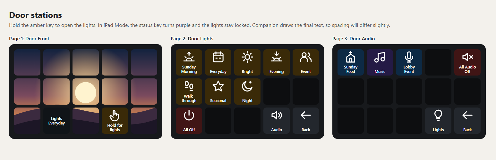
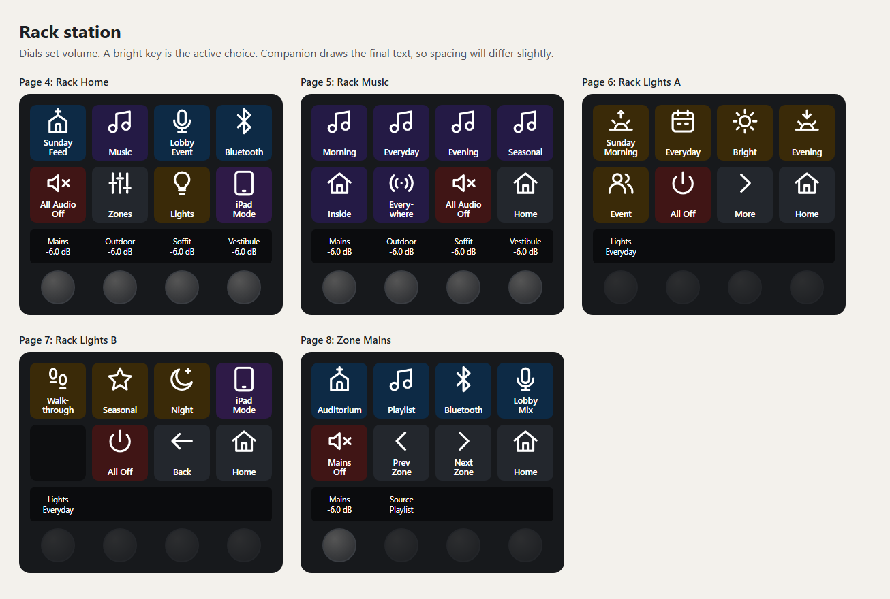

# Stream Deck pages

This is every Stream Deck page, key by key, with what runs behind each one. It is generated from [build.py](../config/stream-deck/build.py), together with the importable file and the icons, so all of them match.

Import [lobby.companionconfig](../config/stream-deck/lobby.companionconfig) into Companion instead of building these by hand. [Companion setup](07-companion-setup.md) has the steps.

**Status:** The file has 185 keys and has not yet been imported into a real Companion. Its format and every action were checked against the Companion 5.1.2 and module source, and its logic passed 84 simulated checks. [Bench test 13](09-testing.md) is the real proof.

## How a press reaches the hardware

Real keys don't talk to hardware directly. Each one runs a block on a Library page, so a change happens in one place.

| Target | Connection | Message | Example |
| --- | --- | --- | --- |
| Wing Rack | `wing`, 192.168.50.20 | Wing OSC through the Behringer module | `/bus/14/send/MX1/on` = 1 |
| S-Play Mini | `splay`, 192.168.50.30 port 8000 | OSC, no arguments | `/lobby/preset/1` |
| WiiM | `wiim`, https://192.168.50.40/ | HTTPS GET to `httpapi.asp?command=` | `MCUKeyShortClick:1` |

Key addresses read page/row/column from 0, the same form Companion uses. Rows and columns start at the top left.

On the Stream Deck +, rows 0 and 1 are the keys, row 2 is the touch strip, and row 3 is the dials.

## Colors

Amber is lighting, blue is audio, violet is music, purple is the iPad, and red is off. A brighter key is the active choice. In iPad Mode, lighting keys go dark and show a lock.

The labels are live text, so you can rename a key in Companion without touching its icon. Icons are in [config/stream-deck/icons](../config/stream-deck/icons). Each is 144 pixels square, which suits the 72-pixel MK.2 keys and the 120-pixel Stream Deck + keys.

## Door pages

Doors use a 15-key deck, in 3 rows of 5.

### Page 1: Door Front

The 13 picture keys are one image cut into tiles, and they do nothing. Replace them with the church logo when you have it.

| Key | Shows | Does | What runs behind it |
| --- | --- | --- | --- |
| `1/2/1` | Lights (current look) | Shows the current look | Nothing |
| `1/2/3` | Hold for lights | Hold 1.5 seconds to open Door Lights. Returns here after 30 seconds. Does nothing in iPad Mode | Hold 1.5 s: &nbsp;&nbsp;If lights are on presets: &nbsp;&nbsp;&nbsp;&nbsp;This surface goes to page 2 &nbsp;&nbsp;&nbsp;&nbsp;Wait 30 s &nbsp;&nbsp;&nbsp;&nbsp;This surface goes to page 1 |

### Page 2: Door Lights

| Key | Shows | Does | What runs behind it |
| --- | --- | --- | --- |
| `2/0/0` | Sunday Morning | Plays Sunday Morning, then returns to the front screen | Run `21/1/0` L1 Sunday Morning Wait 5 s This surface goes to page 1 |
| `2/0/1` | Everyday | Plays Everyday, then returns to the front screen | Run `21/1/1` L2 Everyday Wait 5 s This surface goes to page 1 |
| `2/0/2` | Bright | Plays Bright, then returns to the front screen | Run `21/1/2` L3 Bright Wait 5 s This surface goes to page 1 |
| `2/0/3` | Evening | Plays Evening, then returns to the front screen | Run `21/1/3` L4 Evening Wait 5 s This surface goes to page 1 |
| `2/0/4` | Event | Plays Event, then returns to the front screen | Run `21/1/4` L5 Event Wait 5 s This surface goes to page 1 |
| `2/1/0` | Walkthrough | Plays Walkthrough, then returns to the front screen | Run `21/1/5` L6 Walkthrough Wait 5 s This surface goes to page 1 |
| `2/1/1` | Seasonal | Plays Seasonal, then returns to the front screen | Run `21/1/6` L7 Seasonal Wait 5 s This surface goes to page 1 |
| `2/1/2` | Night | Plays Night, then returns to the front screen | Run `21/1/7` L8 Night Wait 5 s This surface goes to page 1 |
| `2/2/0` | All Off | Stops all looks, then returns to the front screen | Run `21/2/0` All Off Wait 5 s This surface goes to page 1 |
| `2/2/3` | Audio | Opens Door Audio | This surface goes to page 3 |
| `2/2/4` | Back | Returns to the front screen | This surface goes to page 1 |

### Page 3: Door Audio

| Key | Shows | Does | What runs behind it |
| --- | --- | --- | --- |
| `3/0/0` | Sunday Feed | Runs Sunday Feed, then returns to the front screen | Run `21/3/0` Room Sunday Feed Wait 5 s This surface goes to page 1 |
| `3/0/1` | Music | Runs Music Inside, then returns to the front screen | Run `21/3/1` Room Music Inside Wait 5 s This surface goes to page 1 |
| `3/0/2` | Lobby Event | Runs Lobby Event, then returns to the front screen | Run `21/3/3` Room Lobby Event Wait 5 s This surface goes to page 1 |
| `3/0/4` | All Audio Off | Turns off every zone, then returns to the front screen | Run `21/3/5` Room All Audio Off Wait 5 s This surface goes to page 1 |
| `3/2/3` | Lights | Opens Door Lights | This surface goes to page 2 |
| `3/2/4` | Back | Returns to the front screen | This surface goes to page 1 |

## Rack pages

The rack uses a Stream Deck + with 8 keys, a touch strip and 4 dials.

### Page 4: Rack Home

| Key | Shows | Does | What runs behind it |
| --- | --- | --- | --- |
| `4/0/0` | Sunday Feed | Runs Sunday Feed on all five zones | Run `21/3/0` Room Sunday Feed |
| `4/0/1` | Music | Runs Music Inside if the room is not already on music, then opens Rack Music | If no zone is on Playlist: &nbsp;&nbsp;Run `21/3/1` Room Music Inside This surface goes to page 5 |
| `4/0/2` | Lobby Event | Runs Lobby Event on all five zones | Run `21/3/3` Room Lobby Event |
| `4/0/3` | Bluetooth | Runs Bluetooth on all five zones | Run `21/3/4` Room Bluetooth |
| `4/1/0` | All Audio Off | Runs All Audio Off on all five zones | Run `21/3/5` Room All Audio Off |
| `4/1/1` | Zones | Opens the first zone page | This surface goes to page 8 |
| `4/1/2` | Lights | Opens Rack Lights A | This surface goes to page 6 |
| `4/1/3` | iPad Mode | Hold 1 second to hand lighting to the iPad, or to take it back | Hold 1 s: &nbsp;&nbsp;Run `21/2/1` iPad Toggle |
| `4/2/0` | Mains (level) | Touch strip: shows the Mains level, or Off | Nothing |
| `4/2/1` | Outdoor (level) | Touch strip: shows the Outdoor level, or Off | Nothing |
| `4/2/2` | Soffit (level) | Touch strip: shows the Soffit level, or Off | Nothing |
| `4/2/3` | Vestibule (level) | Touch strip: shows the Vestibule level, or Off | Nothing |
| `4/3/0` | Dial Mains | Turn for Mains volume, 1 dB per click, stopping at 0 dB and -60 dB. Press to open Zone Mains | Press: &nbsp;&nbsp;This surface goes to page 8 Turn left: &nbsp;&nbsp;If `$(wing:mtx1_level) > -60`: &nbsp;&nbsp;&nbsp;&nbsp;Wing `/mtx/1/fdr` -1 dB Turn right: &nbsp;&nbsp;If `$(wing:mtx1_level) < 0`: &nbsp;&nbsp;&nbsp;&nbsp;Wing `/mtx/1/fdr` +1 dB |
| `4/3/1` | Dial Outdoor | Turn for Outdoor volume, 1 dB per click, stopping at 0 dB and -60 dB. Press to open Zone Outdoor | Press: &nbsp;&nbsp;This surface goes to page 9 Turn left: &nbsp;&nbsp;If `$(wing:mtx2_level) > -60`: &nbsp;&nbsp;&nbsp;&nbsp;Wing `/mtx/2/fdr` -1 dB Turn right: &nbsp;&nbsp;If `$(wing:mtx2_level) < 0`: &nbsp;&nbsp;&nbsp;&nbsp;Wing `/mtx/2/fdr` +1 dB |
| `4/3/2` | Dial Soffit | Turn for Soffit volume, 1 dB per click, stopping at 0 dB and -60 dB. Press to open Zone Soffit | Press: &nbsp;&nbsp;This surface goes to page 10 Turn left: &nbsp;&nbsp;If `$(wing:mtx3_level) > -60`: &nbsp;&nbsp;&nbsp;&nbsp;Wing `/mtx/3/fdr` -1 dB Turn right: &nbsp;&nbsp;If `$(wing:mtx3_level) < 0`: &nbsp;&nbsp;&nbsp;&nbsp;Wing `/mtx/3/fdr` +1 dB |
| `4/3/3` | Dial Vestibule | Turn for Vestibule volume, 1 dB per click, stopping at 0 dB and -60 dB. Press to open Zone Vestibule | Press: &nbsp;&nbsp;This surface goes to page 12 Turn left: &nbsp;&nbsp;If `$(wing:mtx5_level) > -60`: &nbsp;&nbsp;&nbsp;&nbsp;Wing `/mtx/5/fdr` -1 dB Turn right: &nbsp;&nbsp;If `$(wing:mtx5_level) < 0`: &nbsp;&nbsp;&nbsp;&nbsp;Wing `/mtx/5/fdr` +1 dB |

### Page 5: Rack Music

| Key | Shows | Does | What runs behind it |
| --- | --- | --- | --- |
| `5/0/0` | Morning | Chooses and plays Morning | Run `21/2/3` P1 Morning |
| `5/0/1` | Everyday | Chooses and plays Everyday | Run `21/2/4` P2 Everyday |
| `5/0/2` | Evening | Chooses and plays Evening | Run `21/2/5` P3 Evening |
| `5/0/3` | Seasonal | Chooses and plays Seasonal | Run `21/2/6` P4 Seasonal |
| `5/1/0` | Inside | Runs Music Inside on all five zones | Run `21/3/1` Room Music Inside |
| `5/1/1` | Everywhere | Runs Music Everywhere on all five zones | Run `21/3/2` Room Music Everywhere |
| `5/1/2` | All Audio Off | Runs All Audio Off on all five zones | Run `21/3/5` Room All Audio Off |
| `5/1/3` | Home | Opens Rack Home | This surface goes to page 4 |
| `5/2/0` | Mains (level) | Touch strip: shows the Mains level, or Off | Nothing |
| `5/2/1` | Outdoor (level) | Touch strip: shows the Outdoor level, or Off | Nothing |
| `5/2/2` | Soffit (level) | Touch strip: shows the Soffit level, or Off | Nothing |
| `5/2/3` | Vestibule (level) | Touch strip: shows the Vestibule level, or Off | Nothing |
| `5/3/0` | Dial Mains | Turn for Mains volume, 1 dB per click, stopping at 0 dB and -60 dB. Press to open Zone Mains | Press: &nbsp;&nbsp;This surface goes to page 8 Turn left: &nbsp;&nbsp;If `$(wing:mtx1_level) > -60`: &nbsp;&nbsp;&nbsp;&nbsp;Wing `/mtx/1/fdr` -1 dB Turn right: &nbsp;&nbsp;If `$(wing:mtx1_level) < 0`: &nbsp;&nbsp;&nbsp;&nbsp;Wing `/mtx/1/fdr` +1 dB |
| `5/3/1` | Dial Outdoor | Turn for Outdoor volume, 1 dB per click, stopping at 0 dB and -60 dB. Press to open Zone Outdoor | Press: &nbsp;&nbsp;This surface goes to page 9 Turn left: &nbsp;&nbsp;If `$(wing:mtx2_level) > -60`: &nbsp;&nbsp;&nbsp;&nbsp;Wing `/mtx/2/fdr` -1 dB Turn right: &nbsp;&nbsp;If `$(wing:mtx2_level) < 0`: &nbsp;&nbsp;&nbsp;&nbsp;Wing `/mtx/2/fdr` +1 dB |
| `5/3/2` | Dial Soffit | Turn for Soffit volume, 1 dB per click, stopping at 0 dB and -60 dB. Press to open Zone Soffit | Press: &nbsp;&nbsp;This surface goes to page 10 Turn left: &nbsp;&nbsp;If `$(wing:mtx3_level) > -60`: &nbsp;&nbsp;&nbsp;&nbsp;Wing `/mtx/3/fdr` -1 dB Turn right: &nbsp;&nbsp;If `$(wing:mtx3_level) < 0`: &nbsp;&nbsp;&nbsp;&nbsp;Wing `/mtx/3/fdr` +1 dB |
| `5/3/3` | Dial Vestibule | Turn for Vestibule volume, 1 dB per click, stopping at 0 dB and -60 dB. Press to open Zone Vestibule | Press: &nbsp;&nbsp;This surface goes to page 12 Turn left: &nbsp;&nbsp;If `$(wing:mtx5_level) > -60`: &nbsp;&nbsp;&nbsp;&nbsp;Wing `/mtx/5/fdr` -1 dB Turn right: &nbsp;&nbsp;If `$(wing:mtx5_level) < 0`: &nbsp;&nbsp;&nbsp;&nbsp;Wing `/mtx/5/fdr` +1 dB |

### Page 6: Rack Lights A

| Key | Shows | Does | What runs behind it |
| --- | --- | --- | --- |
| `6/0/0` | Sunday Morning | Plays Sunday Morning | Run `21/1/0` L1 Sunday Morning |
| `6/0/1` | Everyday | Plays Everyday | Run `21/1/1` L2 Everyday |
| `6/0/2` | Bright | Plays Bright | Run `21/1/2` L3 Bright |
| `6/0/3` | Evening | Plays Evening | Run `21/1/3` L4 Evening |
| `6/1/0` | Event | Plays Event | Run `21/1/4` L5 Event |
| `6/1/1` | All Off | Stops all looks | Run `21/2/0` All Off |
| `6/1/2` | More | Opens Rack Lights B | This surface goes to page 7 |
| `6/1/3` | Home | Opens Rack Home | This surface goes to page 4 |
| `6/2/0` | Lights (current look) | Touch strip: shows the current look | Nothing |

### Page 7: Rack Lights B

| Key | Shows | Does | What runs behind it |
| --- | --- | --- | --- |
| `7/0/0` | Walkthrough | Plays Walkthrough | Run `21/1/5` L6 Walkthrough |
| `7/0/1` | Seasonal | Plays Seasonal | Run `21/1/6` L7 Seasonal |
| `7/0/2` | Night | Plays Night | Run `21/1/7` L8 Night |
| `7/0/3` | iPad Mode | Hold 1 second to hand lighting to the iPad, or to take it back | Hold 1 s: &nbsp;&nbsp;Run `21/2/1` iPad Toggle |
| `7/1/1` | All Off | Stops all looks | Run `21/2/0` All Off |
| `7/1/2` | Back | Opens Rack Lights A | This surface goes to page 6 |
| `7/1/3` | Home | Opens Rack Home | This surface goes to page 4 |
| `7/2/0` | Lights (current look) | Touch strip: shows the current look | Nothing |

### Pages 8 to 12: Zones

All five zone pages match. Page 8 is shown here. The others use their own matrix and variable.

| Page | Zone | Matrix | Variable | Default fader |
| --- | --- | --- | --- | --- |
| 8 | Mains | MX1 | `z1_src` | -6 dB |
| 9 | Outdoor | MX2 | `z2_src` | -10 dB |
| 10 | Soffit | MX3 | `z3_src` | -10 dB |
| 11 | Bathrooms | MX4 | `z4_src` | -12 dB |
| 12 | Vestibule | MX5 | `z5_src` | -12 dB |

| Key | Shows | Does | What runs behind it |
| --- | --- | --- | --- |
| `8/0/0` | Auditorium | Mains plays Auditorium | Run `20/0/0` Z1 Auditorium Wait 0.2 s Run `21/2/2` Music Stop |
| `8/0/1` | Playlist | Mains plays Playlist | Run `21/0/7` Music Start Wait 0.05 s Run `20/0/1` Z1 Playlist |
| `8/0/2` | Bluetooth | Mains plays Bluetooth | Run `20/0/2` Z1 Bluetooth Wait 0.2 s Run `21/2/2` Music Stop |
| `8/0/3` | Lobby Mix | Mains plays Lobby Mix | Run `20/0/3` Z1 Lobby Mix Wait 0.2 s Run `21/2/2` Music Stop |
| `8/1/0` | Mains Off | Turns off Mains | Run `20/0/4` Z1 Off Wait 0.2 s Run `21/2/2` Music Stop |
| `8/1/1` | Prev Zone | Opens Vestibule | This surface goes to page 12 |
| `8/1/2` | Next Zone | Opens Outdoor | This surface goes to page 9 |
| `8/1/3` | Home | Opens Rack Home | This surface goes to page 4 |
| `8/2/0` | Mains (level) | Touch strip: shows the Mains level, or Off | Nothing |
| `8/2/1` | Source (current) | Touch strip: shows this zone's source | Nothing |
| `8/3/0` | Dial Mains | Turn for Mains volume, 1 dB per click, stopping at 0 dB and -60 dB. Press to open Zone Mains | Press: &nbsp;&nbsp;This surface goes to page 8 Turn left: &nbsp;&nbsp;If `$(wing:mtx1_level) > -60`: &nbsp;&nbsp;&nbsp;&nbsp;Wing `/mtx/1/fdr` -1 dB Turn right: &nbsp;&nbsp;If `$(wing:mtx1_level) < 0`: &nbsp;&nbsp;&nbsp;&nbsp;Wing `/mtx/1/fdr` +1 dB |

## Library

No surface shows these pages. Keep them where they are, because every real key points to them by address.

### Page 20: Zones 1 to 4

| Key | Block | Does | Sends |
| --- | --- | --- | --- |
| `20/0/0` | Z1 Auditorium | Mains plays Auditorium | Wing `/bus/14/send/MX1/on` = 1 Wing `/bus/15/send/MX1/on` = 0 Wing `/bus/16/send/MX1/on` = 0 Wing `/main/1/send/MX1/on` = 0 Wing `/mtx/1/mute` = 0 Set `z1_src` to `Auditorium` |
| `20/0/1` | Z1 Playlist | Mains plays Playlist | Wing `/bus/14/send/MX1/on` = 0 Wing `/bus/15/send/MX1/on` = 1 Wing `/bus/16/send/MX1/on` = 0 Wing `/main/1/send/MX1/on` = 0 Wing `/mtx/1/mute` = 0 Set `z1_src` to `Playlist` |
| `20/0/2` | Z1 Bluetooth | Mains plays Bluetooth | Wing `/bus/14/send/MX1/on` = 0 Wing `/bus/15/send/MX1/on` = 0 Wing `/bus/16/send/MX1/on` = 1 Wing `/main/1/send/MX1/on` = 0 Wing `/mtx/1/mute` = 0 Set `z1_src` to `Bluetooth` |
| `20/0/3` | Z1 Lobby Mix | Mains plays Lobby Mix | Wing `/bus/14/send/MX1/on` = 0 Wing `/bus/15/send/MX1/on` = 0 Wing `/bus/16/send/MX1/on` = 0 Wing `/main/1/send/MX1/on` = 1 Wing `/mtx/1/mute` = 0 Set `z1_src` to `Lobby Mix` |
| `20/0/4` | Z1 Off | Mains off | Wing `/mtx/1/mute` = 1 Set `z1_src` to `Off` |
| `20/1/0` | Z2 Auditorium | Outdoor plays Auditorium | Wing `/bus/14/send/MX2/on` = 1 Wing `/bus/15/send/MX2/on` = 0 Wing `/bus/16/send/MX2/on` = 0 Wing `/main/1/send/MX2/on` = 0 Wing `/mtx/2/mute` = 0 Set `z2_src` to `Auditorium` |
| `20/1/1` | Z2 Playlist | Outdoor plays Playlist | Wing `/bus/14/send/MX2/on` = 0 Wing `/bus/15/send/MX2/on` = 1 Wing `/bus/16/send/MX2/on` = 0 Wing `/main/1/send/MX2/on` = 0 Wing `/mtx/2/mute` = 0 Set `z2_src` to `Playlist` |
| `20/1/2` | Z2 Bluetooth | Outdoor plays Bluetooth | Wing `/bus/14/send/MX2/on` = 0 Wing `/bus/15/send/MX2/on` = 0 Wing `/bus/16/send/MX2/on` = 1 Wing `/main/1/send/MX2/on` = 0 Wing `/mtx/2/mute` = 0 Set `z2_src` to `Bluetooth` |
| `20/1/3` | Z2 Lobby Mix | Outdoor plays Lobby Mix | Wing `/bus/14/send/MX2/on` = 0 Wing `/bus/15/send/MX2/on` = 0 Wing `/bus/16/send/MX2/on` = 0 Wing `/main/1/send/MX2/on` = 1 Wing `/mtx/2/mute` = 0 Set `z2_src` to `Lobby Mix` |
| `20/1/4` | Z2 Off | Outdoor off | Wing `/mtx/2/mute` = 1 Set `z2_src` to `Off` |
| `20/2/0` | Z3 Auditorium | Soffit plays Auditorium | Wing `/bus/14/send/MX3/on` = 1 Wing `/bus/15/send/MX3/on` = 0 Wing `/bus/16/send/MX3/on` = 0 Wing `/main/1/send/MX3/on` = 0 Wing `/mtx/3/mute` = 0 Set `z3_src` to `Auditorium` |
| `20/2/1` | Z3 Playlist | Soffit plays Playlist | Wing `/bus/14/send/MX3/on` = 0 Wing `/bus/15/send/MX3/on` = 1 Wing `/bus/16/send/MX3/on` = 0 Wing `/main/1/send/MX3/on` = 0 Wing `/mtx/3/mute` = 0 Set `z3_src` to `Playlist` |
| `20/2/2` | Z3 Bluetooth | Soffit plays Bluetooth | Wing `/bus/14/send/MX3/on` = 0 Wing `/bus/15/send/MX3/on` = 0 Wing `/bus/16/send/MX3/on` = 1 Wing `/main/1/send/MX3/on` = 0 Wing `/mtx/3/mute` = 0 Set `z3_src` to `Bluetooth` |
| `20/2/3` | Z3 Lobby Mix | Soffit plays Lobby Mix | Wing `/bus/14/send/MX3/on` = 0 Wing `/bus/15/send/MX3/on` = 0 Wing `/bus/16/send/MX3/on` = 0 Wing `/main/1/send/MX3/on` = 1 Wing `/mtx/3/mute` = 0 Set `z3_src` to `Lobby Mix` |
| `20/2/4` | Z3 Off | Soffit off | Wing `/mtx/3/mute` = 1 Set `z3_src` to `Off` |
| `20/3/0` | Z4 Auditorium | Bathrooms plays Auditorium | Wing `/bus/14/send/MX4/on` = 1 Wing `/bus/15/send/MX4/on` = 0 Wing `/bus/16/send/MX4/on` = 0 Wing `/main/1/send/MX4/on` = 0 Wing `/mtx/4/mute` = 0 Set `z4_src` to `Auditorium` |
| `20/3/1` | Z4 Playlist | Bathrooms plays Playlist | Wing `/bus/14/send/MX4/on` = 0 Wing `/bus/15/send/MX4/on` = 1 Wing `/bus/16/send/MX4/on` = 0 Wing `/main/1/send/MX4/on` = 0 Wing `/mtx/4/mute` = 0 Set `z4_src` to `Playlist` |
| `20/3/2` | Z4 Bluetooth | Bathrooms plays Bluetooth | Wing `/bus/14/send/MX4/on` = 0 Wing `/bus/15/send/MX4/on` = 0 Wing `/bus/16/send/MX4/on` = 1 Wing `/main/1/send/MX4/on` = 0 Wing `/mtx/4/mute` = 0 Set `z4_src` to `Bluetooth` |
| `20/3/3` | Z4 Lobby Mix | Bathrooms plays Lobby Mix | Wing `/bus/14/send/MX4/on` = 0 Wing `/bus/15/send/MX4/on` = 0 Wing `/bus/16/send/MX4/on` = 0 Wing `/main/1/send/MX4/on` = 1 Wing `/mtx/4/mute` = 0 Set `z4_src` to `Lobby Mix` |
| `20/3/4` | Z4 Off | Bathrooms off | Wing `/mtx/4/mute` = 1 Set `z4_src` to `Off` |

### Page 21: Zone 5, lights and music

| Key | Block | Does | Sends |
| --- | --- | --- | --- |
| `21/0/0` | Z5 Auditorium | Vestibule plays Auditorium | Wing `/bus/14/send/MX5/on` = 1 Wing `/bus/15/send/MX5/on` = 0 Wing `/bus/16/send/MX5/on` = 0 Wing `/main/1/send/MX5/on` = 0 Wing `/mtx/5/mute` = 0 Set `z5_src` to `Auditorium` |
| `21/0/1` | Z5 Playlist | Vestibule plays Playlist | Wing `/bus/14/send/MX5/on` = 0 Wing `/bus/15/send/MX5/on` = 1 Wing `/bus/16/send/MX5/on` = 0 Wing `/main/1/send/MX5/on` = 0 Wing `/mtx/5/mute` = 0 Set `z5_src` to `Playlist` |
| `21/0/2` | Z5 Bluetooth | Vestibule plays Bluetooth | Wing `/bus/14/send/MX5/on` = 0 Wing `/bus/15/send/MX5/on` = 0 Wing `/bus/16/send/MX5/on` = 1 Wing `/main/1/send/MX5/on` = 0 Wing `/mtx/5/mute` = 0 Set `z5_src` to `Bluetooth` |
| `21/0/3` | Z5 Lobby Mix | Vestibule plays Lobby Mix | Wing `/bus/14/send/MX5/on` = 0 Wing `/bus/15/send/MX5/on` = 0 Wing `/bus/16/send/MX5/on` = 0 Wing `/main/1/send/MX5/on` = 1 Wing `/mtx/5/mute` = 0 Set `z5_src` to `Lobby Mix` |
| `21/0/4` | Z5 Off | Vestibule off | Wing `/mtx/5/mute` = 1 Set `z5_src` to `Off` |
| `21/0/5` | Default Levels | Resets every zone fader | Wing `/mtx/1/fdr` = -6 dB Wing `/mtx/2/fdr` = -10 dB Wing `/mtx/3/fdr` = -10 dB Wing `/mtx/4/fdr` = -12 dB Wing `/mtx/5/fdr` = -12 dB |
| `21/0/6` | Music Play | Starts the chosen playlist, then turns on shuffle and repeat | WiiM `MCUKeyShortClick:$(custom:music_n)` Wait 2 s WiiM `setPlayerCmd:loopmode:2` |
| `21/0/7` | Music Start | Starts music only if nothing is already playing it | If no zone is on Playlist: &nbsp;&nbsp;Run `21/0/6` Music Play |
| `21/1/0` | L1 Sunday Morning | Plays the Sunday Morning look, unless iPad Mode is on | If lights are on presets: &nbsp;&nbsp;S-Play OSC `/lobby/preset/1` &nbsp;&nbsp;Set `light_preset` to `Sunday Morning` &nbsp;&nbsp;Set `light_preset_n` to `1` |
| `21/1/1` | L2 Everyday | Plays the Everyday look, unless iPad Mode is on | If lights are on presets: &nbsp;&nbsp;S-Play OSC `/lobby/preset/2` &nbsp;&nbsp;Set `light_preset` to `Everyday` &nbsp;&nbsp;Set `light_preset_n` to `2` |
| `21/1/2` | L3 Bright | Plays the Bright look, unless iPad Mode is on | If lights are on presets: &nbsp;&nbsp;S-Play OSC `/lobby/preset/3` &nbsp;&nbsp;Set `light_preset` to `Bright` &nbsp;&nbsp;Set `light_preset_n` to `3` |
| `21/1/3` | L4 Evening | Plays the Evening look, unless iPad Mode is on | If lights are on presets: &nbsp;&nbsp;S-Play OSC `/lobby/preset/4` &nbsp;&nbsp;Set `light_preset` to `Evening` &nbsp;&nbsp;Set `light_preset_n` to `4` |
| `21/1/4` | L5 Event | Plays the Event look, unless iPad Mode is on | If lights are on presets: &nbsp;&nbsp;S-Play OSC `/lobby/preset/5` &nbsp;&nbsp;Set `light_preset` to `Event` &nbsp;&nbsp;Set `light_preset_n` to `5` |
| `21/1/5` | L6 Walkthrough | Plays the Walkthrough look, unless iPad Mode is on | If lights are on presets: &nbsp;&nbsp;S-Play OSC `/lobby/preset/6` &nbsp;&nbsp;Set `light_preset` to `Walkthrough` &nbsp;&nbsp;Set `light_preset_n` to `6` |
| `21/1/6` | L7 Seasonal | Plays the Seasonal look, unless iPad Mode is on | If lights are on presets: &nbsp;&nbsp;S-Play OSC `/lobby/preset/7` &nbsp;&nbsp;Set `light_preset` to `Seasonal` &nbsp;&nbsp;Set `light_preset_n` to `7` |
| `21/1/7` | L8 Night | Plays the Night look, unless iPad Mode is on | If lights are on presets: &nbsp;&nbsp;S-Play OSC `/lobby/preset/8` &nbsp;&nbsp;Set `light_preset` to `Night` &nbsp;&nbsp;Set `light_preset_n` to `8` |
| `21/2/0` | All Off | Stops all looks, unless iPad Mode is on | If lights are on presets: &nbsp;&nbsp;S-Play OSC `/lobby/off` &nbsp;&nbsp;Set `light_preset` to `Off` &nbsp;&nbsp;Set `light_preset_n` to `0` |
| `21/2/1` | iPad Toggle | Hands lighting to the iPad, or takes it back | If lights are on presets: &nbsp;&nbsp;S-Play OSC `/lobby/off` &nbsp;&nbsp;Set `light_mode` to `ipad` Otherwise: &nbsp;&nbsp;Set `light_mode` to `presets` &nbsp;&nbsp;If `$(custom:light_preset_n) != '0'`: &nbsp;&nbsp;&nbsp;&nbsp;S-Play OSC `/lobby/preset/$(custom:light_preset_n)` |
| `21/2/2` | Music Stop | Stops the player once no zone is using it | If no zone is on Playlist: &nbsp;&nbsp;WiiM `setPlayerCmd:stop` |
| `21/2/3` | P1 Morning | Chooses Morning. Plays it now, or starts Music Inside if the room is silent | Set `music_n` to `1` Set `music_name` to `Morning` Wait 0.05 s If any zone is on Playlist: &nbsp;&nbsp;Run `21/0/6` Music Play Otherwise: &nbsp;&nbsp;Run `21/3/1` Room Music Inside |
| `21/2/4` | P2 Everyday | Chooses Everyday. Plays it now, or starts Music Inside if the room is silent | Set `music_n` to `2` Set `music_name` to `Everyday` Wait 0.05 s If any zone is on Playlist: &nbsp;&nbsp;Run `21/0/6` Music Play Otherwise: &nbsp;&nbsp;Run `21/3/1` Room Music Inside |
| `21/2/5` | P3 Evening | Chooses Evening. Plays it now, or starts Music Inside if the room is silent | Set `music_n` to `3` Set `music_name` to `Evening` Wait 0.05 s If any zone is on Playlist: &nbsp;&nbsp;Run `21/0/6` Music Play Otherwise: &nbsp;&nbsp;Run `21/3/1` Room Music Inside |
| `21/2/6` | P4 Seasonal | Chooses Seasonal. Plays it now, or starts Music Inside if the room is silent | Set `music_n` to `4` Set `music_name` to `Seasonal` Wait 0.05 s If any zone is on Playlist: &nbsp;&nbsp;Run `21/0/6` Music Play Otherwise: &nbsp;&nbsp;Run `21/3/1` Room Music Inside |
| `21/3/0` | Room Sunday Feed | Sets all five zones and their default levels | Run `20/0/0` Z1 Auditorium Run `20/1/4` Z2 Off Run `20/2/4` Z3 Off Run `20/3/0` Z4 Auditorium Run `21/0/0` Z5 Auditorium Run `21/0/5` Default Levels Wait 0.2 s Run `21/2/2` Music Stop |
| `21/3/1` | Room Music Inside | Sets all five zones and their default levels | Run `21/0/7` Music Start Wait 0.05 s Run `20/0/1` Z1 Playlist Run `20/1/4` Z2 Off Run `20/2/4` Z3 Off Run `20/3/1` Z4 Playlist Run `21/0/1` Z5 Playlist Run `21/0/5` Default Levels |
| `21/3/2` | Room Music Everywhere | Sets all five zones and their default levels | Run `21/0/7` Music Start Wait 0.05 s Run `20/0/1` Z1 Playlist Run `20/1/1` Z2 Playlist Run `20/2/1` Z3 Playlist Run `20/3/1` Z4 Playlist Run `21/0/1` Z5 Playlist Run `21/0/5` Default Levels |
| `21/3/3` | Room Lobby Event | Sets all five zones and their default levels | Run `20/0/3` Z1 Lobby Mix Run `20/1/4` Z2 Off Run `20/2/4` Z3 Off Run `20/3/3` Z4 Lobby Mix Run `21/0/3` Z5 Lobby Mix Run `21/0/5` Default Levels Wait 0.2 s Run `21/2/2` Music Stop |
| `21/3/4` | Room Bluetooth | Sets all five zones and their default levels | Run `20/0/2` Z1 Bluetooth Run `20/1/4` Z2 Off Run `20/2/4` Z3 Off Run `20/3/2` Z4 Bluetooth Run `21/0/2` Z5 Bluetooth Run `21/0/5` Default Levels Wait 0.2 s Run `21/2/2` Music Stop |
| `21/3/5` | Room All Audio Off | Sets all five zones and their default levels | Run `20/0/4` Z1 Off Run `20/1/4` Z2 Off Run `20/2/4` Z3 Off Run `20/3/4` Z4 Off Run `21/0/4` Z5 Off Run `21/0/5` Default Levels Wait 0.2 s Run `21/2/2` Music Stop |

## Triggers

| Trigger | Starts | Does |
| --- | --- | --- |
| Startup recovery | On | Sixty seconds after Companion starts, replays the last look. Leaves the lights alone in iPad Mode |
| Schedule: Sunday arrival | Off | Off at first. Sunday 7:30: Sunday Morning lights and Sunday Feed, unless iPad Mode is on |
| Schedule: Weekday open | Off | Off at first. Weekdays 8:00: Everyday lights and Music Inside, unless iPad Mode is on |
| Schedule: Night shutdown | Off | Off at first. Nightly 22:00: leaves iPad Mode so doors can't stay locked, then all off |

The three schedule triggers import turned off. Set their times and turn them on after launch.

## Custom variables

All of these keep their value through a restart.

| Variable | Holds | Starts as |
| --- | --- | --- |
| `light_mode` | presets or ipad | presets |
| `light_preset` | Name of the current look | Everyday |
| `light_preset_n` | Number of the current look, 0 for off | 2 |
| `music_n` | Number of the chosen playlist | 1 |
| `music_name` | Name of the chosen playlist | Morning |
| `z1_src` | Mains source, or Off | Off |
| `z2_src` | Outdoor source, or Off | Off |
| `z3_src` | Soffit source, or Off | Off |
| `z4_src` | Bathrooms source, or Off | Off |
| `z5_src` | Vestibule source, or Off | Off |

## Change it later

- **Rename a look.** Change the label on the door key and rack key, and the name in its Library block. The look itself lives in the S-Play.
- **Rename a playlist.** Change the label on page 5 and the name in its Library block.
- **Use SharePoint playlists.** Edit one block, `21/0/6` Music Play. Change its first WiiM command to `setPlayerCmd:playlist:<address of the playlist>:0`. Nothing else moves.
- **Change a room scene.** Edit its block on row 3 of page 21. Every door, rack and schedule key follows.
- **Change a default level.** Edit `21/0/5`.
- **Add a door.** Add the surface in Companion and limit it to pages 1 to 3. Nothing in the pages changes.

After any change, export the configuration from Companion and commit it next to this file. From then on, that export is the live copy and `build.py` is only a record of the first version.
